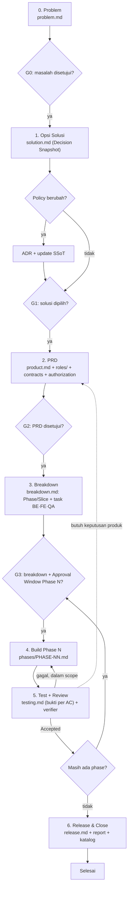

# Panduan SDLC Bertahap — Qlick Hub (DRAFT)

**Status:** Draft usulan — belum berlaku. Berlaku setelah ADR-029 disetujui dan
`docs/4_AGENT_DEV_GUIDELINES.md` diperbarui (lihat [CHANGES_TO_APPLY.md](CHANGES_TO_APPLY.md)).

Tujuan: setiap pekerjaan berjalan lewat tahap yang sama, setiap tahap menghasilkan **satu dokumen
yang bisa kamu buka**, dan agent **selalu menampilkan Stage Card** di chat sebelum lanjut.

---

## 1. Alur tahap

Satu persetujuan per gerbang. Agent tidak boleh melompati gerbang, dan tidak boleh menganggap diam
atau "ok lanjut analisis" sebagai persetujuan (sesuai `AI-007`, `AI-009`).

## 2. Ringkasan tiap tahap

| Tahap | Dokumen (di `docs/features/<FEATURE-ID>/`) | Isi wajib | Gerbang & yang menyetujui | Keluar dari tahap bila… |
| --- | --- | --- | --- | --- |
| 0 Problem | `problem.md` | Masalah, bukti masalah, siapa terdampak, dampak bila tidak dikerjakan, metrik sukses, unknown | **G0** — PO/Owner | Masalah punya bukti (bukan asumsi) dan metrik sukses |
| 1 Opsi Solusi | `solution.md` | ≥2 opsi + "tidak dikerjakan", pro/kontra, rekomendasi, dampak policy → ADR | **G1** — Owner | Satu opsi dipilih; ADR dibuat bila policy berubah |
| 2 PRD | `product.md`, `roles/*`, `contracts.md`, `authorization.md` | Requirement + AC ber-ID, user flow, wireframe **per state**, phone/tablet/desktop, authorization matrix | **G2** — PO | Semua AC punya jalur bukti; semua state UI tergambar |
| 3 Breakdown | `breakdown.md` | Phase = vertical slice; tiap phase WRA ≤ 8; task BE · FE · QA per phase; urutan & dependensi | **G3** — Owner, sekaligus Approval Window Phase berikutnya | Tiap phase bisa diuji sendiri terhadap AC |
| 4 Build | `phases/PHASE-NN.md` | Approval Window, file/path, perintah cek, log perubahan, deviasi | (dalam window G3) | Kandidat teruji + PR |
| 5 Test & Review | `testing.md` | Matriks AC → bukti (E0–E4), outcome sukses/gagal, quality review, hasil verifier | **G5** — verifier/CI | Verifier: `Accepted` / `Accepted with gaps` (gap disetujui) |
| 6 Release & Close | `release.md` | Tier merge, deploy, QA sign-off, keputusan rilis PO, verifikasi target, link report, update katalog/TODO | **G6** — PO (rilis), Owner (Tier 2) | AC terbukti di environment target; task ditutup |

## 3. Jalur sesuai ukuran pekerjaan

Proses harus proporsional (ADR-016). Agent menentukan jalur dari WRA dan menuliskannya di Stage Card.

| Jalur | Kapan | Tahap yang dipakai |
| --- | --- | --- |
| **Cepat** | Bug/fix lokal, WRA 0–4, tidak lintas role, tidak ubah contract/data/authorization | Satu `QUICK_CARD` (problem + AC + bukti) → Build → Test → Close. Tanpa Feature folder. |
| **Standar** | WRA 5–8 atau satu role/layer baru | Tahap 0–6, `solution.md` boleh ringkas bila tidak ada alternatif material |
| **Penuh** | WRA ≥ 9, lintas role, data/migrasi, authorization, release gate | Tahap 0–6 lengkap; wajib dipecah jadi beberapa phase; verifier independen |

Fitur seperti Leader Hub (migrasi + endpoint lintas workspace + authorization) **wajib jalur Penuh**.

## 4. Apa yang kamu lihat di setiap langkah

Setiap kali agent menyelesaikan atau meminta persetujuan suatu tahap, agent menampilkan
**Stage Card** dengan format tetap — lihat [STAGE_CARD.md](STAGE_CARD.md). Isinya: tahap ke berapa,
dokumen yang dibuat/diubah, ringkasan, fakta terkonfirmasi vs `unknown`, keputusan yang dibutuhkan,
dan cara membalas.

`README.md` di folder Feature menyimpan **Stage Tracker** — satu tabel yang menunjukkan posisi
fitur sekarang dan link ke setiap dokumen tahap.

## 5. Cara bertanya ke agent (contoh prompt)

| Kamu ingin… | Ketik ke agent | Agent menjawab dengan |
| --- | --- | --- |
| Mulai ide baru | `Tahap 0: <ceritakan masalahnya>` | Draft `problem.md` + Stage Card G0 + pertanyaan unknown |
| Minta opsi solusi | `Tahap 1 untuk <FEATURE-ID>` | Draft `solution.md` (≥2 opsi + pro/kontra) + Stage Card G1 |
| Buat PRD | `Tahap 2 untuk <FEATURE-ID>, pakai opsi B` | Draft `product.md` (flow + wireframe per state + AC) + role/contract/authorization + Stage Card G2 |
| Pecah jadi task | `Tahap 3 untuk <FEATURE-ID>` | `breakdown.md` (phase, WRA per phase, task BE·FE·QA) + Approval Window Phase 1 + Stage Card G3 |
| Mulai kerja | `Setuju G3, jalankan Phase 1` | Build sampai kandidat teruji, lalu Stage Card tahap 4–5 |
| Cek posisi | `Status <FEATURE-ID>` | Stage Tracker + gerbang yang menunggu |
| Revisi tahap | `Revisi tahap 2: <catatan>` | Dokumen diperbarui + Stage Card baru (gerbang diulang) |
| Pekerjaan kecil | `Quick fix: <masalah>` | `QUICK_CARD` + Approval Window dalam satu pesan |

## 6. Aturan bukti di setiap tahap (tanpa asumsi)

- Setiap pernyataan di dokumen tahap diberi sumber: link file/commit/data, atau label `unknown` / `unverified`.
- Tahap 0–2 boleh berisi `unknown`, tetapi **G2 tidak boleh disetujui** bila ada AC tanpa jalur bukti.
- Tahap 5 memakai level bukti E0–E4 dari `docs/4_AGENT_DEV_GUIDELINES.md` §2A.C. Klaim (E0) tidak pernah menerima AC.
- Kalimat seperti "tidak ada risiko regresi" hanya boleh ditulis bila disertai pemeriksaan yang membuktikannya.

## 7. Isi paket ini

| File | Untuk |
| --- | --- |
| [STAGE_CARD.md](STAGE_CARD.md) | Format laporan per tahap yang wajib ditampilkan agent |
| [QUICK_CARD.md](QUICK_CARD.md) | Jalur Cepat untuk fix kecil |
| [feature-folder/](feature-folder/README.md) | Template folder Feature (perluasan `docs/features/_template/`) |
| [ADR-029-DRAFT.md](ADR-029-DRAFT.md) | Draft keputusan supaya proses ini resmi |
| [CHANGES_TO_APPLY.md](CHANGES_TO_APPLY.md) | Daftar perubahan repo saat paket ini diterapkan |
