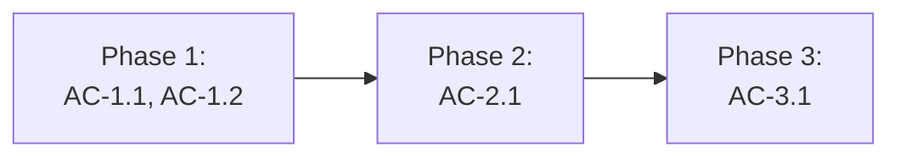

# [FEATURE-ID] — Tahap 3: Breakdown (Phase → Task BE · FE · QA)

**Status:** Draft | Menunggu persetujuan | Disetujui
**Gerbang:** G3 — disetujui oleh Owner; persetujuan ini sekaligus Approval Window untuk phase pertama
**PRD:** [product.md](product.md)
**Applicable Policy IDs:** AI-002, AI-009, AI-014, SDLC-001, TBD

## Aturan pemecahan

1. **Phase = vertical slice** yang bisa diuji sendiri terhadap AC (ADR-017). Bukan "semua BE dulu,
   lalu semua FE".
2. Setiap phase punya WRA ≤ 8. Bila > 8, pecah lagi.
3. Setiap phase berisi task **BE**, **FE**, dan **QA** bila slice itu menyentuh lapisan tersebut;
   lapisan yang tidak tersentuh ditulis `N/A — alasan`.
4. Setiap AC dari PRD harus masuk ke tepat satu phase (boleh diuji ulang di phase berikutnya).
5. Phase berikutnya dimulai hanya setelah phase sebelumnya `Accepted` di tahap 5, kecuali
   dependensinya dinyatakan bebas.

## 1. Peta phase

| Phase | Tujuan (hasil yang bisa dilihat user) | AC | WRA | Bergantung pada | Status |
| --- | --- | --- | --- | --- | --- |
| P1 | | AC-1.1, AC-1.2 | /16 | — | Belum mulai |
| P2 | | | /16 | P1 | Belum mulai |

## 2. Task per phase

### Phase 1 — <nama>

| Task ID | Layer | Pekerjaan | File/path perkiraan | AC | Bukti selesai | Assignee |
| --- | --- | --- | --- | --- | --- | --- |
| P1-BE-1 | BE | Endpoint + policy service | `apps/api/src/modules/...` | AC-1.2 | Integration test 403/200 (E3) | |
| P1-BE-2 | BE | Migrasi (bila ada) | `apps/api/src/db/migrations/...` | AC-1.1 | Clean migrate + read-back (E3) | |
| P1-FE-1 | FE | Halaman + semua state | `apps/web/src/...` | AC-1.1 | Component test + phone/tablet/desktop (E2/E4) | |
| P1-QA-1 | QA | Test Case + UAT | — | AC-1.1, AC-1.2 | Test Result tersegel (E4) | |

WRA Phase 1 (8 dimensi, 0–2): requirement _ · lapisan _ · data _ · authorization _ · contract _ ·
ketersinggungan _ · validasi _ · eksternal _ = **_/16**

### Phase 2 — <nama>

<ulangi tabel di atas>

## 3. Risiko lintas phase

| Risiko | Phase | Mitigasi / rollback |
| --- | --- | --- |
| | | |

## 4. Stop condition yang sudah terlihat

Aksi yang tetap butuh persetujuan baru meski G3 disetujui (`AI-013`): migrasi destruktif/backfill,
perubahan authorization/secret/dependency, mutasi data Production, merge Tier 2, perluasan scope.

| Phase | Stop condition | Kapan akan diminta |
| --- | --- | --- |
| | | |
