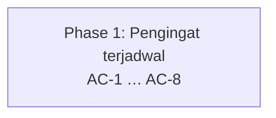

# DEADLINE-REMINDER-CRON — Tahap 3: Breakdown (Phase → Task BE · FE · QA)

**Status:** Disetujui
**Gerbang:** G3 — disetujui oleh Owner; persetujuan ini sekaligus Approval Window untuk phase pertama
**PRD:** [product.md](product.md)
**Applicable Policy IDs:** AI-002, AI-009, AI-014, SDLC-001, AUTH-012

**Jalur:** Standar (WRA 8/16).

## Aturan pemecahan

1. **Phase = vertical slice** yang bisa diuji sendiri terhadap AC (ADR-017). Bukan "semua BE dulu,
   lalu semua FE".
2. Setiap phase punya WRA ≤ 8. Bila > 8, pecah lagi.
3. Setiap phase berisi task **BE**, **FE**, dan **QA** bila slice itu menyentuh lapisan tersebut;
   lapisan yang tidak tersentuh ditulis `N/A — alasan`.
4. Setiap AC dari PRD harus masuk ke tepat satu phase (boleh diuji ulang di phase berikutnya).
5. Phase berikutnya dimulai hanya setelah phase sebelumnya `Accepted` di tahap 5, kecuali
   dependensinya dinyatakan bebas.

## 1. Peta phase

Satu phase: endpoint, aturan, dan penghapusan pemicu browser harus rilis bersama. Bila pemicu browser
dihapus tanpa endpoint terjadwal, pengingat berhenti; bila endpoint rilis tanpa penghapusan, beban
browser tetap ada.

| Phase | Tujuan (hasil yang bisa dilihat user)                                   | AC          | WRA  | Bergantung pada | Status          |
| ----- | ----------------------------------------------------------------------- | ----------- | ---- | --------------- | --------------- |
| P1    | Pengingat deadline harian dari Supabase Cron; browser tidak lagi memicu | AC-1 – AC-8 | 8/16 | —               | Kandidat teruji |

## 2. Task per phase

### Phase 1 — Pengingat terjadwal

| Task ID  | Layer | Pekerjaan                                                                          | File/path                                                                                                             | AC         | Bukti selesai                                            | Assignee |
| -------- | ----- | ---------------------------------------------------------------------------------- | --------------------------------------------------------------------------------------------------------------------- | ---------- | -------------------------------------------------------- | -------- |
| P1-BE-1  | BE    | `requireCronSecret` + route `/v1/cron/deadline-reminders`, dipasang sebelum origin | `apps/api/src/modules/cron/*`, `apps/api/src/app.ts`, `apps/api/src/config/env.ts`                                    | AC-1–AC-3  | Integration test (E3)                                    | Claude   |
| P1-BE-2  | BE    | Jendela 7 hari, status tertutup, Workspace arsip, `idempotency_key`                | `apps/api/src/modules/notifications/notificationService.ts`, `apps/api/src/services/fcmService.ts`                    | AC-4, AC-5 | Integration test termasuk run paralel (E3)               | Claude   |
| P1-BE-3  | BE    | Pemicu manual wajib `workspaceId` + membership owner/admin                         | `apps/api/src/modules/notifications/notificationRoutes.ts`, `notificationController.ts`                               | AC-6       | Integration test 400/403/200 (E3)                        | Claude   |
| P1-FE-1  | FE    | Hapus pemicu browser, thunk, dan client API                                        | `apps/web/src/features/notifications/hooks/useNotifications.ts`, `store/uiSlice.ts`, `lib/api/notificationService.ts` | AC-7       | Typecheck, lint, test web (E2)                           | Claude   |
| P1-OPS-1 | Ops   | Runbook Supabase Cron + `CRON_SECRET`, ADR-040, `AUTH-012`                         | `docs/DEPLOYMENT_AND_ENVIRONMENTS.md`, `docs/adr/ADR-040-…`, `docs/1_ARCHITECTURE.md`, env examples                   | AC-8       | `docs:check`, `env:examples:check` (E2)                  | Claude   |
| P1-QA-1  | QA    | Verifikasi Production setelah deploy                                               | Supabase SQL Editor, log Vercel                                                                                       | AC-8       | `status_code = 200` + log `cron.deadline_reminders` (E4) | Owner    |

WRA Phase 1 (8 dimensi, 0–2): requirement 0 · lapisan 1 · data 0 · authorization 2 · contract 0 ·
ketersinggungan 1 · validasi 2 · eksternal 2 = **8/16**

## 3. Risiko lintas phase

| Risiko                                                                  | Phase | Mitigasi / rollback                                                                                  |
| ----------------------------------------------------------------------- | ----- | ---------------------------------------------------------------------------------------------------- |
| Merge sebelum setup Supabase → tidak ada pengingat sampai setup selesai | P1    | Set `CRON_SECRET` sebelum merge; jalankan runbook segera setelah deploy (release.md §1)              |
| Supabase Cron tidak tersedia di plan                                    | P1    | Jangan merge; kembali ke G1 dengan opsi C                                                            |
| Secret bocor                                                            | P1    | Rotasi di Vercel + Vault bersamaan; dampak terbatas pada satu job idempoten tanpa identitas pengguna |
| Scheduler mengirim ganda                                                | P1    | `idempotency_key` unik + jeda 20 jam (AC-5)                                                          |

## 4. Stop condition yang sudah terlihat

Aksi yang tetap butuh persetujuan baru meski G3 disetujui (`AI-013`): migrasi destruktif/backfill,
perubahan authorization/secret/dependency, mutasi data Production, merge Tier 2, perluasan scope.

| Phase | Stop condition                                                 | Kapan akan diminta               |
| ----- | -------------------------------------------------------------- | -------------------------------- |
| P1    | Merge PR (Tier 2) dan setup secret/Supabase Cron di Production | Setelah PR siap; dilakukan Owner |
| P1    | Ternyata perlu migrasi atau mengubah policy origin global      | Berhenti dan minta keputusan     |
