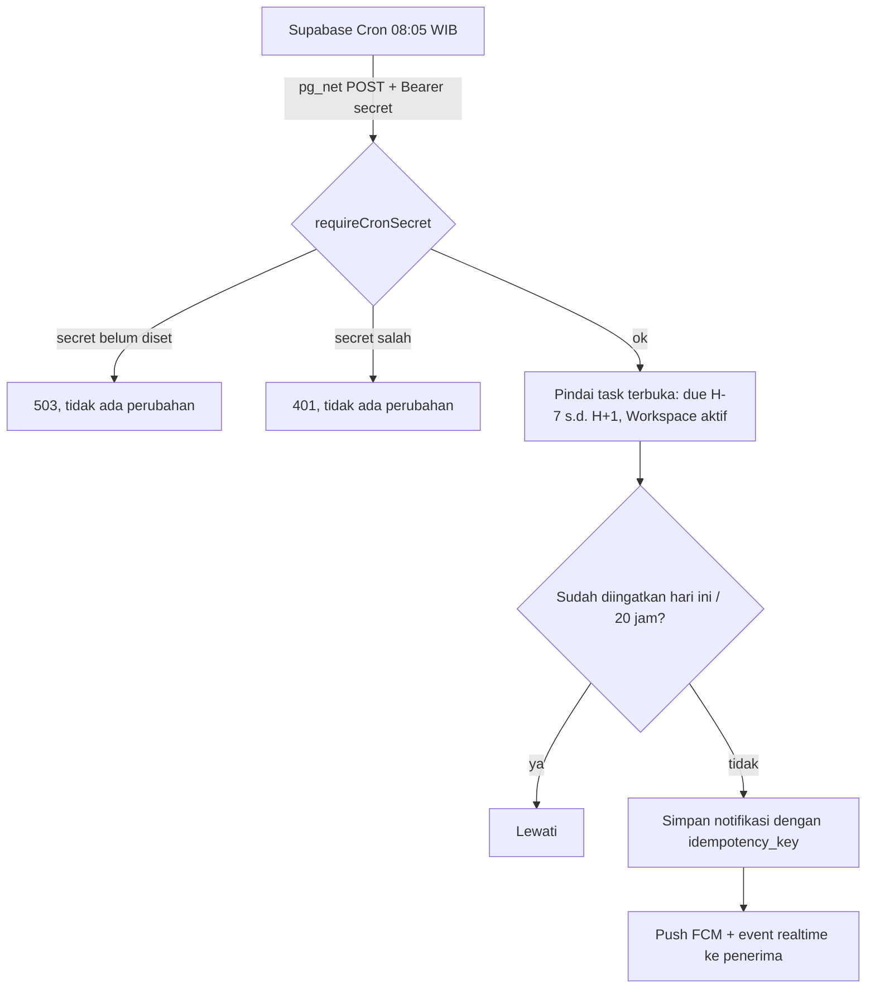

# DEADLINE-REMINDER-CRON — Tahap 2: PRD (Product Requirements)

**Status:** Disetujui
**Gerbang:** G2 — disetujui oleh PO
**Solusi terpilih:** [solution.md](solution.md)
**Applicable Policy IDs:** DOC-005, SDLC-001, AUTH-012, DATA-001, TEST-001

> Menggantikan `product.md` lama di `_template`. Aturan global (token warna, state UI wajib, RBAC)
> ditautkan ke SSoT, bukan disalin.

## 1. Tujuan dan pengguna

Assignee dan reporter task menerima pengingat deadline sekali sehari dari job terjadwal, tanpa
bergantung pada Admin/Owner yang sedang online, dan tanpa pengingat untuk task yang sudah lama
overdue atau sudah ditutup. Metrik sukses: [problem.md](problem.md) §5.

## 2. Requirement dan Acceptance Criteria

| Req ID | Requirement                                 | AC ID | Acceptance Criterion (Given / When / Then)                                                                                                                                                                                                                         | Role              | Bukti minimum (E-level)                |
| ------ | ------------------------------------------- | ----- | ------------------------------------------------------------------------------------------------------------------------------------------------------------------------------------------------------------------------------------------------------------------ | ----------------- | -------------------------------------- |
| REQ-1  | Endpoint terjadwal terlindungi secret mesin | AC-1  | Given `CRON_SECRET` belum diset, When scheduler memanggil `POST /v1/cron/deadline-reminders`, Then 503 `CRON_NOT_CONFIGURED` dan tidak ada notifikasi dibuat                                                                                                       | Owner             | E3 — integration test                  |
|        |                                             | AC-2  | Given secret diset, When header Authorization hilang, salah, atau tanpa `Bearer`, Then 401 dan tidak ada notifikasi                                                                                                                                                | Owner             | E3 — integration test                  |
|        |                                             | AC-3  | Given secret benar dan Origin bukan origin browser yang diizinkan, When scheduler memanggil, Then 200; route browser biasa dengan Origin yang sama tetap 403                                                                                                       | Owner             | E3 — integration test                  |
| REQ-2  | Aturan pengingat                            | AC-4  | Given task di Workspace aktif, When job berjalan, Then hanya task belum `done`/`canceled` dengan `dueDate` dari 7 hari lalu sampai besok yang diingatkan, ke assignee dan reporter, dengan pesan berbeda untuk task overdue; task Workspace arsip tidak diingatkan | Developer, QA, PO | E3 — integration test write/read-back  |
| REQ-3  | Idempoten terhadap pengiriman ganda         | AC-5  | Given dua pemanggilan bersamaan atau berulang di hari yang sama, Then setiap pasangan task × penerima punya tepat satu pengingat                                                                                                                                   | Owner             | E3 — integration test paralel          |
| REQ-4  | Pemicu manual dibatasi per Workspace        | AC-6  | Given `POST /v1/notifications/check-deadlines`, Then tanpa `workspaceId` 400, admin global yang bukan owner/admin Workspace 403, owner Workspace 200 dengan jendela yang sama                                                                                      | Owner / Admin     | E3 — integration test                  |
| REQ-5  | Browser tidak lagi memicu pemindaian        | AC-7  | Given Admin/Owner membuka aplikasi, Then web app hanya memuat notifikasi dan tidak memanggil `check-deadlines`                                                                                                                                                     | Owner / Admin     | E1/E2 — kode + typecheck/lint/test web |
| REQ-6  | Scheduler Production berjalan harian        | AC-8  | Given setup Supabase Cron selesai, When job dijalankan manual dan terjadwal, Then `net._http_response.status_code = 200` dan log API `cron.deadline_reminders` muncul                                                                                              | Owner             | E4 — Production, setelah deploy        |

Setiap AC wajib punya bukti minimum. AC tanpa jalur bukti = G2 tidak boleh disetujui.

## 3. User flow

| Langkah | Layar / route                            | Aksi user / sistem              | Respons sistem                                 | AC terkait |
| ------- | ---------------------------------------- | ------------------------------- | ---------------------------------------------- | ---------- |
| 1       | `POST /v1/cron/deadline-reminders`       | Scheduler memanggil             | 503/401/200 sesuai secret                      | AC-1–AC-3  |
| 2       | Service pengingat                        | Memindai dan membuat notifikasi | Notifikasi + push hanya untuk pasangan baru    | AC-4, AC-5 |
| 3       | Panel notifikasi web (yang sudah ada)    | Pengguna membuka aplikasi       | Notifikasi pengingat tampil seperti sebelumnya | AC-7       |
| 4       | `POST /v1/notifications/check-deadlines` | Owner/Admin Workspace (manual)  | 400/403/200 per Workspace                      | AC-6       |

## 4. Wireframe per state

Tidak ada layar baru atau yang berubah. Panel notifikasi memakai komponen yang sudah ada; satu-satunya
perubahan web adalah menghapus pemanggilan latar belakang di `useNotifications.ts`.

### Komponen Atomic

| Kebutuhan              | Komponen yang dipakai ulang (`apps/web/src/components/ui`)    | Komponen baru? alasan |
| ---------------------- | ------------------------------------------------------------- | --------------------- |
| Menampilkan notifikasi | Komponen notifikasi yang sudah ada (`features/notifications`) | Tidak                 |

## 5. Data, contract, authorization

- Data & API: [contracts.md](contracts.md)
- Authorization matrix: [authorization.md](authorization.md)
- Langkah per role: [roles/](roles/)

## 6. Di luar scope

- Mengubah jadwal default selain lewat runbook (Owner dapat mengganti `cron.schedule`).
- Dispatcher outbox S6, polling notifikasi, realtime SSE (PROD-LATENCY-FOLLOWUP).
- Pengaturan pengingat per pengguna atau per Workspace.

## 7. Unknown yang tersisa

| Pertanyaan                                                | Memengaruhi AC | Status                                                               |
| --------------------------------------------------------- | -------------- | -------------------------------------------------------------------- |
| Supabase Cron/pg_net tersedia di plan project Production? | AC-8           | Open — dicek Owner saat setup; fallback opsi C tercatat di ADR-040   |
| Jendela overdue 7 hari dan jadwal 08:05 WIB               | AC-4, AC-8     | Diputuskan — Owner 2026-11-04 (7 hari); jadwal default, dapat diubah |
