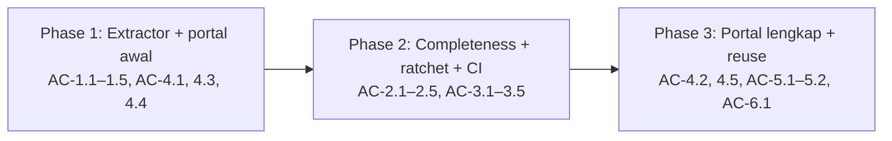

# DOC-PORTAL — Tahap 3: Breakdown (Phase → Task BE · FE · QA)

**Status:** Disetujui
**Gerbang:** G3 — disetujui oleh reyand (Owner) 2026-10-14; sekaligus Approval Window untuk Phase 1
**PRD:** [product.md](product.md)
**Applicable Policy IDs:** AI-002, AI-009, AI-013, AI-014, DOC-006, SDLC-001

"BE" di feature ini = tooling Node (`tools/docsys`), "FE" = portal statis. Aplikasi Qlick Hub
(`apps/web`, `apps/api`, database) tidak disentuh di phase mana pun.

## 1. Peta phase

| Phase | Tujuan (hasil yang bisa dilihat user)                                                                               | AC                                                    | WRA  | Bergantung pada | Tier PR    | Status      |
| ----- | ------------------------------------------------------------------------------------------------------------------- | ----------------------------------------------------- | ---- | --------------- | ---------- | ----------- |
| P1    | `npm run docs:extract` + `npm run docs:portal` menampilkan Beranda & Stack serta Fitur & Kontrak API dari data asli | AC-1.1–1.5, AC-4.1 (2 halaman), AC-4.3, AC-4.4        | 5/16 | —               | Tier 2     | Selesai     |
| P2    | PR yang menambah gap baru jadi merah di CI; gap lama tercatat di baseline                                           | AC-2.1–2.5, AC-3.1–3.5                                | 7/16 | P1              | **Tier 2** | Berjalan    |
| P3    | Enam halaman portal lengkap dengan badge gap, responsif, dan siap dibawa ke proyek lain                             | AC-4.1 (sisa), AC-4.2, AC-4.5, AC-5.1, AC-5.2, AC-6.1 | 3/16 | P2              | Tier 1     | Belum mulai |

## 2. Task per phase

### Phase 1 — Extractor + portal awal

| Task ID  | Layer  | Pekerjaan                                                                                                                                 | File/path                                    | AC               | Bukti selesai                                      |
| -------- | ------ | ----------------------------------------------------------------------------------------------------------------------------------------- | -------------------------------------------- | ---------------- | -------------------------------------------------- |
| P1-DOC-1 | Docs   | Buat folder dengan `npm run sdlc:new -- feature DOC-PORTAL`, isi tahap 0–3 yang disetujui, Stage Tracker                                  | `docs/features/DOC-PORTAL/`                  | —                | `docs:check` hijau (E2)                            |
| P1-BE-1  | Tool   | Core: loader config, runner adapter, penulis JSON, JSON Schema v1                                                                         | `tools/docsys/core/`, `tools/docsys/schema/` | AC-1.1, AC-1.5   | Unit test (E2)                                     |
| P1-BE-2  | Tool   | Adapter: `package-json`, `express-routes` (parser TypeScript), `zod-contracts`, `sequelize-models`, `markdown` (fitur, policy, ADR, TODO) | `tools/docsys/adapters/`                     | AC-1.2–1.4       | Fixture test + 24 endpoint testManagement (E2)     |
| P1-BE-3  | Tool   | `docsys.config.json` untuk qlickhub, script npm, `.docsys/` di `.gitignore`                                                               | root                                         | AC-1.1           | Extract di `main` lulus schema (E2)                |
| P1-FE-1  | Portal | Kerangka portal statis (HTML + JS, tanpa dependency), state loading/empty/error, halaman Beranda & Stack dan Fitur & Kontrak API          | `tools/docsys/portal/`                       | AC-4.1, 4.3, 4.4 | Screenshot desktop (E4) + Playwright smoke (E2)    |
| P1-QA-1  | QA     | Bandingkan hasil extract dengan hitungan manual: endpoint testManagement, jumlah model, versi stack                                       | —                                            | AC-1.2–1.4       | Tabel perbandingan di `phases/PHASE-01.md` (E1+E2) |

WRA Phase 1: requirement 1 · lapisan 1 · data 0 · authorization 0 · contract 0 · ketersinggungan 1 ·
validasi 2 (portal diamati di browser) · eksternal 0 = **5/16**

### Phase 2 — Completeness + ratchet + CI

| Task ID  | Layer | Pekerjaan                                                                                                                           | File/path             | AC          | Bukti selesai                    |
| -------- | ----- | ----------------------------------------------------------------------------------------------------------------------------------- | --------------------- | ----------- | -------------------------------- |
| P2-DOC-1 | Docs  | ADR-033 `Accepted`, `DOC-006` di `POLICY_REGISTRY.md`, docs/4 §2B, `AGENTS.md` (baris checklist)                                    | `docs/`               | —           | `docs:check` hijau (E2)          |
| P2-BE-1  | Tool  | Rule `DS-R01`–`DS-R05` dengan pesan perbaikan                                                                                       | `tools/docsys/rules/` | AC-2.1–2.5  | Fixture test per rule (E2)       |
| P2-BE-2  | Tool  | `docs:completeness`, `docs:baseline --init/--shrink`, `DOCSYS_MODE=report`                                                          | `tools/docsys/cli/`   | AC-3.1–3.4  | Fixture test (E2)                |
| P2-BE-3  | Tool  | Inisialisasi `quality/doc-baseline.json` dari `main`                                                                                | `quality/`            | AC-3.1      | Jumlah gap per rule dicatat (E2) |
| P2-BE-4  | CI    | Tambah langkah ke `npm run validate`                                                                                                | `package.json`        | AC-3.5      | Log CI `verify` (E2)             |
| P2-DOC-2 | Docs  | Template `docs/ux/UX_MATRIX.md` (semua alur `ROLE_FLOWS.md`, nilai `Belum dinilai`); format `Layer:` dijelaskan di header `TODO.md` | `docs/ux/`, `TODO.md` | AC-2.3, 2.4 | Rule lulus untuk file baru (E2)  |
| P2-QA-1  | QA    | PR uji yang sengaja menambah endpoint tanpa dokumen → CI merah; lalu dilengkapi → hijau                                             | branch uji            | AC-3.2      | Dua run CI (E2)                  |

WRA Phase 2: requirement 1 · lapisan 1 · data 0 · authorization 0 · contract 0 · ketersinggungan 2
(gate CI untuk semua PR) · validasi 2 (run CI nyata) · eksternal 1 (GitHub Actions) = **7/16**

### Phase 3 — Portal lengkap + reuse

| Task ID  | Layer  | Pekerjaan                                                                                  | File/path                 | AC          | Bukti selesai                             |
| -------- | ------ | ------------------------------------------------------------------------------------------ | ------------------------- | ----------- | ----------------------------------------- |
| P3-FE-1  | Portal | Halaman ERD, Governance, TODO aktif, UI/UX Matrix; badge dan daftar gap per halaman        | `tools/docsys/portal/`    | AC-4.1, 4.5 | Screenshot per halaman (E4)               |
| P3-FE-2  | Portal | Responsif 390 / 768 / 1280; pencarian                                                      | `tools/docsys/portal/`    | AC-4.2      | Screenshot 390 px + Playwright (E2/E4)    |
| P3-BE-1  | Tool   | Uji core pada proyek fixture dengan struktur berbeda; test anti-path-qlickhub di core      | `tools/docsys/__tests__/` | AC-5.1, 5.2 | Test (E2)                                 |
| P3-DOC-1 | Docs   | `tools/docsys/README.md`: instalasi, config, menulis adapter, langkah pakai di proyek baru | `tools/docsys/`           | AC-6.1      | `docs:check` hijau (E2)                   |
| P3-QA-1  | QA     | Walkthrough portal sebagai PO, Dev, QA, Owner                                              | —                         | AC-4.x      | Catatan + screenshot di `testing.md` (E4) |

WRA Phase 3: requirement 0 · lapisan 1 · data 0 · authorization 0 · contract 0 · ketersinggungan 0 ·
validasi 2 (portal diamati di browser) · eksternal 0 = **3/16**

## 3. Risiko lintas phase

| Risiko                                                                   | Phase | Mitigasi / rollback                                                                          |
| ------------------------------------------------------------------------ | ----- | -------------------------------------------------------------------------------------------- |
| Parser salah menghitung route (mis. route dinamis atau router bersarang) | P1    | AC-1.2 dibandingkan manual; pola yang tak dikenali dilaporkan sebagai peringatan, bukan diam |
| Gate CI salah memblokir PR                                               | P2    | Baseline + `DOCSYS_MODE=report`; revert satu baris di `validate`                             |
| `DS-R01` menghasilkan banyak gap lama sehingga baseline besar            | P2    | Diterima: baseline memang mencatat utang; portal menampilkan tren menyusut                   |
| Portal ketinggalan dari format data                                      | P1–P3 | `schemaVersion` + state error AC-4.4                                                         |

## 4. Stop condition yang sudah terlihat

| Phase | Stop condition                                                                                         | Kapan akan diminta                                                        |
| ----- | ------------------------------------------------------------------------------------------------------ | ------------------------------------------------------------------------- |
| P1    | Menambah dependency npm (target: nol; parser memakai `typescript` yang sudah ada)                      | Bila ternyata perlu                                                       |
| P2    | Merge Tier 2 (`quality/**`, `docs/adr/**`, `AGENTS.md`, `POLICY_REGISTRY.md`) → label `owner-approved` | Saat PR P2 siap                                                           |
| P2    | Pengecualian Tier 1 untuk PR yang hanya mengecilkan baseline (ubah `checkTier.mjs`)                    | **Tidak dikerjakan sekarang** — usulan ditunda sampai terbukti merepotkan |
| Semua | Perluasan scope ke `apps/*` atau OpenAPI                                                               | Feature terpisah                                                          |
