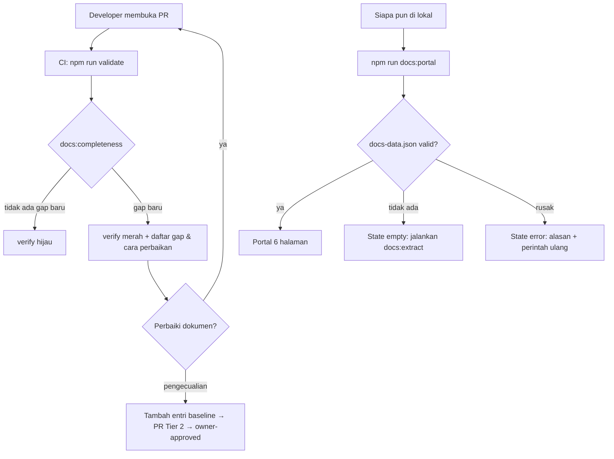

# DOC-PORTAL — Tahap 2: PRD (Product Requirements)

**Status:** Disetujui
**Gerbang:** G2 — disetujui oleh reyand (Owner, juga PO) 2026-10-14
**Solusi terpilih:** [solution.md](solution.md) — Opsi A (tool sendiri: core + adapter)
**ADR:** ADR-033 (ditambahkan di Phase 2)
**Applicable Policy IDs:** DOC-002, DOC-004, DOC-006, SDLC-001, AI-020

## 1. Tujuan dan pengguna

Satu portal lokal yang menampilkan stack, fitur dan kontrak API, ERD, governance, TODO aktif per
layer, dan UI/UX matrix, dibangun otomatis dari repo; ditambah completeness check yang mencegah gap
dokumen baru. Pengguna: Owner, PO, Developer, QA, dan agent AI. Metrik sukses: lihat
[problem.md](problem.md) §5.

## 2. Requirement dan Acceptance Criteria

| Req ID | Requirement                                                       | AC ID  | Acceptance Criterion (Given / When / Then)                                                                                                                                                                                      | Role      | Bukti minimum                              |
| ------ | ----------------------------------------------------------------- | ------ | ------------------------------------------------------------------------------------------------------------------------------------------------------------------------------------------------------------------------------- | --------- | ------------------------------------------ |
| REQ-1  | Extractor menghasilkan `docs-data.json`                           | AC-1.1 | Given repo `main`, When `npm run docs:extract`, Then file berisi bagian `stack`, `features`, `endpoints`, `contracts`, `erd`, `policies`, `adrs`, `todo`, `uxMatrix`, `meta.commit`, `meta.schemaVersion` dan lolos JSON Schema | Dev       | E2 — unit test schema                      |
|        |                                                                   | AC-1.2 | Given modul `testManagement`, When extract, Then tepat 24 endpoint dengan method + path `/v1/...` sama dengan `testManagementRoutes.ts`                                                                                         | Dev       | E2 — fixture test + E1 perbandingan manual |
|        |                                                                   | AC-1.3 | Given seluruh model di `apps/api/src/db/models`, When extract, Then setiap model muncul di `erd.entities` beserta asosiasi `hasMany`/`belongsTo`/`belongsToMany`                                                                | Dev       | E2 — test                                  |
|        |                                                                   | AC-1.4 | Given versi di `package.json` dan `.nvmrc`, When extract, Then `stack` memuat versi yang sama                                                                                                                                   | Dev       | E2 — test                                  |
|        |                                                                   | AC-1.5 | Given repo tidak berubah, When extract dua kali, Then output identik kecuali `meta.generatedAt`; tanpa jaringan dan tanpa database                                                                                              | Dev       | E2 — test                                  |
| REQ-2  | Aturan completeness ber-ID dengan pesan yang bisa ditindaklanjuti | AC-2.1 | Given endpoint yang path-nya tidak disebut di dokumen fitur mana pun, When check, Then gap `DS-R01` mencatat method, path, file route, dan saran file dokumen                                                                   | Dev, QA   | E2 — fixture test                          |
|        |                                                                   | AC-2.2 | Given model yang belum dipetakan ke domain di `docsys.config.json`, When check, Then gap `DS-R02`                                                                                                                               | Dev       | E2                                         |
|        |                                                                   | AC-2.3 | Given item TODO terbuka tanpa baris `Layer: PRD=…, BE=…, FE=…` (nilai `Todo`/`In progress`/`Done`/`N/A`), When check, Then gap `DS-R03`                                                                                         | PO        | E2                                         |
|        |                                                                   | AC-2.4 | Given alur role di `ROLE_FLOWS.md` tanpa baris di `docs/ux/UX_MATRIX.md`, When check, Then gap `DS-R04` (nilai boleh `Belum dinilai`)                                                                                           | QA        | E2                                         |
|        |                                                                   | AC-2.5 | Given file fitur tidak tercantum di `FEATURE_CATALOG.md` atau tautan katalog rusak, When check, Then gap `DS-R05`                                                                                                               | PO        | E2                                         |
| REQ-3  | Ratchet baseline (DOC-006)                                        | AC-3.1 | Given semua gap ada di `quality/doc-baseline.json`, When `npm run docs:completeness`, Then exit 0 dan laporan menampilkan jumlah gap lama                                                                                       | Dev       | E2                                         |
|        |                                                                   | AC-3.2 | Given PR menambah gap yang tidak ada di baseline, When check, Then exit 1 dengan daftar gap baru dan cara memperbaikinya                                                                                                        | Dev       | E2 — fixture test + E2 run CI pada PR uji  |
|        |                                                                   | AC-3.3 | Given gap lama sudah diperbaiki, When `npm run docs:baseline -- --shrink`, Then entri terhapus; perintah ini tidak pernah menambah entri                                                                                        | Dev       | E2                                         |
|        |                                                                   | AC-3.4 | Given `DOCSYS_MODE=report`, When check menemukan gap baru, Then exit 0 dan laporan menandai mode report                                                                                                                         | Owner     | E2                                         |
|        |                                                                   | AC-3.5 | Given `npm run validate`, Then langkah completeness ikut berjalan di CI `verify`                                                                                                                                                | Owner     | E2 — log CI                                |
| REQ-4  | Portal lokal tanpa login                                          | AC-4.1 | Given `docs-data.json` ada, When `npm run docs:portal`, Then portal terbuka di `localhost` dengan 6 halaman sesuai mockup dan bekerja tanpa jaringan                                                                            | Semua     | E4 — screenshot desktop                    |
|        |                                                                   | AC-4.2 | Given lebar 390 px, Then tidak ada scroll horizontal halaman; tabel lebar scroll di dalam kotaknya                                                                                                                              | QA        | E4 — screenshot 390 px + Playwright smoke  |
|        |                                                                   | AC-4.3 | Given `docs-data.json` belum ada, Then state empty menampilkan perintah `npm run docs:extract`                                                                                                                                  | Semua     | E2 — Playwright                            |
|        |                                                                   | AC-4.4 | Given file rusak atau `schemaVersion` tidak cocok, Then state error menampilkan alasannya                                                                                                                                       | Semua     | E2 — Playwright                            |
|        |                                                                   | AC-4.5 | Given gap di laporan, Then setiap halaman menampilkan jumlah gap terkait dan daftar per rule                                                                                                                                    | Owner, PO | E4                                         |
| REQ-5  | Bisa dipakai ulang                                                | AC-5.1 | Given proyek fixture dengan nama folder berbeda dan config sendiri, When extract + check memakai core yang sama, Then lolos tanpa mengubah file core                                                                            | Dev       | E2 — test                                  |
|        |                                                                   | AC-5.2 | Given kode core, Then tidak ada path atau nama khusus qlickhub (dicek otomatis)                                                                                                                                                 | Dev       | E2 — test                                  |
| REQ-6  | Dokumentasi                                                       | AC-6.1 | `tools/docsys/README.md` menjelaskan instalasi, config, adapter, dan cara pakai di proyek baru; `DOC-006` tercatat di `POLICY_REGISTRY.md`; `npm run docs:check` lulus                                                          | Dev       | E2                                         |

## 3. User flow

| Langkah | Tempat        | Aksi                                  | Respons sistem              | AC                 |
| ------- | ------------- | ------------------------------------- | --------------------------- | ------------------ |
| 1       | Terminal      | `npm run docs:extract`                | Tulis `docs-data.json`      | AC-1.1–1.5         |
| 2       | Terminal / CI | `npm run docs:completeness`           | Exit 0/1 + laporan          | AC-2.x, AC-3.1–3.4 |
| 3       | Terminal      | `npm run docs:portal`                 | Server lokal + buka browser | AC-4.1             |
| 4       | Browser       | Navigasi 6 halaman, filter, pencarian | Render dari JSON            | AC-4.1–4.5         |

## 4. Wireframe per state

Desain: Design artifact **Qlick Hub Dev Portal** (6 artboard, dibuat 2026-10-14). Portal tidak memakai komponen
`apps/web` karena terpisah dari aplikasi; token warna mengikuti mockup.

| State             | Tampilan                                                                      |
| ----------------- | ----------------------------------------------------------------------------- |
| Default           | Sesuai artboard 1–6                                                           |
| Loading           | Skeleton kartu dan baris tabel                                                |
| Empty             | Panel di tengah: "Data portal belum dibuat" + perintah `npm run docs:extract` |
| Error             | Panel: alasan (file rusak / `schemaVersion` X ≠ Y) + perintah ulang           |
| Gap               | Badge jumlah gap di menu samping; daftar gap per rule di tiap halaman         |
| Permission-denied | Tidak berlaku (portal lokal tanpa login)                                      |

| Breakpoint      | Perbedaan layout                                                                       |
| --------------- | -------------------------------------------------------------------------------------- |
| Phone (390)     | Menu samping menjadi baris atas yang wrap; grid jadi 1 kolom; tabel scroll dalam kotak |
| Tablet (768)    | Menu samping tetap; grid 2 kolom                                                       |
| Desktop (≥1280) | Sesuai mockup                                                                          |

## 5. Data, contract, authorization

- Format data: [contracts.md](contracts.md)
- Authorization: [authorization.md](authorization.md)
- Langkah per role: [roles/](roles/)

## 6. Di luar scope

- Hosting, deploy, atau autentikasi portal.
- Menulis ulang 33 kartu fitur legacy dan mengisi nilai UX matrix.
- OpenAPI dan adapter untuk stack selain Express + Zod + Sequelize.
- Perubahan pada `apps/web`, `apps/api`, `packages/contracts`, atau database.

## 7. Unknown yang tersisa

| Pertanyaan                                             | Memengaruhi AC                        | Status                         |
| ------------------------------------------------------ | ------------------------------------- | ------------------------------ |
| Stack proyek berikutnya                                | Tidak (adapter baru = fitur terpisah) | Open                           |
| Format penanda layer TODO (`Layer: PRD=…, BE=…, FE=…`) | AC-2.3                                | Diputuskan G2: format diterima |
| Lokasi UX matrix (`docs/ux/UX_MATRIX.md`)              | AC-2.4                                | Diputuskan G2: lokasi diterima |
