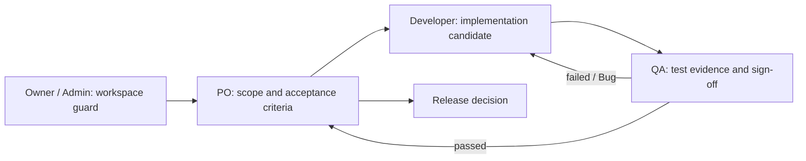

# E2E-SDLC-FLOW — Feature Overview

**Status:** Active
**Owner:** reyand (Owner)
**Last reviewed:** 2026-11-06
**Applicable Policy IDs:** DOC-005, SDLC-001, SDLC-002, QA-004, QA-008, QA-010, RELEASE-001, TEST-001

> Salin seluruh folder ke `docs/features/<FEATURE-ID>/`. File ini adalah pintu masuk kanonis.
> Sepuluh heading bernomor di bawah **wajib dipertahankan** karena divalidasi `npm run docs:check`.
> Buat folder dengan `npm run sdlc:new -- feature <ID>`. Tahap `Disetujui`/`Selesai` wajib mencatat
> penyetuju/tanggal dan dokumennya bebas placeholder (`SDLC-002`).
> Alur tahap dan Stage Card: [Agent Guidelines §2B](../../4_AGENT_DEV_GUIDELINES.md#2b-tahap-sdlc-feature-staged-feature-sdlc).
> Feature `Active` tidak boleh berisi placeholder.

## Stage Tracker

| Tahap             | Dokumen                                                                                | Status               | Gerbang         | Disetujui oleh / tanggal                 | Catatan                                                                                            |
| ----------------- | -------------------------------------------------------------------------------------- | -------------------- | --------------- | ---------------------------------------- | -------------------------------------------------------------------------------------------------- |
| 0 Problem         | [problem.md](problem.md)                                                               | Disetujui            | G0              | reyand (Owner) 2026-11-05                | Audit Production + rencana perbaikan                                                               |
| 1 Opsi Solusi     | [solution.md](solution.md)                                                             | Disetujui            | G1              | reyand (Owner) 2026-11-05                | ADR di solution.md; K1–K5 diputuskan                                                               |
| 2 PRD             | [product.md](product.md)                                                               | Disetujui            | G2              | reyand (Owner) 2026-11-05                | G0–G2 disetujui sekaligus dari rencana                                                             |
| 3 Breakdown       | [breakdown.md](breakdown.md)                                                           | Disetujui            | G3              | reyand (Owner) 2026-11-05; P7 2026-11-06 | P1–P6 satu putaran; P7 (AC-11 – AC-15) ditambah dari uji manual                                    |
| (shared)          | [contracts.md](contracts.md) · [authorization.md](authorization.md) · [roles/](roles/) | Disetujui            | bagian G2       | reyand (Owner) 2026-11-05                |                                                                                                    |
| 4 Build           | [phases/](phases/)                                                                     | Selesai              | dalam window G3 | reyand (Owner) 2026-11-05                | P1–P6 PR #105 (`f521444`); P7 kandidat teruji ([PHASE-02](phases/PHASE-02.md))                     |
| 5 Test & Review   | [testing.md](testing.md)                                                               | Menunggu persetujuan | G5              | CI PR #105 + reyand (Owner) 2026-11-05   | P1–P6 lulus termasuk E4 Production; P7 menunggu CI PR                                              |
| 6 Release & Close | [release.md](release.md)                                                               | Draft                | G6              | —                                        | P1–P6 dirilis dan diuji manual 2026-11-05 (sign-off + keputusan rilis tercatat); P7 menunggu rilis |

Status tahap: `Belum mulai`, `Draft`, `Menunggu persetujuan`, `Disetujui`, `Blocked`, `Selesai`.
(Ini terpisah dari **Status** kartu di atas, yang tetap `Draft` / `Active` / `Superseded` / `Archived`.)

## 1. Tujuan dan Pengguna

PO, Developer, dan QA menjalankan satu Feature dari ide sampai Keputusan Rilis lewat UI: tombol
mengikuti role Workspace, kartu Tugas Saya membuka halaman yang boleh dibuka, gerbang uji dan retest
dijaga API, dan PO mencatat rilis di halaman Feature. Detail: [problem.md](problem.md),
[solution.md](solution.md) (termasuk ADR-nya).

## 2. Requirement dan Acceptance Criteria

Link Requirement dan AC ber-ID di [product.md](product.md).

## 3. Alur Lintas Peran

| Pembaca       | Baca berikutnya                              | Output / handoff                    |
| ------------- | -------------------------------------------- | ----------------------------------- |
| Owner / Admin | [roles/owner-admin.md](roles/owner-admin.md) | Batas workspace dan akses           |
| PO            | [roles/po.md](roles/po.md)                   | Scope disetujui dan keputusan rilis |
| Developer     | [roles/developer.md](roles/developer.md)     | Kandidat dan bukti implementasi     |
| QA            | [roles/qa.md](roles/qa.md)                   | Test result, Bug/retest, sign-off   |

User flow per layar ada di [product.md](product.md) §3.

## 4. Data dan Relasi

Lihat [contracts.md](contracts.md).

## 5. API dan Shared Contract

Lihat [contracts.md](contracts.md); jangan menyalin field kontrak.

## 6. Authorization

Lihat [authorization.md](authorization.md).

## 7. UI dan Interaction States

User flow dan wireframe per state di [product.md](product.md) §3–§4.

## 8. Pengujian dan Evidence

Lihat [testing.md](testing.md); pembagian phase di [breakdown.md](breakdown.md).

## 9. Release dan Readiness

Lihat [release.md](release.md).

## 10. Traceability

`Problem → Solution/ADR → Requirement → AC → Phase → Task BE/FE/QA → contract/code → Test Result →
Bug/retest → report → release decision`
