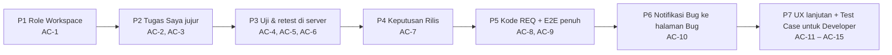

# E2E-SDLC-FLOW — Tahap 3: Breakdown (Phase → Task BE · FE · QA)

**Status:** Disetujui
**Gerbang:** G3 — disetujui oleh Owner; persetujuan ini sekaligus Approval Window untuk phase pertama
**PRD:** [product.md](product.md)
**Applicable Policy IDs:** AI-002, AI-009, AI-014, SDLC-001, QA-010

**Jalur:** Standar. Owner meminta semua phase dijalankan dalam satu putaran ("aku ingin jalannya
1 round semua"), jadi P1–P5 dibangun di satu branch dan satu PR; log build ada di
[PHASE-01](phases/PHASE-01.md).

## Aturan pemecahan

1. **Phase = vertical slice** yang bisa diuji sendiri terhadap AC (ADR-017).
2. Setiap phase punya WRA ≤ 8.
3. Setiap phase berisi task **BE**, **FE**, dan **QA** bila slice itu menyentuh lapisan tersebut;
   lapisan yang tidak tersentuh ditulis `N/A — alasan`.
4. Setiap AC dari PRD masuk ke tepat satu phase; AC-9 menguji ulang semuanya.

## 1. Peta phase

| Phase | Tujuan (hasil yang bisa dilihat user)                                                                                             | AC            | WRA  | Bergantung pada | Status            |
| ----- | --------------------------------------------------------------------------------------------------------------------------------- | ------------- | ---- | --------------- | ----------------- |
| P1    | Tombol mengikuti role Workspace; tombol terkunci punya alasan                                                                     | AC-1          | 4/16 | —               | Kandidat teruji   |
| P2    | Kartu QA per subtask QA dengan kesiapan dari server; gerbang Test Run                                                             | AC-2, AC-3    | 7/16 | P1              | Kandidat teruji   |
| P3    | Retest satu transaksi, satu siklus terbuka, Bug ke Developer yang benar                                                           | AC-4–AC-6     | 8/16 | P2              | Kandidat teruji   |
| P4    | PO mencatat Keputusan Rilis dari halaman Feature                                                                                  | AC-7          | 5/16 | P1              | Kandidat teruji   |
| P5    | Kode `REQ-001`, Brief disetujui di Feature, QA menutup eksekusi, E2E                                                              | AC-8, AC-9    | 8/16 | P1–P4           | Kandidat teruji   |
| P6    | Notifikasi Bug (lonceng dan push) membuka halaman Bug                                                                             | AC-10         | 5/16 | P5              | Kandidat teruji   |
| P7    | Kartu dan tombol Setujui Brief, angka Tugas Saya, Test Case untuk Developer, build dari serah-terima, setujui + selesaikan atomik | AC-11 – AC-15 | 7/16 | P1–P6           | Dirilis (PR #107) |

## 2. Task per phase

| Task ID | Layer | Pekerjaan                                                                                                                                                                                                | File/path                                                                                                                                                                               | AC            | Bukti selesai                       | Assignee |
| ------- | ----- | -------------------------------------------------------------------------------------------------------------------------------------------------------------------------------------------------------- | --------------------------------------------------------------------------------------------------------------------------------------------------------------------------------------- | ------------- | ----------------------------------- | -------- |
| P1-FE-1 | FE    | `selectActiveWorkspaceRole`, dipakai di halaman QA, Test Case, Bug, subtask                                                                                                                              | `apps/web/src/store/workspaceSlice.ts`, `apps/web/src/pages/*`                                                                                                                          | AC-1          | Vitest (E2)                         | Claude   |
| P1-BE   | BE    | N/A — API sudah memakai role Workspace                                                                                                                                                                   | —                                                                                                                                                                                       | —             | —                                   | —        |
| P2-BE-1 | BE    | `developerReadiness.ts`, endpoint readiness, gerbang `createTestRun`, antrean QA                                                                                                                         | `apps/api/src/modules/testManagement/*`, `apps/api/src/modules/workQueue/workQueueService.ts`                                                                                           | AC-2, AC-3    | Integration test (E3)               | Claude   |
| P2-FE-1 | FE    | Kesiapan dari API, kartu membuka subjeknya, judul kartu bisa diklik                                                                                                                                      | `apps/web/src/lib/hooks/useDeveloperReadiness.ts`, `apps/web/src/pages/MyTasksPage.tsx`                                                                                                 | AC-2          | Vitest (E2)                         | Claude   |
| P3-BE-1 | BE    | Retest attempt di `recordTestResult`; siklus lama `superseded`; origin QA di Bug                                                                                                                         | `apps/api/src/modules/bugs/bugService.ts`, `testManagementService.ts`, `packages/contracts/src/bug.ts`                                                                                  | AC-4–AC-6     | Integration test (E3)               | Claude   |
| P3-FE-1 | FE    | Satu panggilan retest; daftar Developer Bug; retest hanya QA asal                                                                                                                                        | `apps/web/src/pages/TestCaseRunPage.tsx`, `BugWorkPage.tsx`                                                                                                                             | AC-6          | Vitest (E2)                         | Claude   |
| P4-FE-1 | FE    | Panel rilis di halaman Feature; kartu antrean membuka `?fokus=rilis`                                                                                                                                     | `apps/web/src/pages/FeatureDetailPage.tsx`, `MyTasksPage.tsx`                                                                                                                           | AC-7          | Vitest (E2)                         | Claude   |
| P4-BE   | BE    | N/A — endpoint keputusan rilis sudah ada                                                                                                                                                                 | —                                                                                                                                                                                       | —             | —                                   | —        |
| P5-BE-1 | BE    | Kode `REQ-001` saat Apply + migrasi rename                                                                                                                                                               | `apps/api/src/modules/requirements/requirementCodes.ts`, `apps/api/src/db/migrations/20261105000095-*`                                                                                  | AC-8          | Integration + migration test (E3)   | Claude   |
| P5-FE-1 | FE    | Status Brief di editor Feature; setujui Developer + Selesaikan Eksekusi QA; pesan API spesifik                                                                                                           | `TaskDetailProductBriefTab.tsx`, `QaSubtaskWorkSection.tsx`, `QaSubtaskWorkView.tsx`, `apiClient.ts`                                                                                    | AC-9          | Vitest (E2)                         | Claude   |
| P5-QA-1 | QA    | Playwright satu alur penuh lewat UI                                                                                                                                                                      | `apps/web/e2e/specs/e2e-sdlc-flow.spec.ts`, `apps/web/e2e/support/sdlcFlowSeed.ts`                                                                                                      | AC-9          | Playwright (E4 lokal)               | Claude   |
| P6-DB-1 | DB    | Kolom `notifications.bug_id` + FK Workspace + index + backfill dari outbox                                                                                                                               | `apps/api/src/db/migrations/20261105000096-add-notification-bug-id.cjs`                                                                                                                 | AC-10         | Integration test FK + backfill (E3) | Claude   |
| P6-BE-1 | BE    | Outbox meneruskan `payload.bugId`; notifikasi dan push membawa `bugId`; tautan push ke Bug                                                                                                               | `reliableNotificationOutboxService.ts`, `notificationService.ts`, `fcmService.ts`, `packages/contracts/src/notification.ts`                                                             | AC-10         | Integration test (E3)               | Claude   |
| P6-FE-1 | FE    | Lonceng dan push di depan membuka `/work/bugs/:id`                                                                                                                                                       | `NotificationBell.tsx`, `useFcmNotifications.ts`, `uiSlice.ts`                                                                                                                          | AC-10         | Vitest + E2E langkah 6 (E4 lokal)   | Claude   |
| P5-QA-2 | QA    | Ulangi alur manual di Production setelah deploy                                                                                                                                                          | Production                                                                                                                                                                              | AC-9          | Rekaman/screenshot (E4)             | Owner    |
| P7-BE-1 | BE    | Item antrean `approve_product_brief` untuk Feature yang Brief-nya belum disetujui; endpoint `complete-qa-review` satu transaksi (`updateTaskInTransaction`)                                              | `workQueueService.ts`, `taskLifecycle.ts`, `taskController/Routes/Service.ts`, `packages/contracts/src/{workQueue,task}.ts`                                                             | AC-11, AC-15  | Integration test PostgreSQL (E3)    | Claude   |
| P7-FE-1 | FE    | Tombol dan status Brief di tahap PRD, kartu Tugas Saya, muat ulang jejak setelah Apply, label "Requirement N", tooltip hanya saat terkunci, angka Ringkasan dari antrean, "Menunggu Orang Lain" terlipat | `FeatureStagePanels.tsx`, `TaskDetailDrawer.tsx`, `MyTasksPage.tsx`, `FeatureSpec*Editor.tsx`, `ReleaseAssurancePanel.tsx`, `OverviewStoreDashboard.tsx`, `RoleAwareWorkQueuePanel.tsx` | AC-11, AC-12  | Vitest (E2) + Playwright (E4 lokal) | Claude   |
| P7-FE-2 | FE    | Test Case QA hanya baca di halaman kerja Developer; build/lingkungan di serah-terima mengisi form siklus; satu klik setujui + selesaikan                                                                 | `DeveloperTestCasesSection.tsx`, `SubtaskWorkView.tsx`, `SubtaskWorkPage.tsx`, `qaHandoff.ts`, `TestCaseRunPage.tsx`, `QaSubtaskWorkSection.tsx`, `QaSubtaskWorkView.tsx`               | AC-13 – AC-15 | Vitest (E2) + Playwright (E4 lokal) | Claude   |
| P7-QA-1 | QA    | Ulang singkat di Production: Setujui Brief, Developer melihat Test Case, build terisi, satu klik selesai                                                                                                 | Production                                                                                                                                                                              | AC-11 – AC-15 | Screenshot (E4)                     | Owner    |

## 3. Risiko lintas phase

| Risiko                                               | Phase | Mitigasi / rollback                                                                  |
| ---------------------------------------------------- | ----- | ------------------------------------------------------------------------------------ |
| Gerbang server menolak hasil uji yang dulu lolos     | P2    | Pesan menyebut subtask yang belum siap; aturan per Requirement (K2)                  |
| Kartu QA berkurang dan pengguna mengira tugas hilang | P2    | Kartu per subtask QA milik QA; catatan perubahan di PR                               |
| Siklus lama tertutup saat ada retest berjalan        | P3    | Retest membuat siklus kandidat baru; hasil lama tetap riwayat                        |
| Migrasi kode Requirement                             | P5    | `down` dari `requirement_code_renames`; diterapkan ke Production sebelum merge       |
| Dua migrasi dalam satu PR                            | P5–P6 | Keduanya aditif dan punya `down`; diterapkan berurutan (095, lalu 096) sebelum merge |
