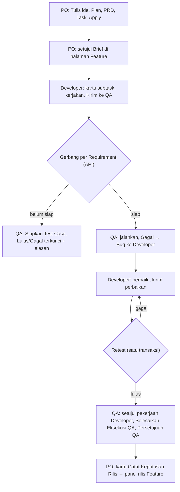

# E2E-SDLC-FLOW — Tahap 2: PRD (Product Requirements)

**Status:** Disetujui
**Gerbang:** G2 — disetujui oleh PO
**Solusi terpilih:** [solution.md](solution.md)
**Applicable Policy IDs:** DOC-005, UI-001, UI-002, SDLC-001, QA-010

> Aturan global (token warna, state UI wajib, RBAC) ditautkan ke SSoT, bukan disalin.

## 1. Tujuan dan pengguna

PO, Developer, dan QA menjalankan satu Feature dari ide sampai Keputusan Rilis lewat UI, tanpa jalan
buntu, dengan alasan yang terlihat setiap kali sebuah aksi dikunci. Metrik: [problem.md](problem.md) §5.

## 2. Requirement dan Acceptance Criteria

| Req ID | Requirement                   | AC ID | Acceptance Criterion (Given / When / Then)                                                                                                                                                                                                                           | Role          | Bukti minimum (E-level) |
| ------ | ----------------------------- | ----- | -------------------------------------------------------------------------------------------------------------------------------------------------------------------------------------------------------------------------------------------------------------------- | ------------- | ----------------------- |
| REQ-1  | Aksi mengikuti role Workspace | AC-1  | Given akun global `dev` dengan role Workspace `qa` yang ditugaskan, when membuka halaman kerja QA, then tombol Test Case aktif; non-QA melihat alasan "hanya melihat"                                                                                                | QA            | E2 unit + E4 E2E        |
| REQ-2  | Tugas Saya jujur              | AC-2  | Given QA, when membuka Tugas Saya, then hanya kartu subtask QA miliknya, dengan alasan kesiapan Developer; setiap kartu membuka halaman yang boleh dibuka                                                                                                            | QA            | E3 + E4                 |
| REQ-3  | Gerbang uji di server         | AC-3  | Given subtask Developer untuk Requirement subtask QA belum Review/Selesai, when QA membuat Test Run, then API `409` menyebut subtask itu; tanpa tautan Requirement, seluruh Feature dihitung                                                                         | QA            | E3                      |
| REQ-3  | Retest satu transaksi         | AC-4  | Given run retest kontekstual, when QA mencatat hasil, then Retest Attempt dan status Bug tersimpan dalam penulisan yang sama                                                                                                                                         | QA            | E3                      |
| REQ-3  | Satu siklus terbuka           | AC-5  | Given siklus uji terbuka, when siklus baru dibuat untuk subtask QA yang sama, then siklus lama `superseded`                                                                                                                                                          | QA            | E3                      |
| REQ-3  | Bug ke Developer yang benar   | AC-6  | Given Requirement tanpa Developer, when QA mengirim Bug, then semua anggota `dev` Workspace bisa dipilih; hanya QA subtask asal yang melihat "Mulai retest"                                                                                                          | QA            | E2                      |
| REQ-4  | Keputusan Rilis di Feature    | AC-7  | Given QA Sign-off tercatat, when PO membuka kartu "Catat Keputusan Rilis", then panel rilis di halaman Feature terbuka dan keputusan tersimpan; QA tidak melihat panel                                                                                               | PO            | E2 + E4                 |
| REQ-5  | Kode Requirement pendek       | AC-8  | Given Apply, then Requirement bernama `REQ-001`, … per Workspace tanpa bentrok saat Apply paralel; kode UUID lama diganti lewat migrasi                                                                                                                              | PO            | E3                      |
| REQ-7  | Notifikasi Bug ke halaman Bug | AC-10 | Given notifikasi Bug (dibuat, perbaikan dikirim, retest, dibuka kembali, status), when penerima mengklik di lonceng atau push, then halaman Bug itu terbuka; notifikasi lama ikut ditautkan dari outbox (K6); Bug dihapus atau notifikasi non-Bug tetap membuka task | Developer, QA | E3 + E4                 |
| REQ-6  | Seluruh alur lewat UI         | AC-9  | Given hanya akun dan Workspace, when PO, Developer, dan QA menjalankan alur, then ide → Apply → Brief disetujui → uji → Bug → retest gagal → retest lulus → selesai QA → sign-off → rilis berhasil                                                                   | Semua         | E4 Playwright           |

## 3. User flow



| Langkah | Layar / route                                  | Aksi user                                 | Respons sistem                             | AC         |
| ------- | ---------------------------------------------- | ----------------------------------------- | ------------------------------------------ | ---------- |
| 1       | `/work?tab=tasks`, `/work/features/:id`        | Tulis ide, isi tahap, Terapkan            | Feature, Requirement `REQ-001`, subtask    | AC-8       |
| 2       | `/work/features/:id?tahap=prd`                 | Status Brief Produk = Disetujui           | Baseline kesiapan bisa dibuat              | AC-9       |
| 3       | `/my-tasks` → `/work/subtasks/:id`             | Developer Kirim ke QA                     | Status Review, pesan serah-terima          | AC-2       |
| 4       | `/work/subtasks/:qaId`                         | QA tambah Test Case                       | Lulus/Gagal terkunci sampai Developer siap | AC-1, AC-3 |
| 5       | `/tests/cases/:id/run`                         | Mulai siklus, Gagal, Kirim bug            | Bug ke Developer terpilih                  | AC-5, AC-6 |
| 6       | `/work/bugs/:id`                               | Developer kirim perbaikan; QA retest      | Bug dibuka kembali / terverifikasi         | AC-4       |
| 7       | `/work/subtasks/:qaId`                         | Setujui, Selesaikan Eksekusi QA, sign-off | Subtask QA selesai, sign-off tercatat      | AC-9       |
| 8       | `/my-tasks` → `/work/features/:id?fokus=rilis` | PO Catat Keputusan Rilis                  | Keputusan tersimpan                        | AC-7       |

## 4. Wireframe per state

### Layar: halaman kerja QA — route `/work/subtasks/:id`

| State                 | Wireframe / link                                                         | Catatan                                     |
| --------------------- | ------------------------------------------------------------------------ | ------------------------------------------- |
| Default (berisi data) | Test Case per Requirement, tombol Lulus/Gagal                            | —                                           |
| Loading               | skeleton halaman                                                         | komponen yang ada                           |
| Empty                 | "+ Test Case" dan "Impor spreadsheet"                                    | —                                           |
| Error                 | alert di atas halaman                                                    | pesan API spesifik (problem details `code`) |
| Disabled              | banner "Menunggu Developer: X dari Y … untuk requirement subtask QA ini" | Lulus/Gagal nonaktif                        |
| Permission-denied     | bagian "Hanya melihat" dengan alasan                                     | AC-1                                        |

```text
┌ Selesaikan eksekusi QA ───────────────────────────────┐
│ Semua Test Case lulus …                               │
│  Backend pendaftaran pasien · Dev BE        [Setujui] │
│  Form pendaftaran pasien · Dev FE           [Setujui] │
│                           [Selesaikan Eksekusi QA]    │
└───────────────────────────────────────────────────────┘
```

| Breakpoint | Perbedaan layout                                 |
| ---------- | ------------------------------------------------ |
| Phone      | Baris persetujuan membungkus; tombol lebar penuh |
| Tablet     | Sama dengan desktop dalam satu kolom             |
| Desktop    | Kolom utama + panel status di kanan              |

### Komponen Atomic

| Kebutuhan              | Komponen yang dipakai ulang (`apps/web/src/components/ui`) | Komponen baru? alasan |
| ---------------------- | ---------------------------------------------------------- | --------------------- |
| Aksi selesai QA        | `Button`, kartu `cardClass` halaman QA                     | Tidak                 |
| Status Brief di editor | `Select`                                                   | Tidak                 |
| Panel rilis di Feature | `ReleaseAssurancePanel` `mode="release"`                   | Tidak                 |

## 5. Data, contract, authorization

- Data & API: [contracts.md](contracts.md)
- Authorization matrix: [authorization.md](authorization.md)
- Langkah per role: [roles/](roles/)

## 6. Di luar scope

- Klaim terbuka QA untuk Feature tanpa subtask QA.

## 7. Unknown yang tersisa

| Pertanyaan                               | Memengaruhi AC | Status                                    |
| ---------------------------------------- | -------------- | ----------------------------------------- |
| Gerbang per Feature atau per Requirement | AC-3           | Diputuskan: per Requirement (K2)          |
| Nasib siklus lama                        | AC-5           | Diputuskan: ditandai digantikan (K3)      |
| Kode UUID lama                           | AC-8           | Diputuskan: diganti semua (K4)            |
| Notifikasi Bug lama ikut ditautkan       | AC-10          | Diputuskan: ya, backfill dari outbox (K6) |
