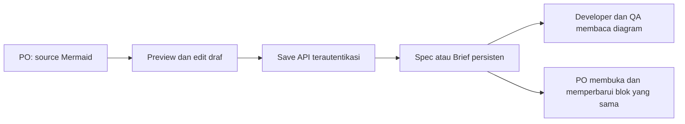

# FEAT-PRD-MERMAID-STUDIO — Feature Overview

**Status:** Active
**Owner:** Reyand
**Last reviewed:** 2026-11-09
**Applicable Policy IDs:** DOC-005, SDLC-001, UI-001, UI-003, CONTRACT-001, DATA-001, TEST-001

## Stage Tracker

| Tahap             | Dokumen                                                                                | Status               | Gerbang         | Disetujui oleh / tanggal   | Catatan                                                   |
| ----------------- | -------------------------------------------------------------------------------------- | -------------------- | --------------- | -------------------------- | --------------------------------------------------------- |
| 0 Problem         | [problem.md](problem.md)                                                               | Disetujui            | G0              | Owner (Reyand), 2026-11-09 |                                                           |
| 1 Opsi Solusi     | [solution.md](solution.md)                                                             | Disetujui            | G1              | Owner (Reyand), 2026-11-09 | ADR: —                                                    |
| 2 PRD             | [product.md](product.md)                                                               | Disetujui            | G2              | Owner (Reyand), 2026-11-09 |                                                           |
| 3 Breakdown       | [breakdown.md](breakdown.md)                                                           | Disetujui            | G3              | Owner (Reyand), 2026-11-09 | Jalur: Standar; P1–P2 disetujui                           |
| (shared)          | [contracts.md](contracts.md) · [authorization.md](authorization.md) · [roles/](roles/) | Disetujui            | bagian G2       | Owner (Reyand), 2026-11-09 | file yang sudah ada di `_template`                        |
| 4 Build           | [phases/](phases/)                                                                     | Disetujui            | dalam window G3 | Owner (Reyand), 2026-11-09 | Kandidat lokal teruji; bukan Production                   |
| 5 Test & Review   | [testing.md](testing.md)                                                               | Menunggu persetujuan | G5              | —                          | Evidence lokal tersedia; verifier/CI independen belum ada |
| 6 Release & Close | [release.md](release.md)                                                               | Belum mulai          | G6              | —                          |                                                           |

Status tahap: `Belum mulai`, `Draft`, `Menunggu persetujuan`, `Disetujui`, `Blocked`, `Selesai`.
(Ini terpisah dari **Status** kartu di atas, yang tetap `Draft` / `Active` / `Superseded` / `Archived`.)

## 1. Tujuan dan Pengguna

PO menempel source Mermaid, memeriksa preview, menyimpan, dan membuka ulang blok yang sama. Detail: [problem.md](problem.md) dan
[solution.md](solution.md).

## 2. Requirement dan Acceptance Criteria

Link Requirement dan AC ber-ID di [product.md](product.md).

## 3. Alur Lintas Peran

| Pembaca       | Baca berikutnya                              | Output / handoff                    |
| ------------- | -------------------------------------------- | ----------------------------------- |
| Owner / Admin | [roles/owner-admin.md](roles/owner-admin.md) | Batas workspace dan akses           |
| PO            | [roles/po.md](roles/po.md)                   | Scope disetujui dan keputusan rilis |
| Developer     | [roles/developer.md](roles/developer.md)     | Kandidat dan bukti implementasi     |
| QA            | [roles/qa.md](roles/qa.md)                   | Test result, Bug/retest, sign-off   |

User flow per layar ada di [product.md](product.md) §3.

## 4. Data dan Relasi

Lihat [contracts.md](contracts.md).

## 5. API dan Shared Contract

Lihat [contracts.md](contracts.md); jangan menyalin field kontrak.

## 6. Authorization

Lihat [authorization.md](authorization.md).

## 7. UI dan Interaction States

User flow dan wireframe per state di [product.md](product.md) §3–§4.

## 8. Pengujian dan Evidence

Lihat [testing.md](testing.md); pembagian phase di [breakdown.md](breakdown.md).

## 9. Release dan Readiness

Lihat [release.md](release.md).

## 10. Traceability

`Problem → Solution/ADR → Requirement → AC → Phase → Task BE/FE/QA → contract/code → Test Result →
Bug/retest → report → release decision`
