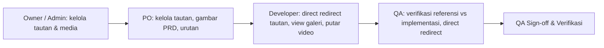

# FEATURE-REFERENCES-MEDIA — Feature Overview

**Status:** Active
**Owner:** reyand (Owner); pelaksana Antigravity
**Last reviewed:** 2026-11-09
**Applicable Policy IDs:** DOC-005, SDLC-001, SDLC-002, AUTH-001, AUTH-002, CONTRACT-001, DATA-001, TEST-001, UI-001, UI-002, UI-003, UI-004, UI-005

Sumber proposal: [Rencana Lanjutan F1–F4](../../plans/QLICKHUB_FOLLOWUP_F1_F4_PLAN.md#f2--referensi--media-di-halaman-feature).
Keputusan Owner K2 telah ditetapkan: hak akses kelola tautan dan media dibatasi khusus untuk **Owner, Admin, dan PO**, sedangkan **Developer dan QA** memiliki akses baca-saja (_view-only_) dan direct redirect. Seluruh fase build (P1 Backend & P2 Frontend) telah diimplementasikan dan diverifikasi dengan bukti primer PostgreSQL dan Vitest.

## Stage Tracker

| Tahap             | Dokumen                                                                                | Status               | Gerbang         | Disetujui oleh / tanggal | Catatan                         |
| ----------------- | -------------------------------------------------------------------------------------- | -------------------- | --------------- | ------------------------ | ------------------------------- |
| 0 Problem         | [problem.md](problem.md)                                                               | Disetujui            | G0              | reyand / 2026-11-09      | Masalah referensi tersebar      |
| 1 Opsi Solusi     | [solution.md](solution.md)                                                             | Disetujui            | G1              | reyand / 2026-11-09      | Opsi A: bagian terstruktur      |
| 2 PRD             | [product.md](product.md)                                                               | Disetujui            | G2              | reyand / 2026-11-09      | AC-F2.1–AC-F2.9                 |
| 3 Breakdown       | [breakdown.md](breakdown.md)                                                           | Disetujui            | G3              | reyand / 2026-11-09      | Jalur: Standar (WRA 16/16)      |
| (shared)          | [contracts.md](contracts.md) · [authorization.md](authorization.md) · [roles/](roles/) | Disetujui            | bagian G2       | reyand / 2026-11-09      | Kontrak, RBAC, dan alur 4 peran |
| 4 Build           | [phases/](phases/)                                                                     | Selesai              | dalam window G3 | Antigravity / 2026-11-09 | P1 Backend & P2 Frontend tuntas |
| 5 Test & Review   | [testing.md](testing.md)                                                               | Selesai              | G5              | Antigravity / 2026-11-09 | 7/7 DB test pass, 10/10 UI pass |
| 6 Release & Close | [release.md](release.md)                                                               | Menunggu persetujuan | G6              | —                        | Rilis Tier 2 (migrasi database) |

## 1. Tujuan dan Pengguna

Menyediakan wadah terstruktur bernama "Referensi & Media" pada tahap PRD halaman Feature di bawah Product Brief. PO, Admin, dan Owner dapat menambahkan tautan eksternal (Figma, Dokumen, Spreadsheet, Video, Gambar/Mockup), menampilkan visual galeri gambar dan pemutar video tersemat murni dari link URL, dan mengatur urutan tautan. Developer dan QA dapat langsung mengklik tautan (_direct redirect_ ke tab baru browser), memperbesar gambar via lightbox, dan memutar video di tempat tanpa opsi mengedit. Rincian ada di [problem.md](problem.md) dan [solution.md](solution.md).

## 2. Requirement dan Acceptance Criteria

Daftar Acceptance Criteria lengkap `AC-F2.1` sampai `AC-F2.9` dirinci di [product.md](product.md).

## 3. Alur Lintas Peran

| Pembaca       | Baca berikutnya                              | Output / handoff                   |
| ------------- | -------------------------------------------- | ---------------------------------- |
| Owner / Admin | [roles/owner-admin.md](roles/owner-admin.md) | Batas workspace dan hak kelola     |
| PO            | [roles/po.md](roles/po.md)                   | Referensi lengkap di tahap PRD     |
| Developer     | [roles/developer.md](roles/developer.md)     | Akses cepat 1-klik ke acuan desain |
| QA            | [roles/qa.md](roles/qa.md)                   | Baseline visual & bukti verifikasi |

User flow per layar ada di [product.md](product.md) §3.

## 4. Data dan Relasi

Tabel database baru `task_links` berelasi many-to-one ke `workspaces(id)` dan `tasks(id)` dengan `ON DELETE CASCADE`. Galeri gambar dan media memanfaatkan tautan referensi bertipe `image` atau format berkas gambar (URL) tanpa upload biner lokal. Rincian skema di [contracts.md](contracts.md).

## 5. API dan Shared Contract

Endpoints CRUD di bawah prefix `/v1/workspaces/:workspaceId/tasks/:taskId/links` dan kontrak TypeScript `TaskLink` dirinci di [contracts.md](contracts.md).

## 6. Authorization

Enforced di backend: hanya peran `owner`, `admin`, dan `po` yang dapat melakukan mutasi tautan dan media. Peran `developer` dan `qa` berstatus baca-saja. Rincian matriks di [authorization.md](authorization.md).

## 7. UI dan Interaction States

User flow, states (loading, empty, error, disabled), wireframe, dan viewport responsif di [product.md](product.md) §3–§4.

## 8. Pengujian dan Evidence

Pengujian PostgreSQL disposable dan component tests di [testing.md](testing.md); pembagian phase di [breakdown.md](breakdown.md).

## 9. Release dan Readiness

Pelacakan rilis dan checklist penutupan di [release.md](release.md).

## 10. Traceability

`Problem (problem.md) → Solusi (solution.md) → PRD & AC (product.md) → Kontrak (contracts.md) → RBAC (authorization.md) → Breakdown (breakdown.md) → Testing (testing.md) → Release (release.md)`
