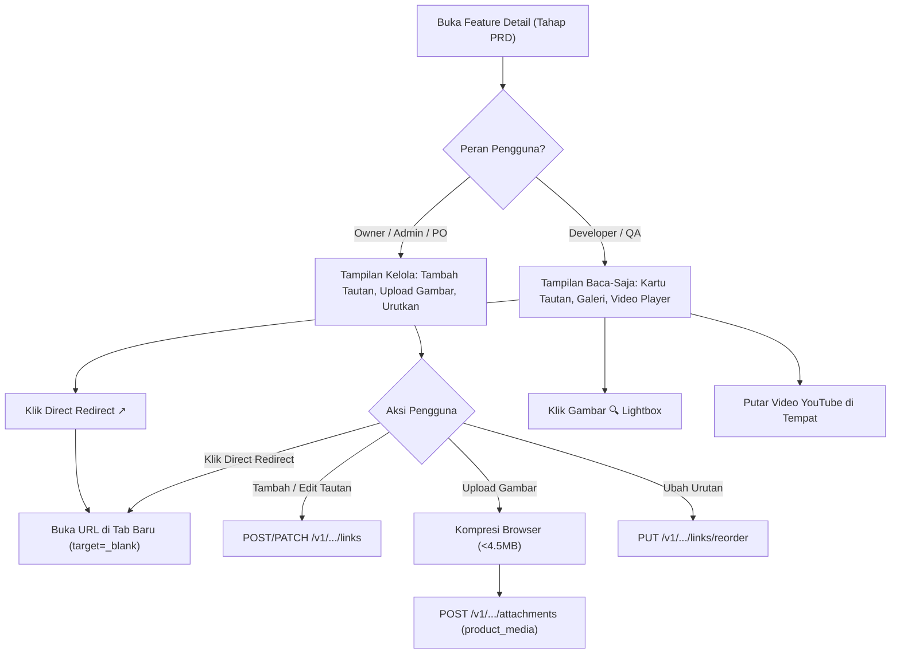

# FEATURE-REFERENCES-MEDIA — Tahap 2: Product Requirements Document (PRD)

**Status:** Menunggu persetujuan
**Gerbang:** G2 — disetujui oleh PO/Owner
**Applicable Policy IDs:** SDLC-001, DOC-005, AUTH-001, AUTH-002, CONTRACT-001, DATA-001, UI-001, UI-002, UI-003, UI-004, UI-005

## 1. User Stories

- **US-1 (PO / Admin / Owner - Kelola Tautan)**: Sebagai PO, Admin, atau Owner, saya ingin menambahkan tautan eksternal (Figma, Dokumen, Spreadsheet, Video, dan Tautan Lainnya) ke tahap PRD Feature dengan judul, jenis, dan pratinjau otomatis, agar semua referensi tersimpan rapi dan mudah diakses tim.
- **US-2 (PO / Admin / Owner - Kelola Galeri Gambar)**: Sebagai PO, Admin, atau Owner, saya ingin mengunggah beberapa gambar mockup ke dalam galeri media PRD dengan keterangan/caption, agar tim visual memahami tampilan yang diharapkan.
- **US-3 (Developer & QA - Direct Redirect & Pratinjau)**: Sebagai Developer atau QA, saya ingin dapat langsung mengklik tautan referensi untuk redirect ke URL tujuan di tab baru, serta melihat galeri gambar dan memutar video di tempat tanpa opsi mengedit, agar acuan pengerjaan subtask jelas.

## 2. Acceptance Criteria (AC)

- **AC-F2.1 (Penyimpanan Tautan Terstruktur)**:
  - Given pengguna berwenang (Owner/Admin/PO) di tahap PRD Feature,
  - When mengisi form Tambah Tautan (URL `https://`, judul wajib, jenis referensi `figma` | `document` | `sheet` | `video` | `other`),
  - Then server memvalidasi URL, menetapkan `sort_order` otomatis, menyimpan relasi ke `workspace_id` dan `task_id`, serta mengembalikan data tautan baru.
- **AC-F2.2 (Validasi URL & Keamanan)**:
  - Given URL dengan skema selain `https://` (misal `http://`, `javascript:`, atau `file://`),
  - When pengguna mencoba menyimpan,
  - Then server menolak dengan HTTP `400 Bad Request` dan pesan validasi yang jelas.
- **AC-F2.3 (Direct Redirect & Rich Link Preview)**:
  - Given tautan yang telah tersimpan,
  - When kartu tautan dirender di antarmuka,
  - Then kartu menampilkan ikon jenis, judul tautan, domain URL, dan tombol direct redirect. Mengklik tombol atau kartu membuka URL target di tab baru browser (`target="_blank" rel="noopener noreferrer"`).
- **AC-F2.4 (Reorder & Edit Tautan)**:
  - Given beberapa tautan pada Feature yang sama,
  - When pengguna berwenang mengklik tombol naik/turun atau memindahkan urutan tautan,
  - Then urutan baru disimpan di database (`sort_order`) dan tampilan segera terbarui tanpa reload halaman.
- **AC-F2.5 (Galeri Gambar Berbasis Tautan URL)**:
  - Given tautan gambar yang tersimpan (bertipe `image` atau berakhiran ekstensi `.png`, `.jpg`, `.jpeg`, `.webp`, `.svg`, `.gif`),
  - When galeri visual dirender di bawah bagian referensi,
  - Then gambar tampil dalam galeri grid responsif dengan nama/judul, thumbnail, tombol "Perbesar" (Lightbox Modal), dan tautan direct buka URL target (`target="_blank"`). Seluruh media dikelola murni berbasis tautan tanpa upload berkas biner lokal.
- **AC-F2.6 (Inline Video Player YouTube)**:
  - Given tautan video YouTube yang valid,
  - When tautan tersebut dibuka dalam kartu media,
  - Then tersedia opsi pemutaran video langsung di tempat menggunakan embedded player tanpa harus meninggalkan halaman Feature.
- **AC-F2.7 (Enforcement Hak Akses / RBAC)**:
  - Given pengguna dengan peran `developer` atau `qa`,
  - When mengirim request mutasi (`POST`, `PATCH`, `DELETE`, `PUT /reorder` pada endpoint tautan),
  - Then backend menolak dengan HTTP `403 Forbidden`. Pada antarmuka pengguna, tombol Tambah, Edit, dan Hapus disembunyikan.
- **AC-F2.8 (Akses Baca-Saja di Desk Developer & QA)**:
  - Given Developer atau QA membuka halaman kerja subtask,
  - When melihat ringkasan "Referensi Feature",
  - Then seluruh tautan dan galeri media tampil dalam mode baca-saja lengkap dengan tautan direct redirect yang berfungsi.
- **AC-F2.9 (Penghapusan Bersih / Cascade)**:
  - Given Feature dihapus,
  - When mutasi penghapusan Feature berhasil,
  - Then seluruh baris `task_links` dan lampiran terkait terhapus secara otomatis melalui constraint database `ON DELETE CASCADE`.

## 3. User Flow

## 4. UI Interaction States & Viewports

### States

- **Loading State**: Komponen `Skeleton` berukuran kartu (tinggi 64px) dirender saat memuat daftar tautan dan thumbnail galeri.
- **Empty State**: Ketika belum ada referensi, PO melihat pesan: _"Belum ada referensi atau media produk. Tambahkan tautan Figma, dokumen, atau gambar mockup."_ lengkap dengan tombol aksi utama `+ Tambah Referensi`. Developer/QA melihat teks: _"Belum ada referensi atau media untuk Feature ini."_
- **Error State**: Menampilkan komponen `Alert` varian error bila gagal memuat atau memvalidasi URL.
- **Disabled State**: Input form dan tombol simpan dinonaktifkan saat mutasi sedang berlangsung (_loading spinner_).

### Viewports (Responsivitas)

- **Desktop (1440px)**: Grid galeri gambar 3-4 kolom; kartu tautan 2 kolom dengan preview thumbnail di sisi kiri dan aksi di kanan.
- **Tablet (768px)**: Grid galeri gambar 2 kolom; kartu tautan 1 kolom penuh.
- **Mobile (390px)**: Grid galeri gambar 1-2 kolom; kartu tautan vertikal dengan tombol _Direct Redirect_ dan menu aksi yang ramah sentuhan (_touch target_ minimal 44x44px).
- **Theme**: Lulus uji kontras WCAG AA pada mode Light dan Dark (`npm run theme:check`).
