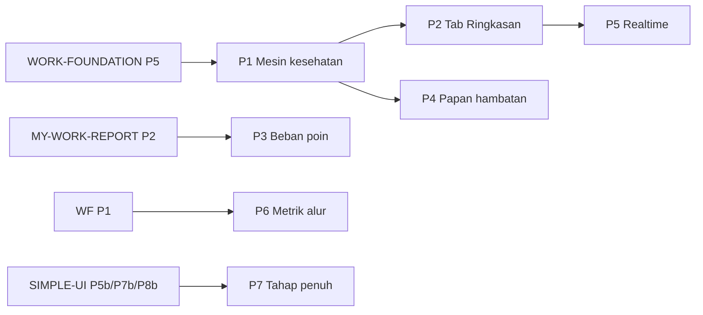

# LEADER-PIPELINE-HUB — Tahap 3: Breakdown (Phase → Task BE · FE · QA)

**Status:** Disetujui
**Gerbang:** G3 — disetujui oleh Owner; persetujuan ini sekaligus Approval Window berurutan untuk P1–P7
**Disetujui:** Owner melalui chat, 2026-11-17 — "Setuju G2 G3 semua (Recommended)" setelah merge PR #132
**PRD:** [product.md](product.md)
**Applicable Policy IDs:** AI-002, AI-009, AI-014, SDLC-001

## Aturan pemecahan

Mengikuti template; satu PR per phase. `LeaderHubPage.tsx` juga diubah oleh LEADER-SDLC-HUB (Codex);
P2 menunggu pekerjaan itu di-commit/merge atau dikoordinasikan.

## 1. Peta phase

| Phase | Tujuan                              | AC             | WRA  | Bergantung                     | Status                  |
| ----- | ----------------------------------- | -------------- | ---- | ------------------------------ | ----------------------- |
| P1    | Mesin kesehatan + tahap             | AC-1.1–AC-1.3  | 8/16 | WF P5                          | Kandidat lokal          |
| P2    | Tab Ringkasan                       | AC-2.1, AC-2.2 | 6/16 | P1; koordinasi LEADER-SDLC-HUB | Belum mulai             |
| P3    | Beban tim berbasis poin             | AC-3.1         | 7/16 | MWR P2                         | Belum mulai             |
| P4    | Papan hambatan + Ping PIC           | AC-4.1, AC-4.2 | 6/16 | P1                             | Kandidat lokal (AC-4.1) |
| P5    | Realtime                            | AC-5.1         | 6/16 | P2                             | Belum mulai             |
| P6    | Metrik alur + timeframe kualitas    | AC-6.1         | 6/16 | WF P1                          | Belum mulai             |
| P7    | Tahap Plan, Verif. Prod, Monitoring | AC-7.1         | 5/16 | SIMPLE-UI                      | Belum mulai             |

## 2. Task per phase

| Task ID | Layer | Pekerjaan                                                                 | File/path perkiraan                                                    | AC     | Bukti selesai           |
| ------- | ----- | ------------------------------------------------------------------------- | ---------------------------------------------------------------------- | ------ | ----------------------- |
| P1-BE-1 | BE    | Contract ringkasan Leader; service tahap + kesehatan dengan alasan        | `packages/contracts/src/leader.ts`, `modules/leader/leaderPipeline.ts` | AC-1.x | Integration per kondisi |
| P2-FE-1 | FE    | Tab Ringkasan memakai `organisms/leaderHub`; mapper contract → view-model | `LeaderHubPage.tsx`, `features/leader/`                                | AC-2.x | Component + E4          |
| P3-BE-1 | BE    | Ganti aturan beban; pakai mesin beban MY-WORK-REPORT                      | `leaderService.ts`                                                     | AC-3.1 | Integration             |
| P4-BE-1 | BE    | `POST …/blockers/:id/ping` dengan batas 1 jam                             | `modules/tasks/`                                                       | AC-4.1 | Integration             |
| P4-FE-1 | FE    | Aksi Ping PIC/Buka                                                        | `OpenBlockersPanel`                                                    | AC-4.x | Component               |
| P5-FE-1 | FE    | Berlangganan SSE per Workspace yang dipimpin                              | `features/leader/`                                                     | AC-5.1 | Integration/E2          |
| P6-BE-1 | BE    | Metrik alur; timeframe metrik kualitas                                    | `leaderService.ts`                                                     | AC-6.1 | Integration             |
| P7-BE-1 | BE    | Pemetaan tahap tambahan                                                   | `leaderPipeline.ts`                                                    | AC-7.1 | Integration             |
| P*-QA-1 | QA    | Test Case + UAT tiap phase                                                | —                                                                      | semua  | Test Result             |

WRA ringkas — P1: req 1 · lapisan 2 · data 1 · authz 1 · contract 1 · coupling 1 · validasi 1 · eksternal 0 = 8.

## 3. Risiko lintas phase

| Risiko                                                | Phase | Mitigasi / rollback                     |
| ----------------------------------------------------- | ----- | --------------------------------------- |
| Bentrok dengan pekerjaan Codex di `LeaderHubPage.tsx` | P2    | Tunggu commit Codex; PR terpisah        |
| Pemetaan tahap salah menandai Feature                 | P1    | Audit pemetaan pada data uji sebelum UI |
| Notifikasi berlebihan                                 | P4    | Batas 1 jam per hambatan                |

## 4. Stop condition yang sudah terlihat

| Phase | Stop condition                            | Kapan akan diminta |
| ----- | ----------------------------------------- | ------------------ |
| P2    | Pekerjaan LEADER-SDLC-HUB belum di-commit | Sebelum P2         |
| P4    | Notifikasi baru ke pengguna Production    | Saat merge         |
| P7    | SIMPLE-UI P5b/P7b/P8b belum selesai       | Ditunda otomatis   |
