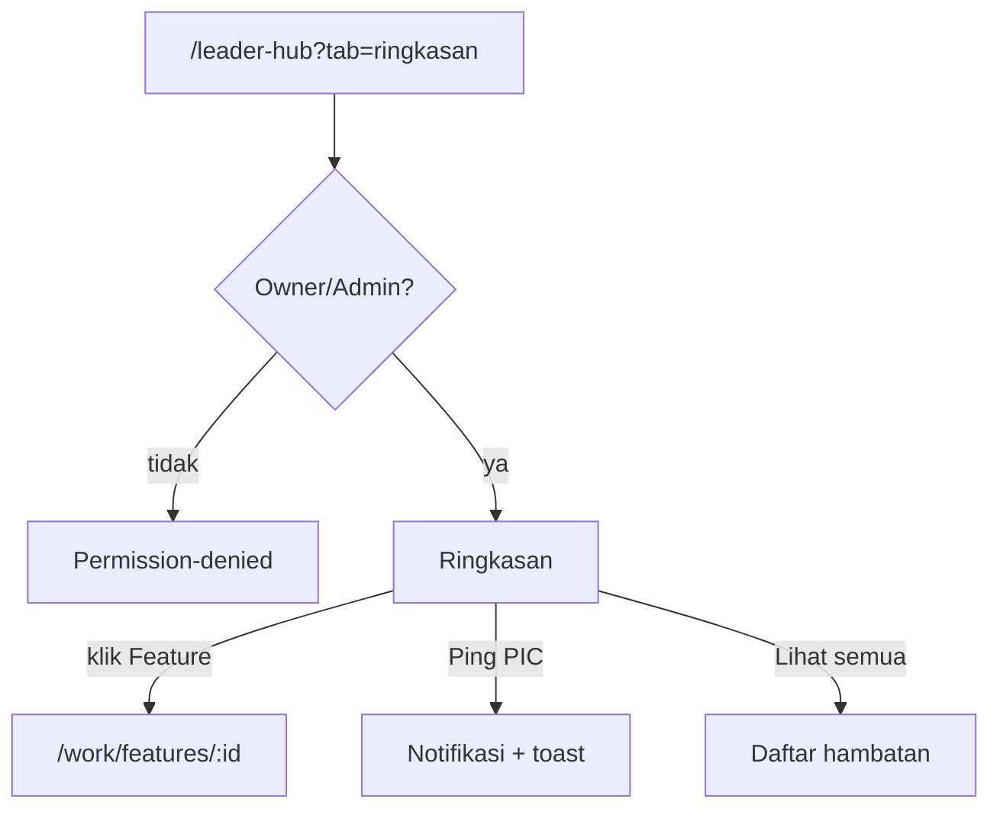

# LEADER-PIPELINE-HUB — Tahap 2: PRD (Product Requirements)

**Status:** Disetujui
**Gerbang:** G2 — disetujui oleh PO
**Disetujui:** Owner melalui chat, 2026-11-17 — "Setuju G2 G3 semua (Recommended)" setelah merge PR #132
**Solusi terpilih:** [solution.md](solution.md)
**Applicable Policy IDs:** DOC-005, UI-001, UI-002, AUTH-002, DATA-005

## 1. Tujuan dan pengguna

Owner/Admin melihat semua Feature aktif di Workspace yang ia pimpin. Metrik: [problem.md](problem.md) §5.

## 2. Requirement dan Acceptance Criteria

| Req ID | Requirement                         | AC ID  | Acceptance Criterion                                                                                                                  | Role        | Bukti minimum |
| ------ | ----------------------------------- | ------ | ------------------------------------------------------------------------------------------------------------------------------------- | ----------- | ------------- |
| REQ-1  | Mesin kesehatan + tahap             | AC-1.1 | Setiap Feature aktif punya tahap saat ini dan umur di tahap itu, diturunkan dari data yang ada; pemetaan tertulis di contracts.md     | Owner/Admin | E3            |
|        |                                     | AC-1.2 | Kesehatan Terhambat/Berisiko/Aman mengikuti ADR-045, satu test per kondisi, dan setiap status membawa alasan + rujukan (task/blocker) | Owner/Admin | E3            |
|        |                                     | AC-1.3 | Non Owner/Admin → 403; Workspace yang tidak dipimpin tidak muncul                                                                     | PO/Dev/QA   | E3            |
| REQ-2  | Tab Ringkasan                       | AC-2.1 | Tab Ringkasan menampilkan 6 kartu, pipeline 9 tahap, hambatan terbuka, beban tim, memakai komponen slice; angka kartu = jumlah baris  | Owner/Admin | E3 + E4       |
|        |                                     | AC-2.2 | Filter Workspace dan periode; state loading/empty/error/denied                                                                        | Owner/Admin | E2 + E4       |
| REQ-3  | Beban tim berbasis poin             | AC-3.1 | Aturan "≥3 subtask" diganti beban poin vs kapasitas (ADR-044) per spesialisasi dan per anggota                                        | Owner/Admin | E3            |
| REQ-4  | Papan hambatan + aksi               | AC-4.1 | Ping PIC mengirim satu notifikasi ke PIC dan tercatat; dibatasi 1 kali per jam per hambatan                                           | Owner/Admin | E3            |
|        |                                     | AC-4.2 | Buka mengarah ke detail Subtask/Feature; reassign/jadwal memakai endpoint yang ada                                                    | Owner/Admin | E2            |
| REQ-5  | Realtime                            | AC-5.1 | Ringkasan diperbarui saat event task/blocker di Workspace yang dipimpin, lewat SSE per Workspace                                      | Owner/Admin | E3            |
| REQ-6  | Metrik alur + kualitas              | AC-6.1 | Lead time, cycle time per tahap, throughput, % tepat waktu; metrik kualitas memakai timeframe                                         | Owner/Admin | E3            |
| REQ-7  | Tahap Plan, Verif. Prod, Monitoring | AC-7.1 | Tahap terisi dari data SIMPLE-UI P5/P7/P8; sebelum tersedia ditampilkan "belum dilacak", bukan dianggap selesai                       | Owner/Admin | E3            |

## 3. User flow

| Langkah | Layar / route               | Aksi user               | Respons sistem        | AC             |
| ------- | --------------------------- | ----------------------- | --------------------- | -------------- |
| 1       | `/leader-hub?tab=ringkasan` | Pilih Workspace/periode | Data dari backend     | AC-2.1, AC-2.2 |
| 2       | Pipeline                    | Arahkan ke titik tahap  | Tooltip tahap + umur  | AC-1.1         |
| 3       | Hambatan                    | Ping PIC / Buka         | Notifikasi / navigasi | AC-4.x         |

## 4. Wireframe per state

### Layar: Leader Hub — Ringkasan

| State                                       | Wireframe / link                                                 | Catatan        |
| ------------------------------------------- | ---------------------------------------------------------------- | -------------- |
| Default                                     | `docs/plans/work-visibility/design/02-leader-hub-ringkasan.webp` |                |
| Loading / Empty / Error / Permission-denied | Galeri Komponen › Leader Hub — Ringkasan (PR #130)               | sudah di-slice |
| Disabled                                    | Ping PIC nonaktif selama batas 1 jam, dengan alasan              |                |

| Breakpoint | Perbedaan layout                                   |
| ---------- | -------------------------------------------------- |
| Phone      | Satu kolom; tabel pipeline bergulir di dalam kartu |
| Tablet     | Kartu 3 kolom                                      |
