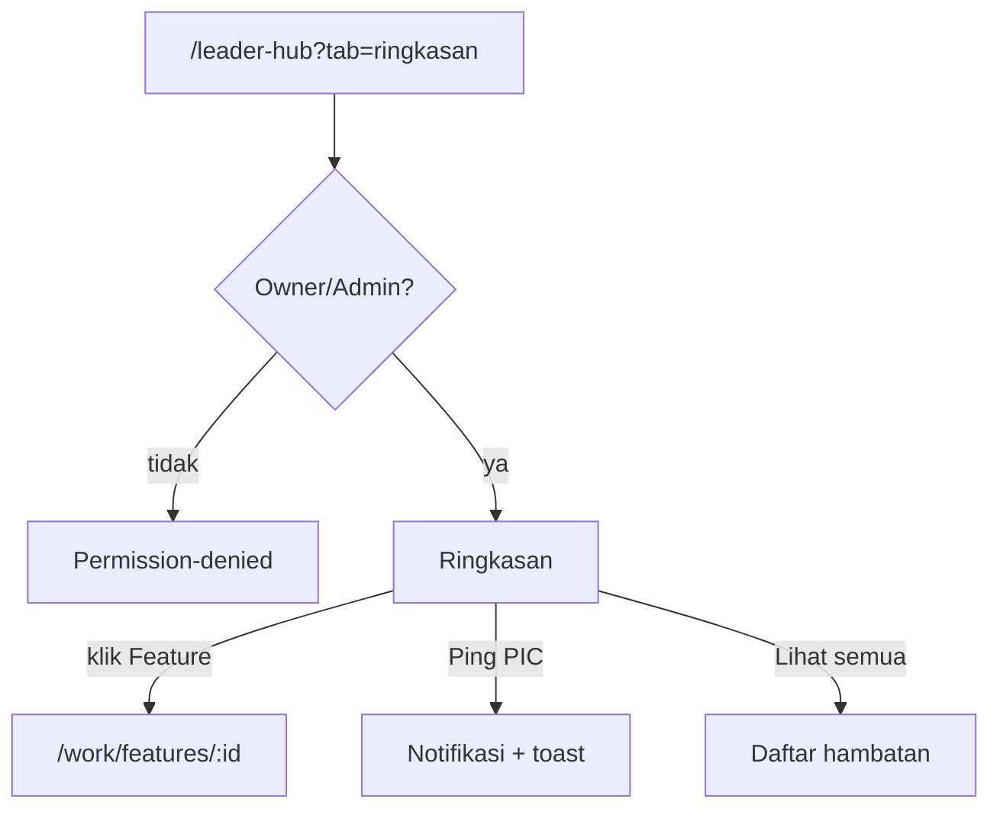

# LEADER-PIPELINE-HUB — Tahap 2: PRD (Product Requirements)

**Status:** Disetujui
**Gerbang:** G2 — disetujui oleh PO
**Disetujui:** Owner melalui chat, 2026-11-17 — "Setuju G2 G3 semua (Recommended)" setelah merge PR #132
**Tambahan 2026-11-19 (REQ-8–REQ-12, tab lain Leader Hub):** Draft — menunggu G2 (PO/Owner)
**Solusi terpilih:** [solution.md](solution.md)
**Applicable Policy IDs:** DOC-005, UI-001, UI-002, AUTH-002, DATA-005

## 1. Tujuan dan pengguna

Owner/Admin melihat semua Feature aktif di Workspace yang ia pimpin. Metrik: [problem.md](problem.md) §5.

## 2. Requirement dan Acceptance Criteria

| Req ID | Requirement                               | AC ID   | Acceptance Criterion                                                                                                                                                                                                                                                                                                               | Role        | Bukti minimum |
| ------ | ----------------------------------------- | ------- | ---------------------------------------------------------------------------------------------------------------------------------------------------------------------------------------------------------------------------------------------------------------------------------------------------------------------------------- | ----------- | ------------- |
| REQ-1  | Mesin kesehatan + tahap                   | AC-1.1  | Setiap Feature aktif punya tahap saat ini dan umur di tahap itu, diturunkan dari data yang ada; pemetaan tertulis di contracts.md                                                                                                                                                                                                  | Owner/Admin | E3            |
|        |                                           | AC-1.2  | Kesehatan Terhambat/Berisiko/Aman mengikuti ADR-045, satu test per kondisi, dan setiap status membawa alasan + rujukan (task/blocker)                                                                                                                                                                                              | Owner/Admin | E3            |
|        |                                           | AC-1.3  | Non Owner/Admin → 403; Workspace yang tidak dipimpin tidak muncul                                                                                                                                                                                                                                                                  | PO/Dev/QA   | E3            |
| REQ-2  | Tab Ringkasan                             | AC-2.1  | Tab Ringkasan menampilkan 6 kartu, pipeline 9 tahap, hambatan terbuka, beban tim, memakai komponen slice; angka kartu = jumlah baris                                                                                                                                                                                               | Owner/Admin | E3 + E4       |
|        |                                           | AC-2.2  | Filter Workspace dan periode; state loading/empty/error/denied                                                                                                                                                                                                                                                                     | Owner/Admin | E2 + E4       |
| REQ-3  | Beban tim berbasis poin                   | AC-3.1  | Aturan "≥3 subtask" diganti beban poin vs kapasitas (ADR-044) per spesialisasi dan per anggota                                                                                                                                                                                                                                     | Owner/Admin | E3            |
| REQ-4  | Papan hambatan + aksi                     | AC-4.1  | Ping PIC mengirim satu notifikasi ke PIC dan tercatat; dibatasi 1 kali per jam per hambatan                                                                                                                                                                                                                                        | Owner/Admin | E3            |
|        |                                           | AC-4.2  | Buka mengarah ke detail Subtask/Feature; reassign/jadwal memakai endpoint yang ada                                                                                                                                                                                                                                                 | Owner/Admin | E2            |
| REQ-5  | Realtime                                  | AC-5.1  | Ringkasan diperbarui saat event task/blocker di Workspace yang dipimpin, lewat SSE per Workspace                                                                                                                                                                                                                                   | Owner/Admin | E3            |
| REQ-6  | Metrik alur + kualitas                    | AC-6.1  | Lead time, cycle time per tahap, throughput, % tepat waktu; metrik kualitas memakai timeframe                                                                                                                                                                                                                                      | Owner/Admin | E3            |
| REQ-7  | Tahap Plan, Verif. Prod, Monitoring       | AC-7.1  | Tahap terisi dari data SIMPLE-UI P5/P7/P8; sebelum tersedia ditampilkan "belum dilacak", bukan dianggap selesai                                                                                                                                                                                                                    | Owner/Admin | E3            |
| REQ-8  | Tab Beban kerja (draft G2)                | AC-8.1  | Kartu beban per spesialisasi (FE/BE/Mobile/QA) dan tabel anggota × 4 minggu: persen poin effort vs kapasitas (ADR-044), cuti ditandai "Cuti"; filter spesialisasi dan jumlah minggu; "Lihat kerjaan" membuka daftar Subtask orang itu                                                                                              | Owner/Admin | E3 + E4       |
|        |                                           | AC-8.2  | Legenda Ringan (di bawah 40%), Seimbang (40–100%), Melebihi (di atas 100%) dibedakan juga oleh teks, bukan warna saja; Subtask tanpa effort disebut jumlahnya ("beban belum diukur"), tidak dihitung 0                                                                                                                             | Owner/Admin | E2            |
| REQ-9  | Tab Hambatan (draft G2)                   | AC-9.1  | Kartu: hambatan terbuka, lebih dari 3 hari, rata-rata umur, selesai 30 hari; tabel hambatan terbuka dengan filter kategori dan urutan (terlama/terbaru); aksi Ping PIC (batas 1 jam, AC-4.1) dan Buka                                                                                                                              | Owner/Admin | E3 + E4       |
|        |                                           | AC-9.2  | "Pola 30 hari terakhir": jumlah hambatan per kategori, tanpa peringkat per orang                                                                                                                                                                                                                                                   | Owner/Admin | E3            |
| REQ-10 | Tab Alur & Kualitas (draft G2)            | AC-10.1 | Satu pilihan periode (Minggu/Bulan/Kuartal/Semua) untuk metrik alur (AC-6.1) dan kualitas; kartu bug staging, bug production, defect escape, reopen, lulus sekali uji; grafik bug per minggu (staging vs production)                                                                                                               | Owner/Admin | E3 + E4       |
|        |                                           | AC-10.2 | Tabel kualitas per Feature (bug staging, production, reopen, tahap) menggantikan tabel per developer; tidak ada peringkat individu                                                                                                                                                                                                 | Owner/Admin | E3            |
| REQ-11 | Tab Laporan tim (draft G2)                | AC-11.1 | Mingguan/Bulanan dengan navigasi periode; kartu Feature dirilis, Subtask selesai (+ % tepat waktu), hambatan aktif, bug kritis/tinggi terbuka; bagian "Yang berjalan baik", "Yang terhambat", "Kapasitas minggu depan", "Perlu keputusan" disusun dari data backend, bisa diedit sebelum dibagikan                                 | Owner/Admin | E3 + E4       |
|        |                                           | AC-11.2 | "Salin teks" dan "Unduh PDF" (cetak browser). "Jadwalkan kirim" (email terjadwal) di luar scope ini — butuh job terjadwal dan izin Owner                                                                                                                                                                                           | Owner/Admin | E2            |
| REQ-12 | Detail Feature dari Leader Hub (draft G2) | AC-12.1 | `/leader-hub/features/:id`: 9 tahap dengan tanggal/umur, "Kenapa terhambat" bernomor dari alasan kesehatan (ADR-045), tabel Subtask (area, assignee, effort, jadwal, status, keterangan); tindakan Ping PIC / Ubah jadwal / Ganti assignee memakai endpoint yang ada dan tercatat di aktivitas; tanpa perubahan otomatis (ADR-024) | Owner/Admin | E3 + E4       |

## 3. User flow

| Langkah | Layar / route               | Aksi user               | Respons sistem        | AC             |
| ------- | --------------------------- | ----------------------- | --------------------- | -------------- |
| 1       | `/leader-hub?tab=ringkasan` | Pilih Workspace/periode | Data dari backend     | AC-2.1, AC-2.2 |
| 2       | Pipeline                    | Arahkan ke titik tahap  | Tooltip tahap + umur  | AC-1.1         |
| 3       | Hambatan                    | Ping PIC / Buka         | Notifikasi / navigasi | AC-4.x         |

## 4. Wireframe per state

### Layar: Leader Hub — Ringkasan

| State                                       | Wireframe / link                                                 | Catatan        |
| ------------------------------------------- | ---------------------------------------------------------------- | -------------- |
| Default                                     | `docs/plans/work-visibility/design/02-leader-hub-ringkasan.webp` |                |
| Loading / Empty / Error / Permission-denied | Galeri Komponen › Leader Hub — Ringkasan (PR #130)               | sudah di-slice |
| Disabled                                    | Ping PIC nonaktif selama batas 1 jam, dengan alasan              |                |

| Breakpoint | Perbedaan layout                                   |
| ---------- | -------------------------------------------------- |
| Phone      | Satu kolom; tabel pipeline bergulir di dalam kartu |
| Tablet     | Kartu 3 kolom                                      |

### Layar: Leader Hub — tab lain (tambahan 2026-11-19, draft G2)

| Layar                                       | Wireframe                                                              | Catatan                                                                 |
| ------------------------------------------- | ---------------------------------------------------------------------- | ----------------------------------------------------------------------- |
| Beban kerja                                 | `docs/plans/work-visibility/design/06-leader-hub-beban-kerja.webp`     | REQ-8                                                                   |
| Hambatan                                    | `docs/plans/work-visibility/design/07-leader-hub-hambatan.webp`        | REQ-9                                                                   |
| Alur & Kualitas                             | `docs/plans/work-visibility/design/08-leader-hub-alur-kualitas.webp`   | REQ-10; di gambar tab bernama "Kualitas", di aplikasi "Alur & Kualitas" |
| Laporan tim                                 | `docs/plans/work-visibility/design/09-leader-hub-laporan-berkala.webp` | REQ-11; di gambar "Laporan berkala"; tombol "Jadwalkan kirim" belum dibangun |
| Detail Feature                              | `docs/plans/work-visibility/design/10-leader-hub-detail-feature.webp`  | REQ-12                                                                  |
| Loading / Empty / Error / Permission-denied | ikut pola tab Ringkasan (`LeaderHubSummaryView`)                       | —                                                                       |

Tab "Bug & SLA" dihapus dari desain Leader Hub (UX-NAV-CLARITY, 2026-11-19); angka bug dan SLA nanti tampil di Alur & Kualitas setelah BUG-INTAKE-SLA lolos G0/G1. Nama tab di aplikasi sejak UX-NAV-CLARITY: Ikhtisar (dulu Ringkasan), Beban kerja, Hambatan, Alur & Kualitas, Laporan tim. Leader Hub hanya untuk membaca; tiap angka menautkan ke tempat kerjanya. Phone: pola sama dengan Ringkasan (satu kolom, tabel bergulir di dalam kartu).
