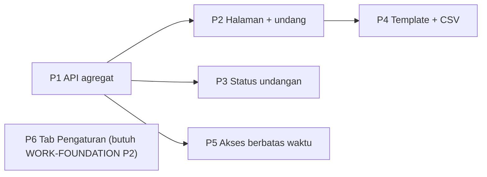

# MEMBER-ACCESS-HUB — Tahap 3: Breakdown (Phase → Task BE · FE · QA)

**Status:** Disetujui
**Gerbang:** G3 — disetujui oleh Owner; persetujuan ini sekaligus Approval Window berurutan untuk P1–P6
**Disetujui:** Owner melalui chat, 2026-11-17 — "Setuju G2 G3 semua (Recommended)" setelah merge PR #132
**PRD:** [product.md](product.md)
**Applicable Policy IDs:** AI-002, AI-009, AI-014, SDLC-001

## Aturan pemecahan

Mengikuti template; satu PR per phase; berhenti pada stop condition §4.

## 1. Peta phase

| Phase | Tujuan                          | AC             | WRA  | Bergantung         | Status         |
| ----- | ------------------------------- | -------------- | ---- | ------------------ | -------------- |
| P1    | API agregat akses               | AC-1.1, AC-1.2 | 6/16 | —                  | Di main (#136) |
| P2    | Halaman matriks + undang        | AC-2.1–AC-2.3  | 6/16 | P1                 | Di main (#146) |
| P3    | Kirim ulang / batalkan undangan | AC-3.1–AC-3.3  | 6/16 | P1                 | Kandidat lokal |
| P4    | Template role + CSV             | AC-4.1, AC-4.2 | 8/16 | P2                 | Belum mulai    |
| P5    | Akses berbatas waktu            | AC-5.1–AC-5.3  | 8/16 | P1                 | Belum mulai    |
| P6    | Tab Pengaturan Workspace        | AC-6.1         | 5/16 | WORK-FOUNDATION P2 | Belum mulai    |

## 2. Task per phase

| Task ID | Layer | Pekerjaan                                                                                | File/path perkiraan                                                          | AC             | Bukti selesai                |
| ------- | ----- | ---------------------------------------------------------------------------------------- | ---------------------------------------------------------------------------- | -------------- | ---------------------------- |
| P1-BE-1 | BE    | Contract `memberAccess.ts`; `GET /me/member-access` (Workspace yang dikelola aktor)      | `packages/contracts/src/memberAccess.ts`, `apps/api/src/modules/workspaces/` | AC-1.x         | Integration lintas Workspace |
| P2-FE-1 | FE    | Halaman `/members`, matriks, reuse `InviteMemberModal`, menu sidebar                     | `apps/web/src/pages/`, `Sidebar.tsx`                                         | AC-2.x         | Component + E4               |
| P3-BE-1 | BE    | Kirim ulang (rotasi token) dan batalkan                                                  | `workspaceMembership.ts`                                                     | AC-3.x         | Integration; email di-mock   |
| P3-FE-1 | FE    | Status dan aksi undangan                                                                 | halaman hub                                                                  | AC-3.1         | Component                    |
| P4-BE-1 | BE    | Tabel `member_role_templates`; import CSV transaksional dengan pratinjau                 | migrasi + modul                                                              | AC-4.x         | Integration                  |
| P4-FE-1 | FE    | Wizard template + CSV                                                                    | modal undang                                                                 | AC-4.x         | Component + E4               |
| P5-BE-1 | BE    | Migrasi `workspace_members.expires_at`; cek di middleware keanggotaan; job cron pencatat | `apps/api/src/http/middleware/`, `apps/api/src/modules/cron/`                | AC-5.1, AC-5.2 | Integration                  |
| P5-FE-1 | FE    | Tanggal berakhir di sel/undangan                                                         | hub                                                                          | AC-5.3         | Component                    |
| P6-FE-1 | FE    | Pengaturan Workspace menjadi tab                                                         | `WorkspaceSettingsPage.tsx`                                                  | AC-6.1         | Component + E4               |
| P*-QA-1 | QA    | Test Case + UAT tiap phase                                                               | —                                                                            | semua          | Test Result                  |

WRA ringkas — P1: req 1 · lapisan 2 · data 0 · authz 2 · contract 1 · coupling 0 · validasi 0 · eksternal 0 = 6. P4: req 1 · lapisan 2 · data 1 · authz 1 · contract 1 · coupling 1 · validasi 1 · eksternal 0 = 8. P5: req 1 · lapisan 2 · data 1 · authz 2 · contract 1 · coupling 0 · validasi 1 · eksternal 0 = 8.

## 3. Risiko lintas phase

| Risiko                                                       | Phase | Mitigasi / rollback                                 |
| ------------------------------------------------------------ | ----- | --------------------------------------------------- |
| Kebocoran keanggotaan Workspace yang tidak dikelola          | P1–P2 | Integration test per aktor; filter di backend       |
| Middleware keanggotaan menolak user aktif karena bug tanggal | P5    | Bandingkan dengan `now()` database; test zona waktu |
| Bentrok file Pengaturan dengan WORK-FOUNDATION P2/P4         | P6    | P6 dikerjakan setelah keduanya merge                |

## 4. Stop condition yang sudah terlihat

| Phase  | Stop condition                                         | Kapan akan diminta               |
| ------ | ------------------------------------------------------ | -------------------------------- |
| P4, P5 | PR berisi migrasi (Tier 2)                             | Saat PR                          |
| P5     | Perubahan middleware (Tier 2) dan amandemen `AUTH-001` | Saat PR                          |
| P5     | Menjadwalkan job di Supabase Cron Production           | Setelah merge, dengan izin Owner |
