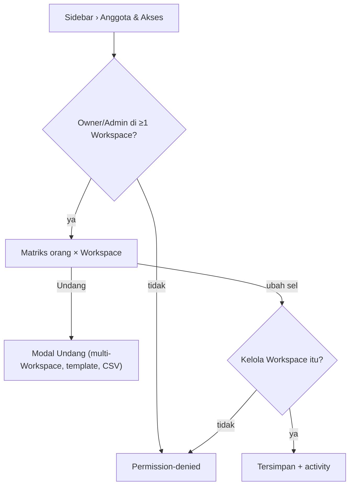

# MEMBER-ACCESS-HUB — Tahap 2: PRD (Product Requirements)

**Status:** Menunggu persetujuan
**Gerbang:** G2 — disetujui oleh PO
**Solusi terpilih:** [solution.md](solution.md)
**Applicable Policy IDs:** DOC-005, UI-001, UI-002, AUTH-001, AUTH-002

## 1. Tujuan dan pengguna

Owner/Admin mengelola akses lintas Workspace dari satu halaman. Metrik: [problem.md](problem.md) §5.

## 2. Requirement dan Acceptance Criteria

| Req ID | Requirement              | AC ID  | Acceptance Criterion                                                                                                                                                     | Role        | Bukti minimum                             |
| ------ | ------------------------ | ------ | ------------------------------------------------------------------------------------------------------------------------------------------------------------------------ | ----------- | ----------------------------------------- |
| REQ-1  | API agregat akses        | AC-1.1 | Given aktor Owner/Admin di Workspace A dan B (bukan C), When membuka hub, Then hanya keanggotaan A dan B yang terlihat                                                   | Owner/Admin | E3                                        |
|        |                          | AC-1.2 | Given aktor tanpa peran Owner/Admin di mana pun, Then 403                                                                                                                | PO/Dev/QA   | E3                                        |
| REQ-2  | Matriks + undang         | AC-2.1 | Matriks orang × Workspace dengan role dan spesialisasi; mengubah sel memanggil endpoint per Workspace yang ada                                                           | Owner/Admin | E3 + E4                                   |
|        |                          | AC-2.2 | Undang memakai ulang modal undangan; satu orang ke banyak Workspace                                                                                                      | Owner/Admin | E3                                        |
|        |                          | AC-2.3 | Mengubah sel di Workspace yang tidak dikelola aktor → 403; memberi role Owner tetap dibatasi                                                                             | Owner/Admin | E3                                        |
| REQ-3  | Status undangan          | AC-3.1 | Status Menunggu aktivasi / Aktif tampil per orang                                                                                                                        | Owner/Admin | E3                                        |
|        |                          | AC-3.2 | Kirim ulang membuat token baru dan token lama tidak berlaku                                                                                                              | Owner/Admin | E3 (email di-mock sebagai seam eksternal) |
|        |                          | AC-3.3 | Batalkan undangan menghapus keanggotaan yang belum aktif dan tercatat di activity                                                                                        | Owner/Admin | E3                                        |
| REQ-4  | Template role + CSV      | AC-4.1 | Template menyimpan set Workspace+role dan dapat dipakai saat undang                                                                                                      | Owner/Admin | E3                                        |
|        |                          | AC-4.2 | CSV (email, workspace, role, spesialisasi) menampilkan pratinjau validasi per baris; baris tidak valid tidak diproses; seluruh baris valid diproses dalam satu transaksi | Owner/Admin | E3                                        |
| REQ-5  | Akses berbatas waktu     | AC-5.1 | Keanggotaan dengan `expires_at` lewat → setiap request ke Workspace itu 401/403 seperti non-anggota                                                                      | semua       | E3                                        |
|        |                          | AC-5.2 | Job terjadwal mencatat activity "akses berakhir"; keamanan tidak bergantung pada job                                                                                     | sistem      | E3                                        |
|        |                          | AC-5.3 | UI menampilkan tanggal berakhir dan bisa memperpanjang/menghapusnya                                                                                                      | Owner/Admin | E2 + E4                                   |
| REQ-6  | Tab Pengaturan Workspace | AC-6.1 | Pengaturan menjadi tab: Umum, Kalender & Kapasitas, Anggota, Alur & Kebijakan, QA, Log Audit, Zona Bahaya; URL menyimpan tab aktif                                       | Owner/Admin | E2 + E4                                   |

## 3. User flow

| Langkah | Layar / route  | Aksi user                                                 | Respons sistem        | AC             |
| ------- | -------------- | --------------------------------------------------------- | --------------------- | -------------- |
| 1       | `/members`     | Buka hub                                                  | Matriks dengan filter | AC-1.1         |
| 2       | Modal Undang   | Isi email, pilih Workspace/role/template, atau unggah CSV | Pratinjau + simpan    | AC-2.2, AC-4.x |
| 3       | Sel matriks    | Ubah role / batas waktu                                   | Simpan per Workspace  | AC-2.1, AC-5.3 |
| 4       | Baris undangan | Kirim ulang / batalkan                                    | Token baru / dihapus  | AC-3.x         |

## 4. Wireframe per state

### Layar: Anggota & Akses — `/members`

| State             | Wireframe / link                                          | Catatan |
| ----------------- | --------------------------------------------------------- | ------- |
| Default           | `docs/plans/work-visibility/design/03-anggota-akses.webp` |         |
| Loading           | skeleton tabel                                            |         |
| Empty             | "Belum ada anggota lain" + Undang                         |         |
| Error             | Alert + Coba lagi                                         |         |
| Disabled          | sel Workspace yang tidak dikelola tampil hanya-baca       |         |
| Permission-denied | `AccessRestricted`                                        |         |

### Modal: Undang — `04-undang-anggota.webp`

| Breakpoint | Perbedaan layout                                              |
| ---------- | ------------------------------------------------------------- |
| Phone      | Matriks bergulir horizontal di dalam kartu; modal layar penuh |
| Tablet     | Kolom Workspace dapat digulir                                 |
