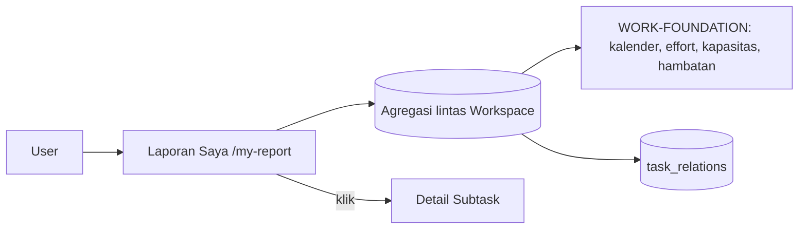

# MY-WORK-REPORT — Feature Overview

**Status:** Draft
**Owner:** Owner Qlick Hub
**Last reviewed:** 2026-11-17
**Applicable Policy IDs:** AUTH-001, AUTH-002, AUTH-011, AUTH-013, FLOW-007, DATA-001, DATA-005, CONTRACT-001, UI-001, TEST-001, SDLC-001

Laporan Saya: semua kerjaan user di semua Workspace, ketepatan waktu, beban harian, kewajaran waktu, dan irisan lintas Workspace.

## Stage Tracker

| Tahap             | Dokumen                                                                                | Status      | Gerbang         | Disetujui oleh / tanggal       | Catatan                                                             |
| ----------------- | -------------------------------------------------------------------------------------- | ----------- | --------------- | ------------------------------ | ------------------------------------------------------------------- |
| 0 Problem         | [problem.md](problem.md)                                                               | Disetujui   | G0              | Owner melalui chat, 2026-11-17 | Program WORK-VISIBILITY                                             |
| 1 Opsi Solusi     | [solution.md](solution.md)                                                             | Disetujui   | G1              | Owner melalui chat, 2026-11-17 | ADR: [ADR 044](../../adr/README.md), [ADR 047](../../adr/README.md) |
| 2 PRD             | [product.md](product.md)                                                               | Disetujui   | G2              | Owner melalui chat, 2026-11-17 |                                                                     |
| 3 Breakdown       | [breakdown.md](breakdown.md)                                                           | Disetujui   | G3              | Owner melalui chat, 2026-11-17 | Jalur: Penuh                                                        |
| (shared)          | [contracts.md](contracts.md) · [authorization.md](authorization.md) · [roles/](roles/) | Disetujui   | bagian G2       | Owner melalui chat, 2026-11-17 |                                                                     |
| 4 Build           | [phases/](phases/)                                                                     | Belum mulai | dalam window G3 | —                              | P1–P5                                                               |
| 5 Test & Review   | [testing.md](testing.md)                                                               | Belum mulai | G5              | —                              | Verifier: CI + review independen                                    |
| 6 Release & Close | [release.md](release.md)                                                               | Belum mulai | G6              | —                              |                                                                     |

Status tahap: `Belum mulai`, `Draft`, `Menunggu persetujuan`, `Disetujui`, `Blocked`, `Selesai`.

## 1. Tujuan dan Pengguna

Setiap anggota bisa menjawab "kerjaan saya mana yang telat atau berisiko di semua Workspace" dari satu halaman. Detail: [problem.md](problem.md) dan [solution.md](solution.md); program: [WORK_VISIBILITY_PROGRAM_PLAN](../../plans/WORK_VISIBILITY_PROGRAM_PLAN.md).

## 2. Requirement dan Acceptance Criteria

Requirement dan AC ber-ID ada di [product.md](product.md).

## 3. Alur Lintas Peran

| Pembaca       | Baca berikutnya                              | Output / handoff                                             |
| ------------- | -------------------------------------------- | ------------------------------------------------------------ |
| Owner / Admin | [roles/owner-admin.md](roles/owner-admin.md) | Laporan pribadi; tidak melihat laporan orang lain di sini    |
| PO            | [roles/po.md](roles/po.md)                   | Termasuk Feature yang ia laporkan; membuat relasi antar task |
| Developer     | [roles/developer.md](roles/developer.md)     | Laporan kerjaan sendiri                                      |
| QA            | [roles/qa.md](roles/qa.md)                   | Laporan kerjaan sendiri; bukti rekonsiliasi                  |

## 4. Data dan Relasi

Lihat [contracts.md](contracts.md).

## 5. API dan Shared Contract

Lihat [contracts.md](contracts.md); bentuk field mengikuti `packages/contracts`, tidak disalin di sini.

## 6. Authorization

Lihat [authorization.md](authorization.md).

## 7. UI dan Interaction States

Layar baru `/my-report` mengikuti desain `01-laporan-saya.webp`; komponen sudah di-slice di `apps/web/src/components/ui/organisms/myWorkReport/` (PR #131) dan tinggal disambungkan. Desain: [work-visibility/design](../../plans/work-visibility/design/README.md). User flow dan state per layar di [product.md](product.md) §3–§4.

## 8. Pengujian dan Evidence

Lihat [testing.md](testing.md); pembagian phase di [breakdown.md](breakdown.md).

## 9. Release dan Readiness

Lihat [release.md](release.md).

## 10. Traceability

`Problem → Solution/ADR → Requirement → AC → Phase → Task BE/FE/QA → contract/code → Test Result → Bug/retest → report → release decision`
