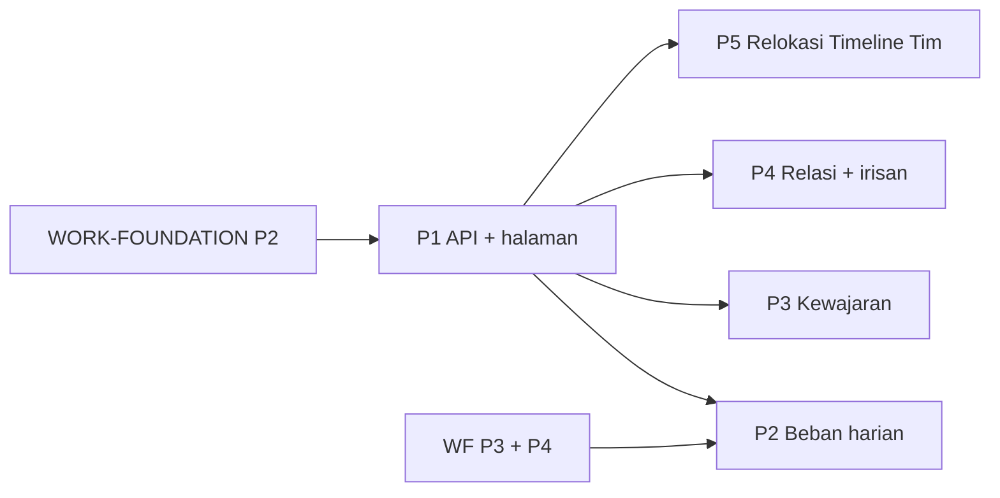

# MY-WORK-REPORT — Tahap 3: Breakdown (Phase → Task BE · FE · QA)

**Status:** Disetujui
**Gerbang:** G3 — disetujui oleh Owner; persetujuan ini sekaligus Approval Window berurutan untuk P1–P5
**Disetujui:** Owner melalui chat, 2026-11-17 — "Setuju G2 G3 semua (Recommended)" setelah merge PR #132
**PRD:** [product.md](product.md)
**Applicable Policy IDs:** AI-002, AI-009, AI-014, SDLC-001

## Aturan pemecahan

Mengikuti template; satu PR per phase; berhenti pada stop condition §4.

## 1. Peta phase

| Phase | Tujuan                                  | AC             | WRA  | Bergantung                                        | Status      |
| ----- | --------------------------------------- | -------------- | ---- | ------------------------------------------------- | ----------- |
| P1    | API + halaman 6 kategori + daftar + CSV | AC-1.1–AC-1.5  | 8/16 | WF P2 (kalender), WF P5 (hambatan untuk Berisiko) | Belum mulai |
| P2    | Beban harian lintas Workspace           | AC-2.1, AC-2.2 | 7/16 | P1, WF P3, WF P4                                  | Belum mulai |
| P3    | Kewajaran waktu                         | AC-3.1, AC-3.2 | 6/16 | P1, WF P1, WF P3                                  | Belum mulai |
| P4    | Relasi antar task + irisan + redaksi    | AC-4.1–AC-4.3  | 8/16 | P1                                                | Belum mulai |
| P5    | Relokasi Timeline Tim                   | AC-5.1         | 4/16 | P1; koordinasi UI-WORKSPACE-REFRESH               | Belum mulai |

## 2. Task per phase

| Task ID | Layer | Pekerjaan                                                                               | File/path perkiraan                                                                 | AC             | Bukti selesai                               |
| ------- | ----- | --------------------------------------------------------------------------------------- | ----------------------------------------------------------------------------------- | -------------- | ------------------------------------------- |
| P1-BE-1 | BE    | Contract `myWorkReport.ts`; `GET /v1/me/work-report` + CSV; kategori di backend         | `packages/contracts/src/myWorkReport.ts`, modul baru `apps/api/src/modules/myWork/` | AC-1.1–AC-1.4  | Integration seed 2+ Workspace, rekonsiliasi |
| P1-FE-1 | FE    | Halaman `/my-report` memakai komponen slice; mapper contract → view-model; menu sidebar | `apps/web/src/pages/MyWorkReportPage.tsx`, `organisms/myWorkReport/`                | AC-1.1, AC-1.5 | Component + E4                              |
| P2-BE-1 | BE    | Mesin beban harian (dipakai ulang LEADER-PIPELINE-HUB)                                  | `modules/myWork/workload.ts`                                                        | AC-2.x         | Integration angka manual                    |
| P2-FE-1 | FE    | Sambungkan `DailyLoadChart` + Lihat penyebab                                            | organism                                                                            | AC-2.1         | Component                                   |
| P3-BE-1 | BE    | Baseline median per effort per Workspace                                                | `modules/myWork/fairness.ts`                                                        | AC-3.1         | Integration                                 |
| P3-FE-1 | FE    | Kolom Kewajaran + saran di form Subtask                                                 | tabel, form                                                                         | AC-3.1         | Component                                   |
| P4-BE-1 | BE    | Migrasi `task_relations`; contract `taskRelation.ts`; CRUD Planner; redaksi             | migrasi, `modules/tasks/`                                                           | AC-4.1, AC-4.2 | Integration redaksi                         |
| P4-FE-1 | FE    | Panel relasi di detail Subtask; kartu Irisan                                            | `taskDetail/`, `CrossWorkspaceLinks`                                                | AC-4.3         | Component                                   |
| P5-FE-1 | FE    | Pindahkan Timeline Tim ke konteks Workspace                                             | `ReportPage.tsx`, `Sidebar.tsx`                                                     | AC-5.1         | Component + E4                              |
| P*-QA-1 | QA    | Test Case + UAT tiap phase                                                              | —                                                                                   | semua          | Test Result                                 |

WRA ringkas — P1: req 1 · lapisan 2 · data 1 · authz 1 · contract 1 · coupling 1 · validasi 1 · eksternal 0 = 8. P4: req 1 · lapisan 2 · data 1 · authz 2 · contract 1 · coupling 0 · validasi 1 · eksternal 0 = 8.

## 3. Risiko lintas phase

| Risiko                                                   | Phase  | Mitigasi / rollback                                                          |
| -------------------------------------------------------- | ------ | ---------------------------------------------------------------------------- |
| Query agregasi lambat untuk user dengan banyak Workspace | P1, P2 | Batasi periode (maks 90 hari), indeks, satu query per jenis data (tanpa N+1) |
| Bocor detail lintas Workspace                            | P4     | Test redaksi per pembaca                                                     |
| Bentrok navigasi dengan UI-WORKSPACE-REFRESH             | P1, P5 | Cek status Feature itu sebelum mulai                                         |

## 4. Stop condition yang sudah terlihat

| Phase | Stop condition                              | Kapan akan diminta          |
| ----- | ------------------------------------------- | --------------------------- |
| P4    | PR berisi migrasi `task_relations` (Tier 2) | Saat PR                     |
| P5    | Perubahan navigasi utama                    | Konfirmasi Owner sebelum PR |
