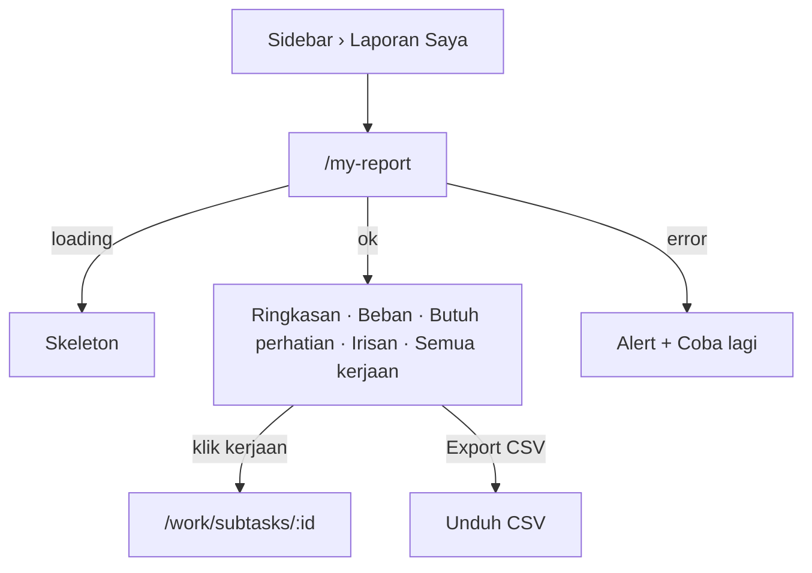

# MY-WORK-REPORT — Tahap 2: PRD (Product Requirements)

**Status:** Disetujui
**Gerbang:** G2 — disetujui oleh PO
**Disetujui:** Owner melalui chat, 2026-11-17 — "Setuju G2 G3 semua (Recommended)" setelah merge PR #132
**Solusi terpilih:** [solution.md](solution.md)
**Applicable Policy IDs:** DOC-005, UI-001, UI-002, AUTH-011, AUTH-013, DATA-005

## 1. Tujuan dan pengguna

Semua role melihat kerjaannya sendiri lintas Workspace. Metrik: [problem.md](problem.md) §5.

## 2. Requirement dan Acceptance Criteria

Kategori ketepatan (dihitung di backend dengan kalender Workspace task; `canceled` dikeluarkan):
Selesai tepat waktu (`done`, tanggal `completedAt` ≤ `dueDate`) · Selesai telat · Telat (belum selesai,
`dueDate` < hari ini) · Berisiko (belum telat dan: sisa ≤2 hari kerja dengan status `todo`, atau ≥70%
waktu terpakai dengan status `todo`, atau ada hambatan terbuka) · Sesuai jadwal · Tanpa jadwal.

| Req ID | Requirement           | AC ID  | Acceptance Criterion                                                                                                                                                                                         | Role  | Bukti minimum                        |
| ------ | --------------------- | ------ | ------------------------------------------------------------------------------------------------------------------------------------------------------------------------------------------------------------ | ----- | ------------------------------------ |
| REQ-1  | Ringkasan + daftar    | AC-1.1 | Given seed 2+ Workspace, When user membuka `/my-report`, Then semua Subtask dengan assignee = user (dan Feature yang ia laporkan untuk PO/Owner) dari Workspace aktifnya muncul, dikelompokkan ke 6 kategori | semua | E3                                   |
|        |                       | AC-1.2 | Jumlah di kartu = jumlah baris daftar per kategori                                                                                                                                                           | semua | E3 rekonsiliasi                      |
|        |                       | AC-1.3 | Kerjaan dari Workspace yang bukan keanggotaan aktif user tidak muncul                                                                                                                                        | semua | E3                                   |
|        |                       | AC-1.4 | Filter periode, Workspace, dan status; Export CSV berisi baris yang sama dengan daftar terfilter                                                                                                             | semua | E3 + E2                              |
|        |                       | AC-1.5 | State loading/empty/error dan phone/desktop sesuai desain                                                                                                                                                    | semua | E2 + E4                              |
| REQ-2  | Beban harian          | AC-2.1 | Beban per hari = Σ(poin ÷ hari kerja task) ÷ kapasitas harian (ADR-044); hari >100% ditandai Bentrok beserta task penyebab                                                                                   | semua | E3 dengan angka yang dihitung manual |
|        |                       | AC-2.2 | Subtask tanpa effort tampil sebagai "beban belum diukur", tidak dihitung sebagai 0 diam-diam                                                                                                                 | semua | E3                                   |
| REQ-3  | Kewajaran waktu       | AC-3.1 | Label per task: Terlalu ketat/Wajar/Longgar/Data belum cukup terhadap median Workspace (ADR-044 butir 5)                                                                                                     | semua | E3                                   |
|        |                       | AC-3.2 | Tidak ada angka atau label yang membandingkan orang                                                                                                                                                          | semua | E1 review                            |
| REQ-4  | Relasi + irisan       | AC-4.1 | Planner membuat relasi `blocks/relates_to/duplicates` antar task, termasuk lintas Workspace yang ia ikuti                                                                                                    | PO    | E3                                   |
|        |                       | AC-4.2 | Pembaca yang tidak boleh membaca task tujuan hanya melihat jenis relasi dan rentang tanggal                                                                                                                  | semua | E3 redaksi                           |
|        |                       | AC-4.3 | Kartu Irisan menampilkan bentrok jadwal, saling bergantung (mulai sebelum dependency selesai), dan terkait                                                                                                   | semua | E3 + E2                              |
| REQ-5  | Relokasi Timeline Tim | AC-5.1 | Timeline Tim tersedia di konteks Workspace; menu Laporan Saya global di sidebar                                                                                                                              | semua | E2 + E4                              |

## 3. User flow

| Langkah | Layar / route | Aksi user               | Respons sistem                 | AC             |
| ------- | ------------- | ----------------------- | ------------------------------ | -------------- |
| 1       | `/my-report`  | Pilih periode/Workspace | Data dihitung ulang di backend | AC-1.1, AC-1.4 |
| 2       | Kartu Bentrok | Lihat penyebab          | Daftar task penyebab           | AC-2.1         |
| 3       | Tabel         | Klik kerjaan            | Detail Subtask                 | AC-1.1         |

## 4. Wireframe per state

### Layar: Laporan Saya — `/my-report`

| State                                       | Wireframe / link                                         | Catatan        |
| ------------------------------------------- | -------------------------------------------------------- | -------------- |
| Default                                     | `docs/plans/work-visibility/design/01-laporan-saya.webp` |                |
| Loading / Empty / Error / Permission-denied | Galeri Komponen › Laporan Saya (PR #131)                 | sudah di-slice |
| Disabled                                    | Export CSV nonaktif saat tidak ada baris                 |                |

| Breakpoint | Perbedaan layout                                     |
| ---------- | ---------------------------------------------------- |
| Phone      | Satu kolom; grafik dan tabel bergulir di dalam kartu |
| Tablet     | Kartu ringkasan 3 kolom                              |
