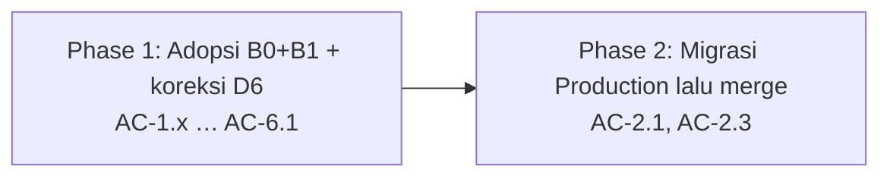

# QA-DESK-SIMPLIFY — Tahap 3: Breakdown (Phase → Task BE · FE · QA)

**Status:** Disetujui
**Gerbang:** G3 — disetujui oleh Owner; persetujuan ini sekaligus Approval Window untuk phase pertama
**PRD:** [product.md](product.md)
**Applicable Policy IDs:** AI-002, AI-009, AI-013, AI-014, SDLC-001

Kode B0/B1 sudah dibangun AGY (branch `feat/qa-desk-backend-b1`, di-rebase ke `main` `221fa0a`).
Breakdown ini mencatat apa yang diadopsi, koreksi yang masih harus dibuat, dan urutan rilis.

## 1. Peta phase

| Phase | Tujuan (hasil yang bisa dilihat user)                               | AC                          | WRA  | Bergantung pada | Status      |
| ----- | ------------------------------------------------------------------- | --------------------------- | ---- | --------------- | ----------- |
| P1    | Kode B0+B1 lolos CI dengan ADR-032, SSoT, dan koreksi backfill      | AC-1.1 … AC-6.1             | 8/16 | —               | Belum mulai |
| P2    | Migrasi 087/088 jalan di Production, lalu PR di-merge (auto-deploy) | AC-2.1, AC-2.3 (Production) | 6/16 | P1              | Belum mulai |

## 2. Task per phase

### Phase 1 — Adopsi B0+B1

| Task ID | Layer | Pekerjaan                                                                                       | File/path                                         | AC     | Bukti selesai                                                         |
| ------- | ----- | ----------------------------------------------------------------------------------------------- | ------------------------------------------------- | ------ | --------------------------------------------------------------------- |
| P1-BE-1 | BE    | Ambil 5 commit AGY apa adanya                                                                   | branch `feat/qa-desk-backend-b1`                  | semua  | Rebase bersih (sudah)                                                 |
| P1-BE-2 | DB    | Backfill 087: hapus fallback `document_owner_id`/`reporter_id`; lewati Feature tanpa penyetuju  | `apps/api/src/db/migrations/20261012000087-*.cjs` | AC-2.2 | Disiapkan di branch: migration test lulus 2/2; suite API 500/500 (E3) |
| P1-QA-1 | QA    | Jalankan suite integration API penuh + migration test pada PostgreSQL disposable                | —                                                 | semua  | Angka pass/fail persis (E3)                                           |
| P1-DOC  | Docs  | ADR-032 Accepted; docs/1, docs/2 §2/§5, FLOW-005, QA-001, Feature Card SDLC_QUALITY_AND_RELEASE | `docs/`                                           | —      | `docs:check` hijau                                                    |
| P1-FE   | FE    | N/A — UI di Feature terpisah; field kontrak baru opsional sehingga web lama tetap jalan         | —                                                 | —      | `web build` + vitest web hijau di CI                                  |

WRA Phase 1: requirement 1 · lapisan 1 · data 2 · authorization 2 · contract 1 · ketersinggungan 1 ·
validasi 0 · eksternal 0 = **8/16**

### Phase 2 — Rilis

| Task ID  | Layer | Pekerjaan                                                          | AC     | Bukti selesai                                                              |
| -------- | ----- | ------------------------------------------------------------------ | ------ | -------------------------------------------------------------------------- |
| P2-OPS-1 | Ops   | Query read-only Production: jumlah Feature yang akan di-backfill   | AC-2.1 | Selesai 2026-10-13: content_eligible 0, will_backfill 0 (dijalankan Owner) |
| P2-OPS-2 | Ops   | Owner: backup, jalankan 087 + 088 di Production, simpan log        | AC-2.1 | Log migrasi + `SequelizeMeta` (E4)                                         |
| P2-OPS-3 | Ops   | Merge PR (Tier 2, label `owner-approved` oleh Owner) → auto-deploy | —      | Deployment Production + smoke test (E4)                                    |

WRA Phase 2: data 2 · eksternal 2 · authorization 0 · lainnya 2 = **6/16**

## 3. Risiko lintas phase

| Risiko                                                             | Phase | Mitigasi / rollback                                               |
| ------------------------------------------------------------------ | ----- | ----------------------------------------------------------------- |
| Merge sebelum migrasi → kode baru tanpa trigger 088 (edit = 409)   | P2    | Migrasi wajib sebelum merge; checklist di PR                      |
| Backfill membuat baseline yang kemudian dipakai test cycle         | P2    | `down()` mempertahankan baseline terpakai; revert kode tetap aman |
| Baseline otomatis dipicu di dalam transaksi tulis Requirement/Task | P1    | Test B0 + suite penuh; perhatikan lock `FOR UPDATE` pada Feature  |

## 4. Stop condition yang sudah terlihat

| Phase | Stop condition                                 | Kapan akan diminta           |
| ----- | ---------------------------------------------- | ---------------------------- |
| P1    | Perubahan authorization `testManagementPolicy` | G3 (dokumen ini)             |
| P2    | Backfill + migrasi Production, merge Tier 2    | Setelah Tahap 5 P1 disetujui |
