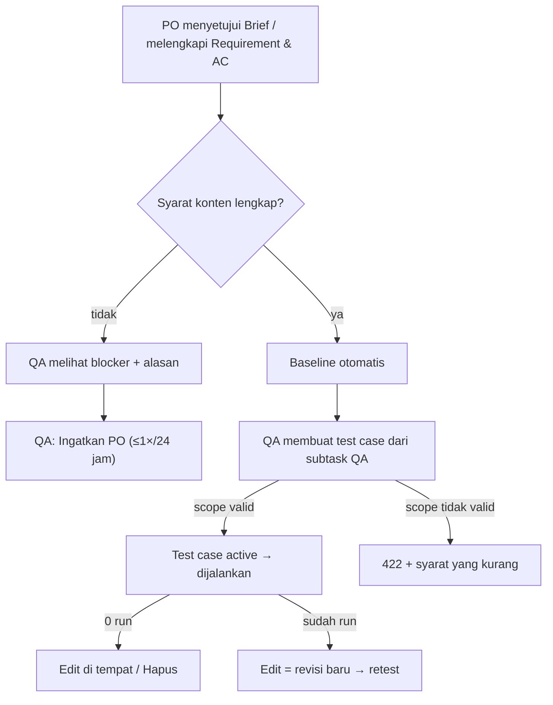

# QA-DESK-SIMPLIFY — Tahap 2: PRD (Product Requirements)

**Status:** Menunggu persetujuan
**Gerbang:** G2 — disetujui oleh PO
**Solusi terpilih:** [solution.md](solution.md)
**Applicable Policy IDs:** DOC-005, SDLC-001, FLOW-005, QA-001

> Feature ini hanya backend, DB, dan kontrak. Layar QA (drawer ringkas, 3 tab, bug inline) dikerjakan
> di Feature UI terpisah setelah ini; karena itu §4 tidak berisi wireframe.

## 1. Tujuan dan pengguna

QA dapat membuat, mengedit, menghapus, dan menjalankan test case di subtask QA miliknya tanpa
menunggu langkah administratif PO, dan baseline kesiapan Feature terbentuk sendiri ketika isinya
lengkap. Metrik: [problem.md](problem.md) §5.

## 2. Requirement dan Acceptance Criteria

| Req ID | Requirement                 | AC ID  | Acceptance Criterion (Given / When / Then)                                                                                                     | Role  | Bukti minimum (E-level)              |
| ------ | --------------------------- | ------ | ---------------------------------------------------------------------------------------------------------------------------------------------- | ----- | ------------------------------------ |
| REQ-1  | Baseline otomatis           | AC-1.1 | Given Brief disetujui, ≥1 Requirement aktif tertaut, semua punya AC aktif When syarat terakhir terpenuhi Then baseline `observation` terbentuk | PO    | E3 — integration test B0             |
|        |                             | AC-1.2 | Given syarat belum lengkap When QA membuka workflow summary Then blocker `feature_baseline_missing` + alasan spesifik berbahasa Indonesia      | QA    | E3 — integration test B0             |
|        |                             | AC-1.3 | Given test cycle aktif When baseline baru terbentuk Then cycle tetap memakai baseline lama dan `isBaselineSuperseded=true`                     | QA    | E3 — integration test B0             |
| REQ-2  | Backfill deterministik      | AC-2.1 | Given Feature memenuhi REQ-1 dan punya event `product_brief_approved` When migrasi 087 jalan Then satu baseline `backfilled`, idempoten        | Owner | E3 — migration test                  |
|        |                             | AC-2.2 | Given Feature tanpa event penyetuju When migrasi jalan Then tidak ada baseline (tanpa identitas tebakan)                                       | Owner | E3 — migration test (perlu ditambah) |
|        |                             | AC-2.3 | Given baseline backfill dipakai test cycle When `down()` Then baseline itu dipertahankan                                                       | Owner | E3 — migration test                  |
| REQ-3  | Test case QA langsung aktif | AC-3.1 | Given QA assignee + scope valid When membuat test case dengan `qaSubtaskId` Then status dan revisi `active`                                    | QA    | E3 — integration test D1             |
|        |                             | AC-3.2 | Given scope tidak valid When membuat/aktivasi Then 422 dengan syarat yang kurang, bukan 403                                                    | QA    | E3 — integration test D1             |
| REQ-4  | Hapus test case 0 run       | AC-4.1 | Given test case tanpa run When pembuat QA/PO menghapus Then 204, relasi terhapus, activity tercatat                                            | QA    | E3 — integration test D2             |
|        |                             | AC-4.2 | Given sudah ada run When menghapus Then 409; Given bukan pembuat/Dev Then 403                                                                  | QA    | E3 — integration test D2             |
| REQ-5  | Edit test case aktif        | AC-5.1 | Given versi aktif 0 run When QA dalam scope mengedit Then definisi berubah di tempat, author/publisher tetap                                   | QA    | E3 — integration test D5             |
|        |                             | AC-5.2 | Given versi sudah dijalankan When QA mengedit Then revisi baru; hasil lama tidak lagi memenuhi gate (`needsRetest`)                            | QA    | E3 — integration test D5             |
|        |                             | AC-5.3 | Given QA di luar scope / Dev When mengedit Then 422 / 403                                                                                      | Dev   | E3 — integration test D5             |
| REQ-6  | Ingatkan PO                 | AC-6.1 | Given baseline belum ada When QA klik Ingatkan PO Then notifikasi outbox ke PO; kedua kali dalam 24 jam → 429                                  | QA    | E3 — integration test remind-po      |

## 3. User flow

| Langkah | Layar / route                      | Aksi user           | Respons sistem                   | AC terkait     |
| ------- | ---------------------------------- | ------------------- | -------------------------------- | -------------- |
| 1       | Brief / Requirement (PO)           | Approve / tambah AC | Baseline otomatis                | AC-1.1         |
| 2       | Drawer QA (UI lama)                | Buka subtask QA     | Blocker + alasan atau versi uji  | AC-1.2, AC-6.1 |
| 3       | `POST /test-cases`                 | Buat test case      | `active` atau 422                | AC-3.1, AC-3.2 |
| 4       | `PATCH` / `DELETE /test-cases/:id` | Edit / hapus        | Di tempat, revisi baru, 204, 409 | AC-4.x, AC-5.x |

## 4. Wireframe per state

Tidak ada layar baru atau berubah di Feature ini. Wireframe ada di Feature UI lanjutan.

## 5. Data, contract, authorization

- Data & API: [contracts.md](contracts.md)
- Authorization matrix: [authorization.md](authorization.md)

## 6. Di luar scope

- Perubahan UI QA drawer (Prompt A, C).
- Peringatan "test case belum direview PO" di Keputusan Rilis (bagian D4) — menyusul bersama UI.
- Menjalankan migrasi di Production (stop condition terpisah).

## 7. Unknown yang tersisa

| Pertanyaan                                       | Memengaruhi AC | Status |
| ------------------------------------------------ | -------------- | ------ |
| Atribusi `established_by` backfill (D6)          | AC-2.1, AC-2.2 | Open   |
| Atribusi `established_by` baseline otomatis (D7) | AC-1.1         | Open   |
