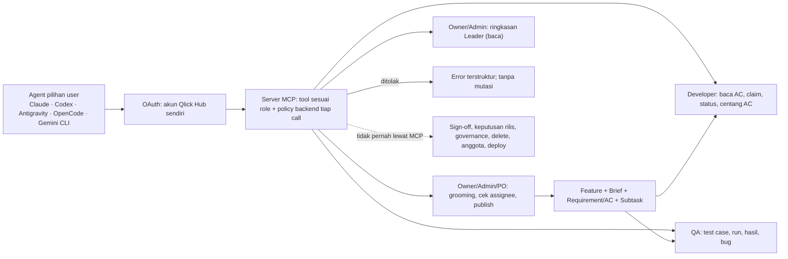

# QLICKHUB-PRODUCT-MCP — Agent pribadi untuk semua role Qlick Hub

**Status:** Draft
**Owner:** Reyand (Owner)
**Last reviewed:** 2026-11-18
**Applicable Policy IDs:** DOC-005, DOC-006, SDLC-001, SDLC-002, DOMAIN-002, DOMAIN-003, DOMAIN-004, AUTH-001, AUTH-002, AUTH-011, FLOW-007, AI-001, AI-006, AI-009, AI-013, DATA-001, CONTRACT-001, TEST-001

Rencana satu server MCP Qlick Hub yang dipakai dari agent pilihan setiap anggota (Claude, Codex,
Antigravity, OpenCode, Gemini CLI, dan client MCP lain). Setiap orang login dengan akunnya sendiri;
hak mengikuti role membership Workspace, bukan nama agent. Endpoint MCP, OAuth, dan tool di dokumen
ini adalah target; belum diimplementasikan. Dokumen tetap Draft: tidak ada gerbang G0–G3 yang
disetujui dan tidak ada policy yang diaktifkan.

Riwayat: v1 (2026-11-03) merancang grooming Owner/PO lalu publish. Pembaruan 2026-11-18 memperluas
rancangan ke semua role sesuai [rencana perluasan](../../plans/QLICKHUB_MCP_ALL_ROLES_PLAN.md);
Owner memilih seluruh rekomendasi K1–K8 serta opsi a untuk K9 dan K10 di [solution.md](solution.md).

## Stage Tracker

| Tahap             | Dokumen                                                                                | Status      | Gerbang         | Disetujui oleh / tanggal | Catatan                                         |
| ----------------- | -------------------------------------------------------------------------------------- | ----------- | --------------- | ------------------------ | ----------------------------------------------- |
| 0 Problem         | [problem.md](problem.md)                                                               | Draft       | G0              | —                        | Masalah per role                                |
| 1 Opsi Solusi     | [solution.md](solution.md)                                                             | Draft       | G1              | —                        | K1–K10 dipilih Owner; OAuth dan host terbuka    |
| 2 PRD             | [product.md](product.md)                                                               | Draft       | G2              | —                        | AC v1–v3 direncanakan                           |
| 3 Breakdown       | [breakdown.md](breakdown.md)                                                           | Draft       | G3              | —                        | Phase v1–v3; perlu pemecahan auth sebelum Build |
| (shared)          | [contracts.md](contracts.md) · [authorization.md](authorization.md) · [roles/](roles/) | Draft       | bagian G2       | —                        | Katalog tool dan matriks; bukan kontrak runtime |
| 4 Build           | [phases/](phases/)                                                                     | Belum mulai | dalam window G3 | —                        | Tidak diotorisasi                               |
| 5 Test & Review   | [testing.md](testing.md)                                                               | Belum mulai | G5              | —                        | Belum ada evidence MCP                          |
| 6 Release & Close | [release.md](release.md)                                                               | Belum mulai | G6              | —                        | Belum ada deploy                                |

## 1. Tujuan dan Pengguna

Anggota tim bekerja dari agent pilihannya tanpa menyalin ulang data ke dan dari aplikasi:
Owner/Admin/PO grooming lalu publish Feature serta memilih assignee dengan cek bentrok; Developer
membaca AC dan mengerjakan subtask; QA mencatat hasil uji dan bug; Owner/Admin membaca ringkasan
Leader. Rilis bertahap: v1 Planner, v2 baca untuk semua role, v3 tulis Dev/QA. Detail:
[problem.md](problem.md).

## 2. Requirement dan Acceptance Criteria

Lihat [product.md](product.md). AC adalah rancangan, bukan hasil uji.

## 3. Alur Lintas Peran

Jalur: [Owner/Admin](roles/owner-admin.md), [PO](roles/po.md), [Developer](roles/developer.md),
[QA](roles/qa.md), [Leader](roles/leader.md).

## 4. Data dan Relasi

Tidak ada tabel domain baru; tool memakai Task, Feature Spec, Requirement/AC, Bug, Test Case, blocker,
dan kapasitas yang sudah ada. Persistensi additive mungkin perlu untuk grant OAuth dan receipt
idempotensi publish. Lihat [contracts.md](contracts.md).

## 5. API dan Shared Contract

Katalog tool usulan v1–v3 dan pemetaan ke endpoint/service: [contracts.md](contracts.md).
Panduan koneksi yang direncanakan: [setup.md](setup.md).

## 6. Authorization

Lihat [authorization.md](authorization.md). OAuth tidak menggantikan membership Workspace dan
tidak ada tool yang memberi hak melebihi REST/UI.

## 7. UI dan Interaction States

Interaksi berlangsung di agent; tidak ada halaman produk baru. Login OAuth memakai browser.
State dan batas UI dijelaskan di [product.md](product.md).

## 8. Pengujian dan Evidence

[test plan](testing.md), [breakdown](breakdown.md), laporan
[v1 docs](../../reports/QLICKHUB_PRODUCT_MCP_DOCS_2026-11-03.md) dan
[perluasan semua role](../../reports/QLICKHUB_PRODUCT_MCP_ROLES_DOCS_2026-11-18.md).

## 9. Release dan Readiness

Lihat [release.md](release.md). Kompatibilitas client dan deployment masih unverified.

## 10. Traceability

Percakapan Owner → Problem → Solution/ADR usulan → REQ/AC → phase BE/FE/QA → kontrak/service →
PostgreSQL evidence + UAT client → keputusan rilis.
[Fondasi Feature Spec](../SIMPLE-UI-DELIVERY-FLOW/contracts.md) menunda MCP ke P9; Feature ini
menjadi tempat perencanaan P9 dan perluasannya, bukan implementasinya.
