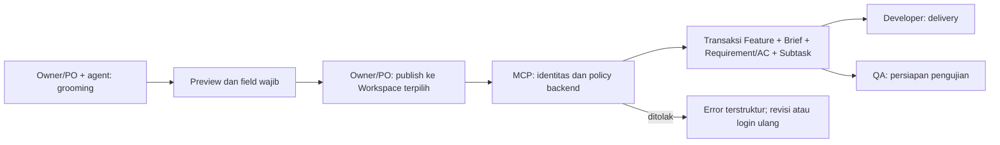

# QLICKHUB-PRODUCT-MCP — Grooming di agent, publish ke Qlick Hub

**Status:** Draft
**Owner:** Reyand (Owner)
**Last reviewed:** 2026-11-03
**Applicable Policy IDs:** DOC-005, DOC-006, SDLC-001, SDLC-002, DOMAIN-002, DOMAIN-003, DOMAIN-004, AUTH-001, AUTH-002, AI-001, AI-006, AI-009, DATA-001, CONTRACT-001, TEST-001

Rencana untuk Owner/PO grooming melalui agent pribadi, lalu publish hasil yang telah direview ke
Qlick Hub. Endpoint MCP, OAuth, dan tool di dokumen ini adalah target; belum diimplementasikan.
Permintaan user “update docnya” mengizinkan penyimpanan draft dokumentasi, bukan persetujuan G0–G3
atau aktivasi policy. Pilihan user: konfirmasi langsung di agent; tanpa approval code/link Qlick Hub.

## Stage Tracker

| Tahap             | Dokumen                                                                                | Status      | Gerbang         | Disetujui oleh / tanggal | Catatan                                         |
| ----------------- | -------------------------------------------------------------------------------------- | ----------- | --------------- | ------------------------ | ----------------------------------------------- |
| 0 Problem         | [problem.md](problem.md)                                                               | Draft       | G0              | —                        | Kebutuhan dari percakapan Owner                 |
| 1 Opsi Solusi     | [solution.md](solution.md)                                                             | Draft       | G1              | —                        | OAuth provider dan semantik Apply masih terbuka |
| 2 PRD             | [product.md](product.md)                                                               | Draft       | G2              | —                        | AC dan bukti direncanakan                       |
| 3 Breakdown       | [breakdown.md](breakdown.md)                                                           | Draft       | G3              | —                        | Penuh; perlu pemecahan auth sebelum Build       |
| (shared)          | [contracts.md](contracts.md) · [authorization.md](authorization.md) · [roles/](roles/) | Draft       | bagian G2       | —                        | Bukan kontrak runtime                           |
| 4 Build           | [phases/](phases/)                                                                     | Belum mulai | dalam window G3 | —                        | Tidak diotorisasi                               |
| 5 Test & Review   | [testing.md](testing.md)                                                               | Belum mulai | G5              | —                        | Belum ada evidence MCP                          |
| 6 Release & Close | [release.md](release.md)                                                               | Belum mulai | G6              | —                        | Belum ada deploy                                |

## 1. Tujuan dan Pengguna

Owner/Admin/PO menyelesaikan grooming di Codex, Claude, atau Antigravity, lalu membuat Feature
normal di Qlick Hub tanpa menyalin ulang hasil percakapan. Detail: [problem.md](problem.md).

## 2. Requirement dan Acceptance Criteria

Lihat [product.md](product.md). AC adalah rancangan, bukan hasil uji.

## 3. Alur Lintas Peran

Jalur: [Owner/Admin](roles/owner-admin.md), [PO](roles/po.md),
[Developer](roles/developer.md), [QA](roles/qa.md).

## 4. Data dan Relasi

Gunakan root Task dan relasi yang sudah ada; lihat [contracts.md](contracts.md).

## 5. API dan Shared Contract

Tool usulan dan pemetaan service: [contracts.md](contracts.md).
Panduan koneksi yang direncanakan: [setup.md](setup.md).

## 6. Authorization

Lihat [authorization.md](authorization.md). OAuth tidak menggantikan membership Workspace.

## 7. UI dan Interaction States

Grooming, preview, dan konfirmasi berlangsung dalam agent. Login OAuth tetap memakai browser.
State serta batas UI dijelaskan di [product.md](product.md).

## 8. Pengujian dan Evidence

[test plan](testing.md), [breakdown](breakdown.md), dan
[laporan pembaruan dokumentasi](../../reports/QLICKHUB_PRODUCT_MCP_DOCS_2026-11-03.md).

## 9. Release dan Readiness

Lihat [release.md](release.md). Kompatibilitas tiga client dan deployment masih unverified.

## 10. Traceability

Percakapan Owner → Problem → Solution/ADR usulan → REQ/AC → phase BE/FE/QA →
kontrak/service → PostgreSQL evidence + UAT → keputusan rilis.
[Fondasi Feature Spec](../SIMPLE-UI-DELIVERY-FLOW/contracts.md)
menunda MCP ke P9; Feature ini menjadi tempat perencanaan P9, bukan implementasinya.
