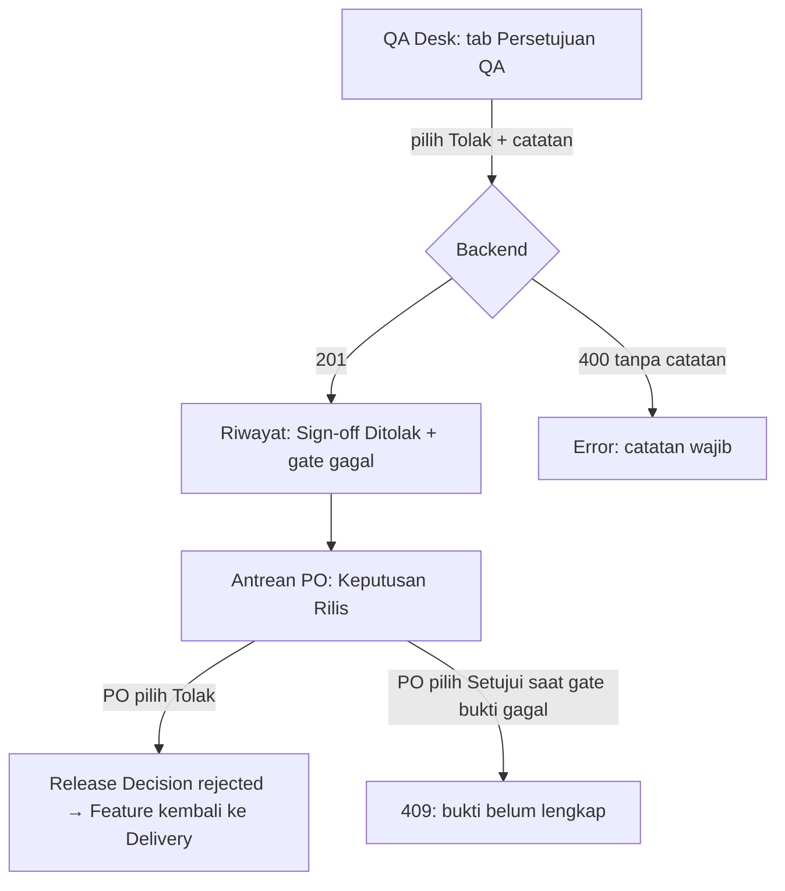

# RELEASE-DEADLOCK-A1-A2 — Tahap 2: PRD

**Status:** Disetujui
**Gerbang:** G2 — disetujui oleh PO
**Solusi terpilih:** [solution.md](solution.md) (A1 Opsi A, A2 Opsi A; D1–D3 disetujui Owner 2026-10-13)
**Applicable Policy IDs:** DOC-005, RELEASE-001, RELEASE-002, RELEASE-003, UI-001, UI-002, SDLC-001

## 1. Tujuan dan pengguna

QA dapat menolak rilis dengan alasan yang tercatat, PO dapat menutup siklus dengan keputusan rilis
`rejected`, dan gate yang dilihat PO memakai aturan bug yang sama dengan gate QA (K2).

## 2. Requirement dan Acceptance Criteria

| Req ID    | Requirement                                            | AC ID  | Acceptance Criterion                                                                                                                                                | Role | Bukti minimum                           |
| --------- | ------------------------------------------------------ | ------ | ------------------------------------------------------------------------------------------------------------------------------------------------------------------- | ---- | --------------------------------------- |
| REQ-A1-01 | QA dapat mencatat sign-off Tolak saat gate bukti gagal | AC-1.1 | Given QA Subtask `in_progress`, test gagal dan bug `open`; When QA assignee POST sign-off `rejected` dengan catatan; Then 201 dan snapshot memuat `failedGateCodes` | QA   | E3 — integration test write + read-back |
|           |                                                        | AC-1.2 | Given kondisi sama; When `rejected` tanpa catatan; Then 400                                                                                                         | QA   | E3                                      |
|           |                                                        | AC-1.3 | Given gate bukti gagal; When QA POST `approved`; Then tetap 409 (perilaku lama dipertahankan)                                                                       | QA   | E3                                      |
|           |                                                        | AC-1.4 | Given pengguna bukan QA assignee; When POST `rejected`; Then 403                                                                                                    | QA   | E3                                      |
| REQ-A1-02 | PO dapat menutup siklus atas sign-off yang ditolak     | AC-2.1 | Given sign-off `rejected` terbaru; When PO POST Release Decision `rejected`; Then 201 tanpa menjalankan gate bukti                                                  | PO   | E3                                      |
|           |                                                        | AC-2.2 | Given sign-off `rejected` dan gate bukti gagal; When PO POST `approved` + override; Then 409 (RELEASE-003)                                                          | PO   | E3                                      |
| REQ-A2-01 | Gate PO menghitung bug semua severity                  | AC-3.1 | Given satu bug `low` berstatus `open`; When readiness dievaluasi; Then gate `unverified_bugs` gagal                                                                 | PO   | E2 unit + E3 integration                |
|           |                                                        | AC-3.2 | Given snapshot lama berisi `critical_high_bugs`; When riwayat dibaca; Then tetap valid terhadap kontrak                                                             | PO   | E2 contract test                        |
|           |                                                        | AC-3.3 | Label UI menampilkan "Bug belum terverifikasi" untuk kode baru                                                                                                      | PO   | E2 component test                       |

## 3. User flow

| Langkah | Layar                        | Aksi                            | Respons                             | AC     |
| ------- | ---------------------------- | ------------------------------- | ----------------------------------- | ------ |
| 1       | QA Desk → Persetujuan QA     | Pilih Tolak, isi catatan, kirim | Sign-off tersimpan, badge "Ditolak" | AC-1.1 |
| 2       | Antrean PO → Keputusan Rilis | Pilih Tolak, kirim              | Release Decision tersimpan          | AC-2.1 |

## 4. Wireframe per state

Layar yang ada (`ReleaseAssurancePanel`) dipakai ulang; tidak ada layar baru.

| State                                          | Perubahan                                                                                                                                      |
| ---------------------------------------------- | ---------------------------------------------------------------------------------------------------------------------------------------------- |
| Default                                        | Pilihan "Tolak" tetap tersedia saat QA Subtask `in_progress` (perlu diverifikasi di build: form saat ini mungkin disembunyikan sebelum `done`) |
| Error                                          | Pesan 400/409 diterjemahkan ke bahasa Indonesia, bukan teks mentah                                                                             |
| Loading / Empty / Disabled / Permission-denied | Tidak berubah dari perilaku sekarang                                                                                                           |

## 5. Data, contract, authorization

- Kontrak: enum `ReadinessGate.code` bertambah `unverified_bugs` (additive). Lihat [contracts.md](contracts.md).
- Otorisasi tidak berubah: hanya QA assignee yang membuat sign-off, PO/Owner/Admin membuat Release Decision dengan pemisahan tugas. Lihat [authorization.md](authorization.md).

## 6. Di luar scope

Penggabungan QA selesai + sign-off (K4), perubahan gate bukti QA, baseline otomatis (K1).

## 7. Unknown yang tersisa

| Pertanyaan                                                                                                                        | Memengaruhi AC         | Status                      |
| --------------------------------------------------------------------------------------------------------------------------------- | ---------------------- | --------------------------- |
| Form sign-off nonaktif selama `blockers` QA tidak kosong — terjawab (E1, `ReleaseAssurancePanel.tsx` 315–322); diatasi di P1-FE-1 | AC-1.1                 | Terjawab                    |
| D1, D2, D3 di solution.md                                                                                                         | AC-1.1, AC-2.2, AC-3.1 | Terjawab (Owner 2026-10-13) |
