# SIMPLE-UI-DELIVERY-FLOW — Tahap 3: Breakdown (Phase → Task BE · FE · QA)

**Status:** Disetujui
**Disetujui:** Owner (Reyand), 2026-10-27, pesan "setuju" atas G3 dan Approval Window P1
**Gerbang:** G3 — disetujui oleh Owner; persetujuan ini sekaligus Approval Window untuk phase pertama (P1)
**PRD:** [product.md](product.md)
**Applicable Policy IDs:** AI-002, AI-009, AI-013, AI-014, SDLC-001, UI-001, UI-002, UI-003, UI-004, UI-005, AUTH-001, CONTRACT-001, DATA-001, TEST-001

## Aturan pemecahan

1. **Phase = vertical slice** yang bisa diuji sendiri terhadap AC (ADR-017). Slice di solution.md §3
   dipecah lagi sampai setiap phase WRA ≤ 8.
2. Setiap phase berisi task **BE**, **FE**, dan **QA** bila disentuh; lapisan yang tidak disentuh ditulis
   `N/A — alasan`.
3. Setiap AC dari PRD masuk ke tepat satu phase (boleh diuji ulang di phase berikutnya).
4. Phase berikutnya dimulai setelah phase sebelumnya `Accepted` di tahap 5, kecuali dependensinya
   dinyatakan bebas. Setiap phase memerlukan Approval Window sendiri.
5. **Batas lingkungan:** semua phase dikerjakan dan diuji lokal. Push branch dan PR boleh; **tidak ada
   merge ke `main`** dan tidak ada deploy Production (solution.md).
6. Branch phase bertumpuk di atas `docs/doc-portal-close` (PR #59) karena header 80px (P3.6) belum ada
   di `main`.

## 1. Peta phase

```mermaid
flowchart LR
    P1["P1 shell<br/>AC-1.1, 1.2"] --> P2a["P2a detail Feature<br/>AC-2.1, 2.2"] --> P2b["P2b redirect + kerja Dev<br/>AC-2.3, 2.4"]
    P2b --> P3a["P3a Test Case + run<br/>AC-3.1–3.3, 3.6"] --> P3b["P3b langkah + lingkungan<br/>AC-3.4"] --> P3c["P3c tindak lanjut gagal<br/>AC-3.5"]
    P2b --> P4a["P4a pesan serah-terima<br/>AC-4.2, 4.4"] --> P4b["P4b Tugas Saya Dev + QA<br/>AC-4.1, 4.3"] --> P4c["P4c Tugas Saya PO<br/>AC-4.1"] --> P4d["P4d riwayat<br/>AC-4.5"]
    P4d --> P5a1["P5a-1 data Plan<br/>AC-5.1, 5.5"] --> P5a2["P5a-2 pertanyaan AI v2<br/>AC-5.2"] --> P5a3["P5a-3 draft + Apply<br/>AC-5.3, 5.4"] --> P5b["P5b UI Plan→Apply<br/>AC-5.6"] --> P5c["P5c kolom Tahap<br/>AC-5.7"]
    P5c --> ADR["ADR rilis"] --> P7a["P7a data rilis<br/>AC-7.1"] --> P7b["P7b verifikasi + terima<br/>AC-7.2, 7.3"] --> P8a["P8a bug Production<br/>AC-8.1"] --> P8b["P8b pemantauan + tutup<br/>AC-8.2"]
```

| Phase | Tujuan yang terlihat user                                                                                                | AC                             | WRA  | Bergantung pada | Status                                                                                                              |
| ----- | ------------------------------------------------------------------------------------------------------------------------ | ------------------------------ | ---- | --------------- | ------------------------------------------------------------------------------------------------------------------- |
| P1    | Shell sederhana: Sidebar ringkas dengan pemilih workspace, 4 menu utama, menu Lainnya, folder, profil; header tipis      | AC-1.1, AC-1.2                 | 6/16 | PR #59          | Accepted (G5 Owner, 2026-10-27)                                                                                     |
| P2a   | Detail Feature sebagai halaman dengan stepper; 8 tab dipetakan ke tahap dan header                                       | AC-2.1, AC-2.2                 | 7/16 | P1              | Kandidat teruji — menunggu verifier G5                                                                              |
| P2b   | URL lama dialihkan; halaman detail kerjaan Developer dengan cek AC dan Kirim ke QA                                       | AC-2.3, AC-2.4                 | 6/16 | P2a             | Approval Window disiapkan ([PHASE-02b](phases/PHASE-02b.md))                                                        |
| P3a   | Halaman tambah dan jalankan Test Case; bukti wajib untuk Gagal/Terblokir; 403 non-QA                                     | AC-3.1, AC-3.2, AC-3.3, AC-3.6 | 7/16 | P2b             | Approval Window disiapkan ([PHASE-03a](phases/PHASE-03a.md))                                                        |
| P3b   | Centang per langkah dan browser/perangkat tersimpan bersama hasil                                                        | AC-3.4                         | 7/16 | P3a             | Kandidat teruji — menunggu UAT dan verifier G5 ([PHASE-03b](phases/PHASE-03b.md))                                   |
| P3c   | Hasil Gagal diteruskan ke Developer sebagai perbaikan atau bug                                                           | AC-3.5                         | 7/16 | P3a             | Kandidat teruji — menunggu verifier G5 ([PHASE-03c](phases/PHASE-03c.md))                                           |
| P3d   | Halaman kerjaan QA (desain 08) dan jalan masuk Persetujuan QA dari Tugas Saya                                            | AC-3.7, AC-3.8                 | 6/16 | P3a             | Kandidat teruji — menunggu verifier G5 ([PHASE-03d](phases/PHASE-03d.md))                                           |
| P3e   | Halaman kerja Bug (Developer dan QA), drawer Detail Bug dihapus, hasil retest memperbarui Bug                            | AC-3.9                         | 6/16 | P3c, P3d        | Kandidat teruji — menunggu UAT dan verifier G5 ([PHASE-03e](phases/PHASE-03e.md))                                   |
| P3f   | Buka kembali Bug yang sudah Terverifikasi (QA) dengan alasan wajib untuk Developer                                       | AC-3.10                        | 5/16 | P3e             | Accepted with gaps (G5, 2026-10-28): E2/E3 lulus; UAT siklus kedua masih terbuka ([PHASE-03f](phases/PHASE-03f.md)) |
| P4a   | Penanda serah-terima di komentar; pesan pengirim di antrean; balas langsung                                              | AC-4.2, AC-4.4                 | 8/16 | P2b             | Selesai — migrasi, tes, dan UAT Dev ↔ QA lolos ([PHASE-04a](phases/PHASE-04a.md))                                   |
| P4b   | Tugas Saya Developer dan QA dengan "Mulai dari sini" dan "Menunggu orang lain"                                           | AC-4.1, AC-4.3                 | 8/16 | P4a             | Selesai — tes dan UAT lokal lolos ([PHASE-04b](phases/PHASE-04b.md))                                                |
| P2c   | Centang AC Developer tersimpan di server per subtask (migrasi + endpoint baru)                                           | AC-2.11                        | 5/16 | P2b             | Kandidat teruji — migrasi dan UAT menunggu ([PHASE-02c](phases/PHASE-02c.md))                                       |
| P4c-1 | Persetujuan QA dipindah ke halaman kerja QA (langkah 1 pelepasan desk QA)                                                | AC-3.11                        | 3/16 | P3b             | Kandidat teruji — UAT menunggu ([PHASE-04c](phases/PHASE-04c.md))                                                   |
| P4c-2 | Impor spreadsheet Test Case di halaman kerja QA (langkah 2 pelepasan desk QA)                                            | AC-3.12                        | 2/16 | P2c             | Kandidat teruji — UAT menunggu ([PHASE-04c2](phases/PHASE-04c2.md))                                                 |
| P4c-3 | Impor Test Case dari tautan Google Sheets dan format sheet tim; cek Requirement per Feature                              | AC-3.13                        | 4/16 | P4c-2           | Kandidat teruji — UAT menunggu ([PHASE-04c3](phases/PHASE-04c3.md))                                                 |
| P4c-4 | Desk QA lama dilepas; Test Case draf bisa diaktifkan di halaman QA; status Dikerjakan otomatis                           | AC-3.14                        | 4/16 | P4c-3           | Kandidat teruji — UAT menunggu ([PHASE-04c4](phases/PHASE-04c4.md))                                                 |
| P4c-6 | Dua tahap QA: Siapkan Test Case (Developer belum selesai), lalu Uji; Lulus/Gagal dikunci di tahap Siapkan                | AC-3.15                        | 4/16 | P4c-4           | Kandidat teruji — UAT menunggu ([PHASE-04c4](phases/PHASE-04c4.md))                                                 |
| P4c-7 | Satu kartu "siap diuji" per Feature di antrean QA (ganti kartu Tinjau Subtask per subtask Developer)                     | AC-3.16                        | 4/16 | P4c-6           | Kandidat teruji — UAT menunggu ([PHASE-04c4](phases/PHASE-04c4.md))                                                 |
| P4c-8 | Tulis ulang e2e QA untuk halaman kerja QA (15 tes desk lama ditandai fixme di P4c-7)                                     | —                              | 4/16 | P4c-7           | Selesai; di `main` ([PR #74](https://github.com/oneilreyand/qlickhub/pull/74)); e2e lokal 12 lulus                  |
| P4c-9 | Tugas Saya PO: kartu "Mulai dari sini" dan grup "Menunggu orang lain" (menggantikan P4c-FE-1; desk lama sudah tidak ada) | AC-4.1, AC-4.3                 | 6/16 | P4b             | Selesai — tes dan UAT lokal lolos ([PHASE-04c9](phases/PHASE-04c9.md))                                              |
| P4d   | Panel riwayat serah-terima per Feature                                                                                   | AC-4.5                         | 8/16 | P4a             | Disetujui; sedang diimplementasikan ([PHASE-04d](phases/PHASE-04d.md))                                              |
| P5a-1 | Plan tersimpan: Feature dibuat dengan tahap Plan (tanpa AI)                                                              | AC-5.1, AC-5.5                 | 8/16 | P4d             | Belum mulai                                                                                                         |
| P5a-2 | Pertanyaan AI v2 (alasan, wajib/opsional, pilihan) tersimpan                                                             | AC-5.2                         | 8/16 | P5a-1           | Belum mulai                                                                                                         |
| P5a-3 | Draft berversi dan Apply dari draft dalam satu transaksi                                                                 | AC-5.3, AC-5.4                 | 8/16 | P5a-2           | Belum mulai                                                                                                         |
| P5b   | UI Plan → PRD → Task → Apply dengan syarat per tahap                                                                     | AC-5.6                         | 6/16 | P5a-3           | Belum mulai                                                                                                         |
| P5c   | Kolom Tahap di Task Hub                                                                                                  | AC-5.7                         | 7/16 | P5b             | Belum mulai                                                                                                         |
| P7a   | Data dan API catatan rilis, cek, penerimaan (setelah ADR rilis diterima)                                                 | AC-7.1                         | 8/16 | ADR rilis       | Belum mulai                                                                                                         |
| P7b   | Halaman verifikasi Production dan penerimaan user; tanda smoke di Test Case                                              | AC-7.2, AC-7.3                 | 7/16 | P7a             | Belum mulai                                                                                                         |
| P8a   | Bug Production dengan `source` dan `release_id`; gate readiness tidak berubah                                            | AC-8.1                         | 8/16 | P7b             | Belum mulai                                                                                                         |
| P8b   | Halaman pemantauan dan tutup rilis dengan syarat di backend                                                              | AC-8.2                         | 8/16 | P8a             | Belum mulai                                                                                                         |

## 2. Task per phase

### Phase 1 — Shell sederhana

| Task ID | Layer | Pekerjaan                                                                                                                                                                                             | File/path perkiraan                                        | AC             | Bukti selesai                                  | Assignee |
| ------- | ----- | ----------------------------------------------------------------------------------------------------------------------------------------------------------------------------------------------------- | ---------------------------------------------------------- | -------------- | ---------------------------------------------- | -------- |
| P1-FE-1 | FE    | Pindahkan pemilih workspace dari Header ke atas Sidebar (komponen ringkas); hapus kartu info workspace                                                                                                | `apps/web/src/components/layout/Sidebar.tsx`, `Header.tsx` | AC-1.1         | Unit test Sidebar/Header (E2)                  | Claude   |
| P1-FE-2 | FE    | Menu utama tetap 4 (Ringkasan, Task Hub, Tugas Saya, Laporan); Leader Hub, Panduan, Pengaturan Workspace, Galeri Komponen dikelompokkan di bagian "Lainnya" dengan aturan visibilitas peran yang sama | `Sidebar.tsx`, `__tests__/Sidebar.test.tsx`                | AC-1.1         | Test visibilitas per peran tetap lulus (E2)    | Claude   |
| P1-FE-3 | FE    | Header tipis: breadcrumb, pencarian, aksi utama halaman, tema, notifikasi, profil; tinggi tetap 80px                                                                                                  | `Header.tsx`, `AppLayout.tsx`                              | AC-1.1         | Unit test Header (E2)                          | Claude   |
| P1-FE-4 | FE    | <1024px: Sidebar sebagai menu yang dibuka-tutup (pakai drawer mobile yang ada); konten tidak tertutup                                                                                                 | `AppLayout.tsx`                                            | AC-1.2         | UAT 390 dan 768 (E4 lokal)                     | Claude   |
| P1-BE   | BE    | N/A — tidak ada endpoint, data, kontrak, atau policy baru                                                                                                                                             | —                                                          | —              | —                                              | —        |
| P1-QA-1 | QA    | UAT lokal Light/Dark di 1440, 1024, 768, 390 per peran yang tersedia; bandingkan dengan `design/01-task-hub*.png`                                                                                     | —                                                          | AC-1.1, AC-1.2 | Catatan UAT + screenshot di laporan (E4 lokal) | QA       |

WRA P1: requirement 1 · lapisan 1 · data 0 · authorization 0 · contract 0 · ketersinggungan 2 · validasi 2 · eksternal 0 = **6/16**

### Phase 2a — Detail Feature sebagai halaman

| Task ID  | Layer | Pekerjaan                                                                                                                                              | File/path perkiraan                               | AC             | Bukti selesai                        |
| -------- | ----- | ------------------------------------------------------------------------------------------------------------------------------------------------------ | ------------------------------------------------- | -------------- | ------------------------------------ |
| P2a-FE-1 | FE    | Route halaman detail Feature dan `FeatureStageStepper` (tahap sementara dihitung dari data yang ada: ada brief/requirement → PRD, ada subtask → Task)  | `apps/web/src/pages/`, `components/ui/molecules/` | AC-2.1         | Component test (E2)                  |
| P2a-FE-2 | FE    | Pecah tab `taskDetail/*` ke bagian Plan (Diskusi), PRD (Brief + Requirement + AC), Task (detail + subtask); Aktivitas, Bug, Jejak Delivery dari header | `organisms/taskDetail/*`, `TaskDetailDrawer.tsx`  | AC-2.2         | Test pemetaan konten (E2) + UAT (E4) |
| P2a-BE   | BE    | N/A — memakai endpoint task/brief/requirement yang ada                                                                                                 | —                                                 | —              | —                                    |
| P2a-QA   | QA    | UAT tiga viewport, Light/Dark; tidak ada data yang hilang dibanding drawer lama                                                                        | —                                                 | AC-2.1, AC-2.2 | E4 lokal                             |

WRA P2a: requirement 1 · lapisan 1 · data 0 · authorization 1 · contract 0 · ketersinggungan 2 · validasi 2 · eksternal 0 = **7/16**

### Phase 2b — Redirect dan detail kerjaan Developer

| Task ID  | Layer | Pekerjaan                                                                                                       | File/path perkiraan                                         | AC             | Bukti selesai                |
| -------- | ----- | --------------------------------------------------------------------------------------------------------------- | ----------------------------------------------------------- | -------------- | ---------------------------- |
| P2b-FE-1 | FE    | Alihkan `?taskId=`, `workQueueRoute`, dan `/projects/:projectId/tasks/:taskId` ke halaman baru                  | `lib/utils/workQueueRoute.ts`, `pages/TaskDeepLinkPage.tsx` | AC-2.3         | Test per pola URL (E2)       |
| P2b-FE-2 | FE    | Halaman detail kerjaan Developer: yang dikerjakan, AC sebagai cek mandiri (state UI saja), diskusi, Kirim ke QA | `pages/`, `organisms/myTasks/`                              | AC-2.4         | Component test + UAT (E2/E4) |
| P2b-BE   | BE    | N/A — transisi status yang ada                                                                                  | —                                                           | —              | —                            |
| P2b-QA   | QA    | UAT Developer lokal                                                                                             | —                                                           | AC-2.3, AC-2.4 | E4 lokal                     |

WRA P2b: requirement 1 · lapisan 1 · data 0 · authorization 1 · contract 0 · ketersinggungan 1 · validasi 2 · eksternal 0 = **6/16**

### Phase 3a — Tambah dan jalankan Test Case

| Task ID  | Layer | Pekerjaan                                                                                                                | File/path perkiraan                                        | AC                    | Bukti selesai                      |
| -------- | ----- | ------------------------------------------------------------------------------------------------------------------------ | ---------------------------------------------------------- | --------------------- | ---------------------------------- |
| P3a-BE-1 | BE    | Verifikasi bahwa penyimpanan hasil Gagal/Terblokir tanpa hasil aktual atau bukti ditolak; bila belum, tambahkan validasi | `modules/testManagement/`                                  | AC-3.2                | Integration test tolak + izin (E3) |
| P3a-BE-2 | BE    | Test 403 non-QA untuk run dan hasil (policy yang ada)                                                                    | `policies/__tests__/`, `modules/testManagement/__tests__/` | AC-3.6                | E3                                 |
| P3a-FE-1 | FE    | Halaman tambah Test Case (pakai ulang field `TestCaseFormModal`) dengan pilihan AC                                       | `pages/`, `organisms/`                                     | AC-3.1                | Component test + E3 read-back      |
| P3a-FE-2 | FE    | Halaman jalankan Test Case: cara uji, hasil, bukti gambar/dokumen/tautan, bukti susulan setelah dikunci                  | `pages/`, `organisms/`                                     | AC-3.2, AC-3.3        | Component test + UAT               |
| P3a-QA   | QA    | UAT QA lokal termasuk bukti susulan                                                                                      | —                                                          | AC-3.1–AC-3.3, AC-3.6 | E4 lokal                           |

WRA P3a: requirement 1 · lapisan 2 · data 0 · authorization 1 · contract 0 · ketersinggungan 1 · validasi 2 · eksternal 0 = **7/16**

### Phase 3b — Status per langkah dan lingkungan

| Task ID  | Layer | Pekerjaan                                                                                                   | File/path perkiraan                                                       | AC     | Bukti selesai                  |
| -------- | ----- | ----------------------------------------------------------------------------------------------------------- | ------------------------------------------------------------------------- | ------ | ------------------------------ |
| P3b-BE-1 | BE    | Migrasi aditif `test_results.step_results`, `test_results.browser`, `test_results.device`; kontrak opsional | `apps/api/src/db/migrations/`, `packages/contracts/src/testManagement.ts` | AC-3.4 | Clean migrate + read-back (E3) |
| P3b-FE-1 | FE    | Centang per langkah dan pilihan browser/perangkat/build                                                     | halaman run                                                               | AC-3.4 | Component test                 |
| P3b-QA   | QA    | UAT run dengan lingkungan                                                                                   | —                                                                         | AC-3.4 | E4 lokal                       |

WRA P3b: requirement 1 · lapisan 2 · data 1 · authorization 0 · contract 1 · ketersinggungan 0 · validasi 2 · eksternal 0 = **7/16**

### Phase 3c — Tindak lanjut hasil gagal

| Task ID  | Layer | Pekerjaan                                                                                                      | File/path perkiraan                                     | AC     | Bukti selesai                 |
| -------- | ----- | -------------------------------------------------------------------------------------------------------------- | ------------------------------------------------------- | ------ | ----------------------------- |
| P3c-BE-1 | BE    | Pakai `changes_requested` (review notes) dan pembuatan bug yang ada; pastikan item muncul di antrean Developer | `modules/tasks/`, `modules/bugs/`, `modules/workQueue/` | AC-3.5 | Integration test antrean (E3) |
| P3c-FE-1 | FE    | Panel "Kirim balik" dengan catatan langkah terisi otomatis                                                     | halaman detail kerjaan QA                               | AC-3.5 | Component test + UAT          |
| P3c-QA   | QA    | UAT QA → Developer                                                                                             | —                                                       | AC-3.5 | E4 lokal                      |

WRA P3c: requirement 1 · lapisan 2 · data 0 · authorization 1 · contract 0 · ketersinggungan 1 · validasi 2 · eksternal 0 = **7/16**

### Phase 4a — Pesan serah-terima

| Task ID  | Layer | Pekerjaan                                                                                                                         | File/path perkiraan                                                                         | AC             | Bukti selesai               |
| -------- | ----- | --------------------------------------------------------------------------------------------------------------------------------- | ------------------------------------------------------------------------------------------- | -------------- | --------------------------- |
| P4a-BE-1 | BE    | Migrasi `task_comments.handoff_kind`; aksi serah-terima menulis komentar bertanda; antrean menyertakan `sender` dan `lastMessage` | `modules/tasks/`, `modules/workQueue/`, `packages/contracts/src/comment.ts`, `workQueue.ts` | AC-4.2, AC-4.4 | E3 tulis/baca + query count |
| P4a-FE-1 | FE    | Pesan pengirim di item antrean dan balas langsung                                                                                 | `organisms/myTasks/`                                                                        | AC-4.2, AC-4.4 | Component test              |
| P4a-QA   | QA    | UAT balas dua arah Dev ↔ QA                                                                                                       | —                                                                                           | AC-4.2, AC-4.4 | E4 lokal                    |

WRA P4a: requirement 1 · lapisan 2 · data 1 · authorization 0 · contract 1 · ketersinggungan 1 · validasi 2 · eksternal 0 = **8/16**

### Phase 4b, 4c, 4d — Tugas Saya per peran dan riwayat

| Task ID  | Layer | Pekerjaan                                                                                                     | AC             | Bukti selesai                 |
| -------- | ----- | ------------------------------------------------------------------------------------------------------------- | -------------- | ----------------------------- |
| P4b-BE-1 | BE    | Bucket `waiting_on_others` per peran (kontrak aditif)                                                         | AC-4.3         | E3 per peran                  |
| P4b-FE-1 | FE    | Kartu "Mulai dari sini" dan grup "Menunggu orang lain" Developer dan QA (tanpa feature flag; lihat PHASE-04b) | AC-4.1, AC-4.3 | Component test + E4 per peran |
| P4c-FE-1 | FE    | Halaman Tugas Saya PO; lepas `DevWorkingDesk`, `QaTestingDesk`, `PoTeamICardGrid` per peran setelah E4        | AC-4.1         | E4 per peran + regresi e2e QA |
| P4d-BE-1 | BE    | Endpoint riwayat serah-terima per Feature dengan paginasi                                                     | AC-4.5         | E3 + query count              |
| P4d-FE-1 | FE    | `HandoffTimeline` di Tugas Saya dan detail Feature                                                            | AC-4.5         | Component test + E4           |

WRA P4b: 1 · 2 · 0 · 1 · 1 · 1 · 2 · 0 = **8/16**; P4c: 1 · 1 · 0 · 1 · 0 · 2 · 2 · 0 = **7/16**;
P4d: 1 · 2 · 0 · 1 · 1 · 1 · 2 · 0 = **8/16**

### Phase 5a-1 sampai 5c — Plan dengan AI sampai kolom Tahap

| Task ID   | Layer | Pekerjaan                                                                                                  | AC             | Bukti selesai                                           |
| --------- | ----- | ---------------------------------------------------------------------------------------------------------- | -------------- | ------------------------------------------------------- |
| P5a1-BE-1 | BE    | Migrasi `feature_plans`; Feature dibuat saat Plan; `featurePlanPolicy`; kontrak `featurePlan.ts`           | AC-5.1, AC-5.5 | E3 izin PO + 403 Dev/QA                                 |
| P5a2-BE-1 | BE    | `feature_plan_questions`; skema klarifikasi v2 berdampingan v1; prompt Gemini; rate limit endpoint AI      | AC-5.2         | E3 dengan klien AI tiruan; satu UAT dengan Gemini lokal |
| P5a3-BE-1 | BE    | `feature_drafts` berversi (409 pada versi lama); `applyDraft` membaca draft versi N; fingerprint idempoten | AC-5.3, AC-5.4 | E3 transaksi gagal sebagian = nol data                  |
| P5b-FE-1  | FE    | Halaman Plan, PRD, Task, Apply dengan syarat per tahap                                                     | AC-5.6         | Component test + E4 PO                                  |
| P5c-FE-1  | FE    | Kolom Tahap di Task Hub dari read model                                                                    | AC-5.7         | E3 + E4                                                 |

WRA P5a-1: 1 · 1 · 2 · 1 · 1 · 0 · 2 · 0 = **8/16**; P5a-2: 1 · 1 · 1 · 0 · 1 · 0 · 2 · 2 = **8/16**;
P5a-3: 1 · 1 · 1 · 1 · 1 · 1 · 2 · 0 = **8/16**; P5b: 1 · 1 · 0 · 0 · 0 · 1 · 2 · 1 = **6/16**;
P5c: 1 · 2 · 0 · 0 · 1 · 1 · 2 · 0 = **7/16**

### Phase 7a sampai 8b — Rilis Production

| Task ID  | Layer | Pekerjaan                                                                                          | AC             | Bukti selesai             |
| -------- | ----- | -------------------------------------------------------------------------------------------------- | -------------- | ------------------------- |
| ADR-REL  | Docs  | ADR catatan rilis, verifikasi Production, penerimaan, dan pemantauan; perbarui RELEASE-001/002     | —              | ADR Accepted sebelum P7a  |
| P7a-BE-1 | BE    | Migrasi `releases`, `release_checks`, `release_acceptances`; `releasePolicy`; kontrak `release.ts` | AC-7.1         | E3 izin + 403             |
| P7b-FE-1 | FE    | Halaman verifikasi dan penerimaan; `test_cases.is_smoke`                                           | AC-7.2, AC-7.3 | Component test + E4 lokal |
| P8a-BE-1 | BE    | `bugs.source`, `bugs.release_id`; test gate readiness `unverified_bugs` tidak berubah              | AC-8.1         | E3 regresi readiness      |
| P8b-FE-1 | FE    | Halaman pemantauan; tutup rilis dengan validasi syarat di backend (409)                            | AC-8.2         | E3 + E4 lokal             |

WRA P7a: 1 · 1 · 2 · 1 · 1 · 0 · 2 · 0 = **8/16**; P7b: 1 · 1 · 1 · 0 · 1 · 1 · 2 · 0 = **7/16**;
P8a: 1 · 1 · 1 · 1 · 1 · 1 · 2 · 0 = **8/16**; P8b: 1 · 2 · 1 · 1 · 1 · 0 · 2 · 0 = **8/16**

Task rinci untuk phase setelah P1 ditulis di `phases/PHASE-NN.md` masing-masing saat Approval Window
phase itu diajukan.

## 3. Risiko lintas phase

| Risiko                                              | Phase    | Mitigasi / rollback                                                                                                                        |
| --------------------------------------------------- | -------- | ------------------------------------------------------------------------------------------------------------------------------------------ |
| Branch bertumpuk di atas PR #59 yang belum di-merge | Semua    | Rebase setiap phase setelah PR #59 berubah; tidak ada merge ke `main`                                                                      |
| Regresi alur QA saat desk lama dilepas              | P4b, P4c | Feature flag per peran; e2e QA lama tetap dijalankan sampai halaman baru lulus E4                                                          |
| Deep link lama rusak                                | P2b      | Test per pola URL; route lama tetap ada sebagai pengalih                                                                                   |
| Biaya dan kegagalan AI                              | P5a-2    | Klien AI tiruan untuk test; rate limit; tombol coba lagi                                                                                   |
| Gate readiness berubah karena bug Production        | P8a      | Test regresi readiness sebelum dan sesudah                                                                                                 |
| `node_modules` di repo khusus macOS                 | Semua    | Claude menjalankan test dan build di salinan Linux terpisah (`$HOME/work/qlickhub`) yang disinkronkan dari repo sebelum setiap pemeriksaan |

## 4. Stop condition yang sudah terlihat

Aksi yang tetap butuh persetujuan baru meski G3 disetujui (`AI-013`): migrasi destruktif/backfill,
perubahan authorization/secret/dependency, mutasi data Production, merge Tier 2, perluasan scope.

| Phase                       | Stop condition                                                       | Kapan akan diminta                               |
| --------------------------- | -------------------------------------------------------------------- | ------------------------------------------------ |
| P1                          | Perlu mengubah token warna, struktur route, atau menambah dependency | Saat ditemukan, sebelum lanjut                   |
| P3b, P4a, P5a-1–3, P7a, P8a | Setiap migrasi (aditif) dan perubahan kontrak bersama                | Di Approval Window phase tersebut                |
| P5a-2                       | Perubahan model atau kunci Gemini, kuota AI                          | Di Approval Window P5a-2                         |
| P7a                         | ADR rilis belum diterima                                             | Sebelum P7a dimulai                              |
| Semua                       | Merge ke `main` atau deploy Production                               | Hanya bila Owner mencabut batas lingkungan lokal |
