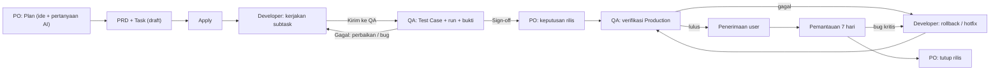

# SIMPLE-UI-DELIVERY-FLOW — Tahap 2: PRD (Product Requirements)

**Status:** Disetujui
**Disetujui:** PO/Owner (Reyand), 2026-10-27, pesan "setuju"
**Gerbang:** G2 — disetujui oleh PO
**Solusi terpilih:** [solution.md](solution.md) (Opsi A, bertahap per slice)
**Applicable Policy IDs:** DOC-005, UI-001, UI-002, UI-003, UI-004, SDLC-001, AUTH-001, AUTH-002, CONTRACT-001, DATA-001, TEST-001, AI-013, RELEASE-001, RELEASE-002

Aturan token warna, state UI wajib, dan RBAC ditautkan ke SSoT (`docs/3_UI_ATOMIC_DESIGN_SYSTEM.md`,
`docs/2_WORKFLOW_AND_ROLES.md`), tidak disalin. Desain acuan: gambar ekspor di [design/](design/README.md) (ADR-035); canvas Design "Qlick Hub — Simple UI"
(https://claude.ai/artifact/XGqbVjeJMRXDS9sZbDSFbg, privat) hanya berkas kerja. Seluruh bukti E4 pada fase ini
adalah UAT lokal (batas lingkungan di solution.md).

## 1. Tujuan dan pengguna

PO, Developer, dan QA melihat pekerjaan mereka, siapa yang menyerahkan, dan pesan pengirimnya di satu
tempat. PO menyusun Feature lewat Plan → PRD → Task → Apply dengan bantuan AI dan menerapkannya secara
eksplisit. QA membuat dan menjalankan Test Case dengan bukti. Setelah rilis, verifikasi Production,
penerimaan user, dan pemantauan 7 hari tercatat. Metrik sukses: [problem.md](problem.md) §5.

## 2. Requirement dan Acceptance Criteria

Kolom **Slice** merujuk urutan di solution.md §3.

| Req ID | Slice                  | Requirement                        | AC ID                                                                                                                                                                                                                                                                                                                                                                                                                                                                                                                                                                                                                    | Acceptance Criterion (Given / When / Then)                                                                                                                                                                                                                                                                                                                                              | Role          | Bukti minimum        |
| ------ | ---------------------- | ---------------------------------- | ------------------------------------------------------------------------------------------------------------------------------------------------------------------------------------------------------------------------------------------------------------------------------------------------------------------------------------------------------------------------------------------------------------------------------------------------------------------------------------------------------------------------------------------------------------------------------------------------------------------------ | --------------------------------------------------------------------------------------------------------------------------------------------------------------------------------------------------------------------------------------------------------------------------------------------------------------------------------------------------------------------------------------- | ------------- | -------------------- |
| REQ-1  | 1                      | Shell sederhana                    | AC-1.1                                                                                                                                                                                                                                                                                                                                                                                                                                                                                                                                                                                                                   | Given pengguna login di desktop ≥1024px, when membuka halaman mana pun, then Sidebar (logo, workspace, 4 menu, folder, profil) dan header 80px tampil tanpa overflow, di Light dan Dark.                                                                                                                                                                                                | Semua         | E2 + E4 (1440, 1024) |
| REQ-1  | 1                      | Shell sederhana                    | AC-1.2                                                                                                                                                                                                                                                                                                                                                                                                                                                                                                                                                                                                                   | Given viewport 390 atau 768, when membuka halaman, then Sidebar menjadi menu yang bisa dibuka-tutup dan konten tidak tertutup.                                                                                                                                                                                                                                                          | Semua         | E4 (390, 768)        |
| REQ-2  | 2                      | Detail Feature sebagai halaman     | AC-2.1                                                                                                                                                                                                                                                                                                                                                                                                                                                                                                                                                                                                                   | Given Feature yang boleh dibaca, when diklik di Task Hub, then halaman detail terbuka di area konten (Sidebar tetap terlihat) dengan stepper Plan · PRD · Task · Apply pada tahap Feature.                                                                                                                                                                                              | Semua         | E2 + E4              |
| REQ-2  | 2                      | Detail Feature sebagai halaman     | AC-2.2                                                                                                                                                                                                                                                                                                                                                                                                                                                                                                                                                                                                                   | Given 8 tab lama, when halaman detail dibuka, then Brief + Requirement + AC ada di PRD, root task + subtask di Task, Diskusi di Plan, sedangkan Aktivitas, Bug, dan Jejak Delivery dapat dibuka dari baris atas tanpa data hilang.                                                                                                                                                      | Semua         | E2 + E4              |
| REQ-2  | 2                      | Detail Feature sebagai halaman     | AC-2.3                                                                                                                                                                                                                                                                                                                                                                                                                                                                                                                                                                                                                   | Given URL lama dengan `?taskId=` atau `/projects/:projectId/tasks/:taskId`, when dibuka, then pengguna diarahkan ke halaman detail yang sama.                                                                                                                                                                                                                                           | Semua         | E2 (tiap pola URL)   |
| REQ-2  | 2                      | Detail kerjaan Developer           | AC-2.4                                                                                                                                                                                                                                                                                                                                                                                                                                                                                                                                                                                                                   | Given subtask milik Developer, when dibuka, then halaman menampilkan yang dikerjakan, AC dari requirement terkait sebagai cek mandiri (tersimpan di server, AC-2.11), diskusi, dan aksi Kirim ke QA yang aktif setelah semua dicentang.                                                                                                                                                 | Developer     | E2 + E4              |
| REQ-2  | 2                      | Centang AC tersimpan               | AC-2.11                                                                                                                                                                                                                                                                                                                                                                                                                                                                                                                                                                                                                  | Given subtask milik Developer, when Developer mencentang kriteria Selesai jika, then pilihan tersimpan di server, bertahan setelah muat ulang atau perubahan status, dan terlihat oleh anggota lain; hanya penanggung jawab, Owner, atau Admin yang dapat mengubah.                                                                                                                     | Developer     | E3 + E4              |
| REQ-3  | 3                      | Tambah Test Case                   | AC-3.1                                                                                                                                                                                                                                                                                                                                                                                                                                                                                                                                                                                                                   | Given QA pada subtask uji, when menambah Test Case, then judul, AC yang diuji (≥1), skenario positif/negatif/edge, prioritas, prasyarat, data uji, langkah, dan hasil diharapkan tersimpan dan tertaut ke AC lewat versi Test Case.                                                                                                                                                     | QA            | E3 write/read-back   |
| REQ-3  | 3                      | Jalankan Test Case                 | AC-3.2                                                                                                                                                                                                                                                                                                                                                                                                                                                                                                                                                                                                                   | Given Test Case aktif, when QA menyimpan hasil Gagal atau Terblokir, then hasil aktual dan bukti wajib (jenis bukti mengikuti aturan backend: ≥1 gambar atau video; dokumen hanya pelengkap); tanpa itu simpan ditolak di backend.                                                                                                                                                      | QA            | E3 + E4              |
| REQ-3  | 3                      | Jalankan Test Case                 | AC-3.3                                                                                                                                                                                                                                                                                                                                                                                                                                                                                                                                                                                                                   | Given run disimpan, when bukti ditambah kemudian, then bukti tercatat sebagai bukti susulan dengan alasan dan hasil asli tidak berubah.                                                                                                                                                                                                                                                 | QA            | E3                   |
| REQ-3  | 3                      | Jalankan Test Case                 | AC-3.4                                                                                                                                                                                                                                                                                                                                                                                                                                                                                                                                                                                                                   | Given run berjalan, when QA mencentang langkah dan memilih browser/perangkat/build, then status per langkah dan lingkungan tersimpan bersama hasil.                                                                                                                                                                                                                                     | QA            | E3                   |
| REQ-3  | 3                      | Tindak lanjut gagal                | AC-3.5                                                                                                                                                                                                                                                                                                                                                                                                                                                                                                                                                                                                                   | Given hasil Gagal tersimpan, when QA memilih Minta perbaikan atau Lapor sebagai bug, then item muncul di Tugas Saya Developer beserta catatan QA.                                                                                                                                                                                                                                       | QA, Developer | E3 + E4              |
| REQ-3  | 3                      | Otorisasi QA                       | AC-3.6                                                                                                                                                                                                                                                                                                                                                                                                                                                                                                                                                                                                                   | Given peran selain QA (atau QA di luar workspace), when mencoba menyimpan hasil run, then API menolak 403 tanpa menulis data.                                                                                                                                                                                                                                                           | Semua         | E3 (403)             |
| REQ-3  | 3                      | Detail kerjaan QA                  | AC-3.7                                                                                                                                                                                                                                                                                                                                                                                                                                                                                                                                                                                                                   | Given subtask QA milik QA yang login, when dibuka dari Tugas Saya, then halaman kerja QA (bukan drawer lama) menampilkan pesan serah-terima dari Developer, Test Case per Requirement dengan hasil terakhirnya, aksi Lulus/Gagal per baris yang membuka halaman jalankan, dan panel status.                                                                                             | QA            | E2 + E4              |
| REQ-3  | 3                      | Jalan masuk Persetujuan QA         | AC-3.8                                                                                                                                                                                                                                                                                                                                                                                                                                                                                                                                                                                                                   | Given item Persetujuan QA yang tertahan QA Subtask, when QA menekan aksinya, then QA dibawa ke halaman kerja QA subtask yang menahan, bukan halaman Feature; bila tidak ada subtask QA aktif milik pengguna, tampil penjelasan.                                                                                                                                                         | QA            | E2 + E4              |
| REQ-3  | 3                      | Halaman kerja Bug                  | AC-3.9                                                                                                                                                                                                                                                                                                                                                                                                                                                                                                                                                                                                                   | Given item Bug (perbaikan Developer atau retest QA) di Tugas Saya, when dibuka, then halaman kerja Bug (bukan drawer lama) menampilkan apa yang rusak, asal temuan QA beserta bukti, riwayat perbaikan/retest, dan aksi sesuai peran; hasil retest di halaman jalankan memperbarui status Bug.                                                                                          | Dev, QA       | E2 + E4              |
| REQ-3  | 3                      | Buka kembali Bug                   | AC-3.10                                                                                                                                                                                                                                                                                                                                                                                                                                                                                                                                                                                                                  | Given Bug Terverifikasi, when QA/Owner/Admin menekan Buka kembali dan mengisi alasan, then Bug berstatus Dibuka kembali, Developer yang ditugaskan diberi tahu dan melihat alasan di halaman Bug, dan siklus perbaikan berikutnya berjalan; alasan kosong atau peran lain ditolak.                                                                                                      | QA, Dev       | E3 + E4              |
| REQ-3  | 3                      | Persetujuan QA di halaman QA       | AC-3.11                                                                                                                                                                                                                                                                                                                                                                                                                                                                                                                                                                                                                  | Given QA yang ditugaskan di halaman kerja QA, when membuka halaman, then bagian Persetujuan QA (Setujui/Tolak) tampil di sana dan item antrean Persetujuan QA mengarah ke halaman itu; peran lain tidak melihatnya.                                                                                                                                                                     | QA            | E2 + E4              |
| REQ-3  | 3                      | Impor spreadsheet di halaman QA    | AC-3.12                                                                                                                                                                                                                                                                                                                                                                                                                                                                                                                                                                                                                  | Given QA yang ditugaskan di halaman kerja QA, when menekan Impor spreadsheet dan menyelesaikan wizard, then Test Case hasil impor muncul di halaman itu tanpa membuka desk QA lengkap; peran lain tidak melihat aksinya.                                                                                                                                                                | QA            | E2 + E4              |
| REQ-3  | 3                      | Impor dari Google Sheets           | AC-3.13                                                                                                                                                                                                                                                                                                                                                                                                                                                                                                                                                                                                                  | Given QA yang ditugaskan, when menempel tautan Google Sheets dan menyelesaikan wizard, then baris dengan Requirement yang sah untuk Feature itu diimpor sebagai Test Case aktif, baris lain tidak diimpor dan diberi alasan, dan kolom hasil uji dilewati tanpa error.                                                                                                                  | QA            | E3 + E4              |
| REQ-3  | 3                      | Lepas desk QA lama dari halaman QA | AC-3.14                                                                                                                                                                                                                                                                                                                                                                                                                                                                                                                                                                                                                  | Given QA atau perencana yang membuka subtask QA, when membuka dari Tugas Saya, tautan lama (`?desk=lengkap`), atau kisi tim Feature, then mendarat di halaman kerja subtask QA; tidak ada lagi desk QA lama, tab Bug lama, atau tautan "Buka desk QA lengkap"; Test Case draf dapat diaktifkan di halaman itu dan subtask QA yang masih To do menjadi Dikerjakan saat QA mulai bekerja. | QA            | E3 + E4              |
| REQ-3  | Dua tahap QA           | AC-3.15                            | Given QA yang ditugaskan dan masih ada subtask Developer Feature itu yang belum siap diuji (status selain Dalam Review atau Selesai; subtask dibatalkan dan subtask QA tidak dihitung), when membuka halaman kerja QA, then halaman menyatakan "Siapkan Test Case" dengan "Menunggu Developer: X dari Y subtask siap diuji"; QA tetap dapat menambah, mengimpor, dan mengaktifkan Test Case; Lulus/Gagal tidak aktif dan simpan hasil di halaman jalankan Test Case diblokir dengan penjelasan. Given semua subtask Developer siap diuji, then banner hilang dan Lulus/Gagal aktif. (Hanya tampilan; API tidak berubah.) | Given QA atau perencana yang membuka subtask QA, when membuka dari Tugas Saya, tautan lama (`?desk=lengkap`), atau kisi tim Feature, then mendarat di halaman kerja subtask QA; tidak ada lagi desk QA lama, tab Bug lama, atau tautan "Buka desk QA lengkap"; Test Case draf dapat diaktifkan di halaman itu dan subtask QA yang masih To do menjadi Dikerjakan saat QA mulai bekerja. | QA            | E3 + E4              |
| REQ-3  | Satu kartu per Feature | AC-3.16                            | Given QA dan Feature yang punya subtask Developer berstatus Dalam Review, when membuka Tugas Saya, then ada satu kartu untuk Feature itu (judul Feature, "X dari Y subtask Developer siap diuji"), bukan satu kartu per subtask Developer; kartu membuka subtask QA milik QA di Feature itu.                                                                                                                                                                                                                                                                                                                             | Given QA atau perencana yang membuka subtask QA, when membuka dari Tugas Saya, tautan lama (`?desk=lengkap`), atau kisi tim Feature, then mendarat di halaman kerja subtask QA; tidak ada lagi desk QA lama, tab Bug lama, atau tautan "Buka desk QA lengkap"; Test Case draf dapat diaktifkan di halaman itu dan subtask QA yang masih To do menjadi Dikerjakan saat QA mulai bekerja. | QA            | E3 + E4              |
| REQ-4  | 4                      | Tugas Saya per peran               | AC-4.1                                                                                                                                                                                                                                                                                                                                                                                                                                                                                                                                                                                                                   | Given pengguna dengan peran PO, Developer, atau QA, when membuka Tugas Saya, then tampil satu kartu "Mulai dari sini" dan grup sesuai peran (solution.md, desain canvas), tiap item dengan satu aksi berikutnya.                                                                                                                                                                        | PO, Dev, QA   | E3 + E4 per peran    |
| REQ-4  | 4                      | Pesan pengirim                     | AC-4.2                                                                                                                                                                                                                                                                                                                                                                                                                                                                                                                                                                                                                   | Given item hasil serah-terima, when ditampilkan, then nama pengirim dan pesan terakhirnya (dari `task_comments` bertanda serah-terima atau catatan review) ikut tampil.                                                                                                                                                                                                                 | PO, Dev, QA   | E3                   |
| REQ-4  | 4                      | Menunggu orang lain                | AC-4.3                                                                                                                                                                                                                                                                                                                                                                                                                                                                                                                                                                                                                   | Given pekerjaan pengguna sedang dipegang peran lain, when Tugas Saya dibuka, then item tampil di grup "Menunggu orang lain" dengan label posisinya dan tanpa aksi kerja.                                                                                                                                                                                                                | PO, Dev, QA   | E3 + E4              |
| REQ-4  | 4                      | Balas langsung                     | AC-4.4                                                                                                                                                                                                                                                                                                                                                                                                                                                                                                                                                                                                                   | Given pesan di kartu "Mulai dari sini", when pengguna membalas, then balasan tersimpan sebagai komentar task yang sama dan pengirim mendapat item/notifikasi.                                                                                                                                                                                                                           | PO, Dev, QA   | E3                   |
| REQ-4  | 4                      | Riwayat serah-terima               | AC-4.5                                                                                                                                                                                                                                                                                                                                                                                                                                                                                                                                                                                                                   | Given Feature yang boleh dibaca, when panel riwayat dibuka, then serah-terima dan pesan tampil terbaru di atas, dipaginasi, dan item untuk pengguna ditandai "Untukmu".                                                                                                                                                                                                                 | Semua         | E3 + E4              |
| REQ-5  | 5a                     | Feature Spec tersimpan             | AC-5.1                                                                                                                                                                                                                                                                                                                                                                                                                                                                                                                                                                                                                   | Given PO menulis judul dan ide Feature, when disimpan, then root Feature dan Feature Spec versi 1 (tahap Plan) dibuat dalam satu transaksi dan Feature tampil di Task Hub.                                                                                                                                                                                                              | PO            | E3                   |
| REQ-5  | 5a                     | Field wajib di server              | AC-5.2                                                                                                                                                                                                                                                                                                                                                                                                                                                                                                                                                                                                                   | Given bagian Plan, PRD, atau Task yang masih punya field wajib kosong, when pengguna atau agent menandainya lengkap, melanjutkan tahap, atau menerapkan, then server menjawab 400 dengan daftar `missingFields` dan tidak menyimpan perubahan tahap.                                                                                                                                    | PO, Dev, QA   | E3 (400)             |
| REQ-5  | 5a                     | Versi dan pelaku                   | AC-5.3                                                                                                                                                                                                                                                                                                                                                                                                                                                                                                                                                                                                                   | Given Spec versi N, when dua penulis menyimpan dari versi yang sama, then yang kedua ditolak 409; setiap versi mencatat pelaku (user atau agent), id, dan jalurnya.                                                                                                                                                                                                                     | PO            | E3 (409)             |
| REQ-5  | 5b                     | AI mengisi Plan                    | AC-5.4                                                                                                                                                                                                                                                                                                                                                                                                                                                                                                                                                                                                                   | Given ide Feature, when PO meminta AI, then AI mengajukan pertanyaan klarifikasi (teks, alasan, wajib/opsional) yang jawabannya tersimpan, lalu bagian Plan terisi lengkap dan ditandai "Diisi AI"; hasil AI divalidasi ulang oleh server.                                                                                                                                              | PO            | E3 (AI tiruan)       |
| REQ-5  | 5c                     | AI menyusun PRD                    | AC-5.5                                                                                                                                                                                                                                                                                                                                                                                                                                                                                                                                                                                                                   | Given Plan lengkap, when PO meminta AI menyusun PRD, then Product Brief, Requirement, dan AC Given/When/Then tersimpan sebagai versi baru, dan setiap Requirement punya minimal satu AC.                                                                                                                                                                                                | PO            | E3 (AI tiruan)       |
| REQ-5  | 5d                     | AI menyusun Task dan Apply         | AC-5.6                                                                                                                                                                                                                                                                                                                                                                                                                                                                                                                                                                                                                   | Given PRD lengkap, when AI menyusun subtask lalu PO menekan Terapkan, then Product Brief, Requirement, AC, subtask, dan tautannya dibuat dalam satu transaksi dari versi N; klik ganda tidak membuat data ganda; gagal sebagian berarti tidak ada yang tersimpan.                                                                                                                       | PO            | E3                   |
| REQ-5  | 5a                     | Otorisasi Spec                     | AC-5.7                                                                                                                                                                                                                                                                                                                                                                                                                                                                                                                                                                                                                   | Given Developer atau QA, when memanggil endpoint Feature Spec untuk menulis, then 403; semua anggota aktif boleh membaca.                                                                                                                                                                                                                                                               | Dev, QA       | E3 (403)             |
| REQ-5  | 5e                     | UI tiga layar                      | AC-5.8                                                                                                                                                                                                                                                                                                                                                                                                                                                                                                                                                                                                                   | Given Feature di tahap Plan, PRD, atau Task, when PO membuka halaman Feature, then layar menampilkan field wajib dengan penanda, field yang belum terisi, dan tombol lanjut yang terkunci beserta alasannya sampai semua wajib terpenuhi.                                                                                                                                               | PO            | E2 + E4              |
| REQ-5  | 5f                     | Kolom Tahap                        | AC-5.9                                                                                                                                                                                                                                                                                                                                                                                                                                                                                                                                                                                                                   | Given daftar Feature, when Task Hub dibuka, then kolom Tahap menampilkan Plan/PRD/Task/Diterapkan yang dihitung dari data Spec dan status task, bukan disimpan terpisah.                                                                                                                                                                                                                | Semua         | E3 + E4              |
| REQ-5  | 5g                     | Penugasan terbuka                  | AC-5.10                                                                                                                                                                                                                                                                                                                                                                                                                                                                                                                                                                                                                  | Given subtask dengan mode penugasan terbuka, when Developer atau QA yang cocok dengan areanya menekan Ambil, then tugas menjadi miliknya secara atomik dan pengambil kedua mendapat 409; peran yang tidak cocok mendapat 403; Owner, Admin, dan PO dapat melepas atau mengalihkan.                                                                                                      | Dev, QA, PO   | E3 + E4              |
| REQ-7  | 7                      | Catatan rilis                      | AC-7.1                                                                                                                                                                                                                                                                                                                                                                                                                                                                                                                                                                                                                   | Given keputusan rilis approved, when rilis dicatat, then PR, commit, deploy ID, URL, migrasi, dan target rollback tersimpan dan dapat diunduh untuk release.md.                                                                                                                                                                                                                         | PO, QA        | E3                   |
| REQ-7  | 7                      | Verifikasi Production              | AC-7.2                                                                                                                                                                                                                                                                                                                                                                                                                                                                                                                                                                                                                   | Given rilis tercatat, when QA menjalankan cek teknis dan smoke Test Case (bertanda smoke) dengan bukti, then penyerahan ke user baru aktif bila semua lulus; bila ada yang gagal, pilihan rollback atau bug hotfix tercatat.                                                                                                                                                            | QA            | E3 + E4 lokal        |
| REQ-7  | 7                      | Penerimaan user                    | AC-7.3                                                                                                                                                                                                                                                                                                                                                                                                                                                                                                                                                                                                                   | Given verifikasi lulus, when penerima menandai Diterima atau Belum diterima (dengan alasan), then hasil tercatat dan pemantauan 7 hari dimulai bila diterima.                                                                                                                                                                                                                           | PO            | E3 + E4              |
| REQ-8  | 8                      | Laporan user sebagai bug           | AC-8.1                                                                                                                                                                                                                                                                                                                                                                                                                                                                                                                                                                                                                   | Given laporan dari user lewat QA/support, when QA mencatatnya, then bug tersimpan dengan environment `production`, `source` (user/support), dan `release_id`, tanpa mengubah gate readiness Feature lain.                                                                                                                                                                               | QA            | E3                   |
| REQ-8  | 8                      | Pemantauan dan tutup rilis         | AC-8.2                                                                                                                                                                                                                                                                                                                                                                                                                                                                                                                                                                                                                   | Given masa pemantauan, when ada laporan belum ditriage atau bug kritis/tinggi terbuka atau masa belum selesai, then Tutup rilis terkunci dengan alasan; setelah semua syarat terpenuhi PO dapat menutup rilis.                                                                                                                                                                          | PO, QA        | E3 + E4              |

Setiap AC punya bukti minimum. Pembagian test per phase ditetapkan di breakdown.md (G3).

## 3. User flow

| Langkah | Layar / route (usulan, final di contracts.md)      | Aksi user                        | Respons sistem                                         | AC terkait             |
| ------- | -------------------------------------------------- | -------------------------------- | ------------------------------------------------------ | ---------------------- |
| 1       | `/work`                                            | Klik Feature                     | Halaman detail pada tahapnya                           | AC-2.1, AC-5.9         |
| 2       | `/work/features/:featureId?tahap=plan`             | Tulis ide, jawab pertanyaan AI   | Pertanyaan/jawaban tersimpan; Plan terisi lengkap      | AC-5.1, AC-5.4         |
| 3       | `…?tahap=prd`, `…?tahap=task`                      | Tinjau dan ubah draft            | Draft berversi tersimpan                               | AC-5.2, AC-5.5, AC-5.8 |
| 4       | `…?tahap=apply`                                    | Centang tinjau, Terapkan         | Data dibuat dalam satu transaksi                       | AC-5.6                 |
| 5       | `/my-tasks`                                        | Pilih item "Mulai dari sini"     | Detail kerjaan sesuai peran                            | AC-4.1–AC-4.4          |
| 6       | `/projects/:projectId/tasks/:taskId`               | Developer cek AC, Kirim ke QA    | Item muncul di Tugas Saya QA                           | AC-2.4                 |
| 7       | `/tests/cases/new`, `/tests/cases/:testCaseId/run` | QA tambah dan jalankan Test Case | Hasil + bukti tersimpan; gagal diteruskan ke Developer | AC-3.1–AC-3.6          |
| 8       | `/releases/:releaseId`                             | QA verifikasi, PO terima         | Catatan rilis, verifikasi, penerimaan tersimpan        | AC-7.1–AC-7.3          |
| 9       | `/releases/:releaseId/monitoring`                  | QA triage, PO tutup              | Bug Production tertaut; rilis ditutup                  | AC-8.1, AC-8.2         |

## 4. Wireframe per state

Wireframe default per layar ada di [design/](design/README.md) (nama artboard di bawah; selama ekspor belum ada, canvas Design dipakai sebagai berkas kerja). State Loading, Empty, Error,
Disabled, dan Permission-denied memakai komponen yang sudah ada: `Skeleton`/`LoadingSpinner`,
`EmptyState`, `Alert` + retry, tombol disabled dengan alasan terlihat, dan `AccessRestricted`.

| Layar                    | Artboard canvas                                 | Catatan state khusus                                                          |
| ------------------------ | ----------------------------------------------- | ----------------------------------------------------------------------------- |
| Task Hub                 | Task Hub — versi sederhana                      | Kolom Tahap baru di slice 5c                                                  |
| Detail Feature: Plan     | 1 · Plan                                        | Tombol "Susun draft PRD" terkunci dengan alasan; error AI = Alert + coba lagi |
| Detail Feature: PRD      | 2 · PRD                                         | Draft badge; konflik versi = Alert dengan muat ulang                          |
| Detail Feature: Task     | 3 · Task                                        | Cakupan requirement belum lengkap = Apply terkunci                            |
| Detail Feature: Apply    | 4 · Apply                                       | Sukses = status; gagal transaksi = Alert, tidak ada data parsial              |
| Detail kerjaan Developer | Detail kerjaan · Developer (subtask)            | Kirim ke QA terkunci sampai semua AC dicentang                                |
| Detail kerjaan PO        | Detail kerjaan · PO (keputusan rilis)           | Opsi Tunda tidak dibangun (keputusan #4)                                      |
| Detail kerjaan QA        | Detail kerjaan · QA (uji subtask)               | Panel kirim balik muncul bila ada Gagal                                       |
| Tambah Test Case         | QA · Tambah Test Case                           | Minimal 1 AC; AI usulan langkah opsional                                      |
| Jalankan Test Case       | QA · Jalankan Test Case + bukti                 | Simpan terkunci tanpa bukti untuk Gagal/Terblokir                             |
| Tugas Saya               | Tugas Saya · PO / Developer / QA                | Empty per grup; "Menunggu orang lain" tanpa aksi                              |
| Verifikasi & penerimaan  | Rilis · Verifikasi Production & penerimaan user | Teks sisa cek terlihat                                                        |
| Pemantauan               | Rilis · Pemantauan pasca-rilis                  | Tutup rilis terkunci dengan daftar syarat                                     |

| Breakpoint      | Perbedaan layout                                                                  |
| --------------- | --------------------------------------------------------------------------------- |
| Phone (390)     | Sidebar jadi menu; panel kanan turun ke bawah konten; tabel jadi daftar bertumpuk |
| Tablet (768)    | Sidebar jadi menu; dua kolom bila muat                                            |
| Desktop (≥1024) | Sidebar tetap; konten + panel kanan                                               |

Desain Dark dan Phone dibuat sebelum slice 1 (keputusan Owner #7) dan ditautkan di tabel ini.

### Komponen Atomic

| Kebutuhan                                | Komponen yang dipakai ulang (`apps/web/src/components/ui`) | Komponen baru? alasan                                           |
| ---------------------------------------- | ---------------------------------------------------------- | --------------------------------------------------------------- |
| Stepper tahap Feature                    | —                                                          | Ya: `FeatureStageStepper`, belum ada stepper bertahap           |
| Kartu "Mulai dari sini" dan item antrean | `Card`, `Button`, `Badge`                                  | Molecule `WorkQueueItem` bila audit reuse membuktikan belum ada |
| Riwayat serah-terima                     | `Avatar`, daftar aktivitas yang ada                        | Organism `HandoffTimeline`                                      |
| Form Test Case dan run                   | Field dari `TestCaseFormModal`, uploader bukti yang ada    | Halaman, bukan modal                                            |
| Drawer lama                              | `Drawer`                                                   | Tetap untuk modal kecil; detail utama pindah ke halaman         |

## 5. Data, contract, authorization

- Data & API: [contracts.md](contracts.md) (diisi bersama G2)
- Authorization matrix: [authorization.md](authorization.md) (diisi bersama G2)
- Langkah per role: [roles/](roles/)

## 6. Di luar scope

- Opsi Tunda pada keputusan rilis (keputusan #4).
- Upload video langsung ke storage (keputusan #5); v1 memakai tautan video.
- Peran pelapor untuk user bisnis (keputusan #9).
- Penyimpanan cek AC mandiri Developer (keputusan #3).
- Tool pemantauan error dan integrasi API Vercel.
- Merge ke `main` atau deploy Production.

## 7. Unknown yang tersisa

| Pertanyaan                                                                                      | Memengaruhi AC | Status                                                         |
| ----------------------------------------------------------------------------------------------- | -------------- | -------------------------------------------------------------- |
| Nama route final dan apakah `/projects/:projectId/tasks/:taskId` dipakai sebagai detail kerjaan | AC-2.3, AC-2.4 | Open — diputuskan di contracts.md                              |
| Skema pertanyaan AI v2 tetap kompatibel dengan modal AI lama selama transisi                    | AC-5.4         | Selesai — v2 berdampingan, modal lama tidak diubah (PHASE-05b) |
| Daftar field wajib Plan, PRD, Task (ADR-036) cukup dan tidak berlebihan untuk AI dan pengguna   | AC-5.2         | Open — Owner meninjau di PR P5-0                               |
| Cara menandai komentar sebagai serah-terima (kolom baru vs tipe komentar)                       | AC-4.2         | Open — diputuskan di contracts.md                              |
| Isi cek teknis otomatis yang bisa dijalankan dari lokal                                         | AC-7.2         | Open — diputuskan di breakdown slice 7                         |
