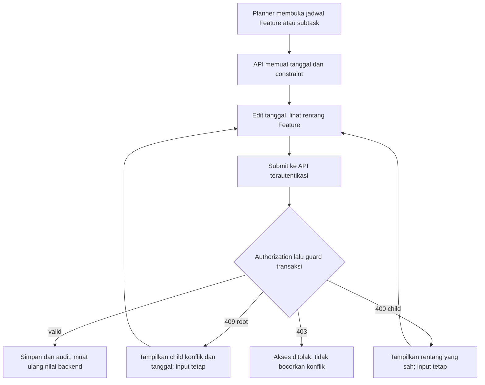

# SUBTASK-SCHEDULE-WITHIN-FEATURE — Tahap 2: PRD

**Status:** Disetujui
**Gerbang:** G2 — disetujui Owner 2026-11-07
**Applicable Policy IDs:** SDLC-001, DOC-005, UI-001, UI-002, AUTH-002, CONTRACT-001, TEST-001

## 1. Tujuan dan pengguna

Planner melihat batas sebelum menyimpan dan mendapat konflik yang dapat ditindaklanjuti.
Developer/QA membaca penanda legacy dari backend. Tidak ada auto-shift dan tidak ada perluasan izin.
Bagian legacy/reopen mengikuti keputusan Owner K1/L1/L2 dan ADR-042.

## 2. Requirement dan Acceptance Criteria

Semua tanggal contoh adalah skenario tes/factory, bukan record Production. Batas inklusif memakai
calendar date `YYYY-MM-DD` yang sudah ada; tidak memperkenalkan timestamp atau konversi timezone baru.

| Requirement                     | AC       | Given / When / Then                                                                                                                                   | Role                           | Minimum bukti                        | Keputusan               |
| ------------------------------- | -------- | ----------------------------------------------------------------------------------------------------------------------------------------------------- | ------------------------------ | ------------------------------------ | ----------------------- |
| REQ-F1-1 Root menjaga rentang   | AC-F1.1  | Child aktif due 20 Nov; root due diubah ke 15 Nov → 409 menyebut child/tanggal, root/audit/history terkait tidak berubah                              | Planner                        | E3 HTTP/readback                     | K1                      |
| REQ-F1-2 Child mengikuti root   | AC-F1.2  | Root 1–30 Nov; create child 25 Nov–5 Des → 400 menyebut 1–30 Nov, tidak ada child/activity baru                                                       | Planner                        | E3                                   | K1                      |
| REQ-F1-1                        | AC-F1.3  | Child done due 20 Nov; root due menjadi 15 Nov → berhasil, audit update normal tersimpan; ulang dengan canceled                                       | Planner                        | E3                                   | Rencana F1              |
| REQ-F1-2                        | AC-F1.4  | Update child aktif keluar start/due → 400, perubahan gabungan di-rollback; tanggal sama persis dengan batas diterima                                  | Planner                        | E3                                   | K1                      |
| REQ-F1-3 Jadwal opsional        | AC-F1.5  | Root tanpa pasangan tanggal tidak membatasi child; child tanpa pasangan tanggal tetap unscheduled; satu tanggal saja tetap ditolak                    | Planner                        | E3 + E2 contract                     | Workflow existing       |
| REQ-F1-4 Legacy aman            | AC-F1.6  | Legacy aktif di luar root → GET menandai tanpa update; edit non-tanggal tetap sah; edit tanggal mengikuti keputusan L1                                | Semua member baca/Planner edit | E3 + E2 UI + E4                      | L1=A disetujui          |
| REQ-F1-1                        | AC-F1.7  | Memperluas root yang membuat semua child valid → diterima; start root melewati start child aktif → 409                                                | Planner                        | E3                                   | K1/L1                   |
| REQ-F1-5 Semua writer/atomicity | AC-F1.8  | Plan sync atau Apply yang melanggar rentang ditolak transaksional dengan error yang sama; spec/root/child/history/audit tetap utuh                    | Planner                        | E3 Feature Spec API                  | K1                      |
| REQ-F1-6 Privacy dan akses      | AC-F1.9  | Developer/QA mencoba tanggal planning → 403; nonmember/Workspace lain tidak memperoleh nama/tanggal child; child dari Feature lain tidak ikut konflik | Semua role                     | E3 allow/deny dan readback           | Policy existing         |
| REQ-F1-5                        | AC-F1.10 | Dua transaksi create/update child dan persempit root pada dua urutan → tidak menghasilkan jadwal invalid baru; failure tanpa side effect              | Planner                        | E3 concurrency dua koneksi           | Desain lock perlu diuji |
| REQ-F1-7 UI jelas               | AC-F1.11 | Form root/child menampilkan rentang; 409 menampilkan nama/tanggal dan mempertahankan input; badge legacy dari API, dengan states/a11y/responsif       | Semua pembaca/Planner edit     | E2 component + E4 390/768/1440 + E2E | Rencana F1              |
| REQ-F1-4                        | AC-F1.12 | Child done/canceled keluar rentang dibuka kembali → sesuai keputusan L2; tanggal terminal tidak menghalangi root; policy transisi tidak dilewati      | Role berwenang existing        | E3 + E2 UI                           | L2=A disetujui          |

Seluruh AC punya jalur bukti; belum ada hasil produk yang Accepted. K1/L1/L2 telah disetujui Owner sebelum build. Tidak membuat AC untuk F2–F4.

## 3. User flow



Route existing: `/work/features/:featureId` di apps/web/src/app/App.tsx.

Surface existing: FeatureDetailPage mengomposisi taskDetail/TaskDetailOverviewTab dan SubtaskList;
CreateSubtaskModal membuat child, SubtaskAccordionItem menyuntingnya. Verifikasi route aktual
sebelum UAT; jangan membuat route baru. Plan editor di Feature Stage juga menampilkan error sync.
Developer/QA hanya melihat tanggal dan label constraint; jadwal bukan field eksekusi mereka.

## 4. Wireframe per state

Berlaku pada editor root (Overview dan Plan), editor child (CreateSubtaskModal dan accordion),
serta daftar child. Ini rancangan teks, bukan bukti UI sudah diimplementasikan.

```text
Feature: Rentang 01–30 Nov                  [Simpan]
Mulai [01 Nov]  Tenggat [15 Nov]
[Konflik] Subtask Integrasi API: 05–20 Nov berada di luar 01–15 Nov.
           Perbaiki tanggal Feature atau jadwal subtask.

Subtask: Integrasi API      [Di luar jadwal Feature]
Rentang Feature 01–30 Nov   Jadwal tersimpan 25 Nov–05 Des
Mulai [25 Nov] Tenggat [05 Des]             [Simpan]
```

| State             | Form root/Plan                                              | Form child                                                   | Daftar child                          |
| ----------------- | ----------------------------------------------------------- | ------------------------------------------------------------ | ------------------------------------- |
| Default           | Tanggal persisted dan tombol simpan                         | Rentang parent sebagai bantuan/min/max UI; server otoritatif | Badge backend jika outside            |
| Loading           | Skeleton existing; submit disabled                          | Tunggu parent/constraint, cegah submit stale                 | Skeleton; tanpa hasil rekaan          |
| Empty             | Tanpa jadwal ditampilkan eksplisit                          | Root tanpa jadwal: Tidak dibatasi; child boleh tanpa jadwal  | Belum ada subtask                     |
| Error             | 409: nama/tanggal child, input tetap; network: retry manual | 400: rentang sah, input tetap; network: retry manual         | Gagal memuat, tombol coba lagi        |
| Disabled          | Saving/read-only; alasan terlihat                           | Saving/read-only/parent belum termuat; alasan terlihat       | Badge tidak menjadi action            |
| Permission-denied | 403 disajikan tanpa detail konflik                          | 403, tidak mencoba ulang sebagai role lain                   | Tidak memuat data Workspace terlarang |
| Legacy            | Tidak mengubah tanggal otomatis; L1 berlaku                 | Badge dan instruksi perbaikan manual                         | Teks + ikon, tidak warna saja         |

| Viewport         | Rancangan dan bukti yang direncanakan                            |
| ---------------- | ---------------------------------------------------------------- |
| Phone 390×844    | Input vertikal, pesan membungkus, modal/accordion tidak overflow |
| Tablet 768×1024  | Field dua kolom bila muat; error di bawah satu baris penuh       |
| Desktop 1440×900 | Komposisi existing; konflik tetap dekat field dan aksi           |

Semua Light/Dark, label aksesibel, fokus keyboard saat error, target sentuh minimum sesuai
[UI §7](../../3_UI_ATOMIC_DESIGN_SYSTEM.md#7-responsive--atomic-quality-gate). Error diumumkan
melalui pola Alert/form existing. Reuse atoms Input/Alert/Badge dan UI schedule existing.
DateRangePicker sudah ada di Gallery tetapi belum memiliki min/max props; jangan mengasumsikan
prop tersebut tersedia. Hindari mengganti seluruh input tanggal tanpa kebutuhan yang terbukti.
Halaman hanya mengomposisi; browser tidak menghitung ulang bisnis containment/legacy.

## 5. Data, kontrak dan izin

[contracts.md](contracts.md), [authorization.md](authorization.md), [roles/](roles/).

## 6. Di luar scope

F2–F4, auto-shift, perubahan workload advisory, sistem kalender baru, migrasi/backfill,
perubahan role, secret/dependency/model AI, serta deploy/mutasi Production.

## 7. Unknown

K1, L1 dan L2 disetujui: [solution.md](solution.md). Lock/query-count/performa dan browser lokal telah diuji, lihat testing. Independent review dan
Production belum diuji. Jika baseline berubah sebelum langkah berikutnya, preflight ulang.

## Persetujuan Owner — 2026-11-07

Owner menjawab `ok` atas permintaan persetujuan G0–G3: K1 tolak tanpa auto-shift;
L1 edit tanggal harus valid penuh, metadata tetap boleh; L2 tolak reopen di luar rentang.
ADR/SSoT dicatat dahulu, lalu Phase 1 lokal. Tidak mencakup commit/push/PR/merge/deploy.
Catatan Blocked/Belum sebelumnya adalah snapshot sebelum keputusan ini, bukan keputusan terbaru.
