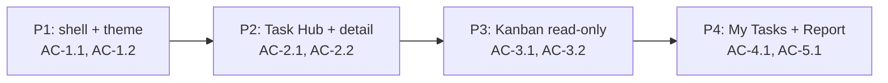

# UI-WORKSPACE-REFRESH — Tahap 3: Breakdown (Phase → Task BE · FE · QA)

**Status:** Disetujui untuk Phase 1 dan Phase 2 saja
**Gerbang:** G3 — disetujui oleh Owner; setiap persetujuan berlaku sebagai Approval Window untuk phase yang disebut
**PRD:** [product.md](product.md)
**Applicable Policy IDs:** AI-002, AI-009, AI-013, AI-014, UI-001, UI-002, UI-003, UI-004, SDLC-001

**Approval Window P1:** user menyetujui lewat pesan `ok kerjakan` pada 2026-10-23 setelah window
P1 dipaparkan. Scope hanya theme dan shell pada path P1.

**Approval Window P2:** user menyetujui lewat pesan `setuju` pada 2026-10-24 setelah window P2
dipaparkan. Scope hanya state filter Task Hub, responsivitas control bar, tes terarah, dan dokumen
P2. Kedua window tidak mencakup API, database, contract, authorization, dependency, deploy, commit,
push, atau PR.

## 1. Peta phase

| Phase | Tujuan yang terlihat                                                     | AC             | WRA  | Bergantung pada | Status                  |
| ----- | ------------------------------------------------------------------------ | -------------- | ---- | --------------- | ----------------------- |
| P1    | Tema bootstrap/provider konsisten dan shell responsif.                   | AC-1.1, AC-1.2 | 6/16 | —               | Menunggu G3             |
| P2    | Filter bertahan lintas view dan detail tidak terhalang shell.            | AC-2.1, AC-2.2 | 7/16 | P1 kandidat E2  | Kandidat E2; E4 pending |
| P3    | Kanban baca-saja paginated per Feature.                                  | AC-3.1, AC-3.2 | 8/16 | P2              | Belum mulai             |
| P4    | Queue menuju konteks benar serta ringkasan/laporan memakai data kanonis. | AC-4.1, AC-5.1 | 8/16 | P3              | Belum mulai             |

## 2. Task per phase

### Phase 1 — Shell dan theme foundation

| Task ID | Layer | Pekerjaan                                                                                                                | File/path perkiraan                                                                                       | AC             | Bukti selesai                                               |
| ------- | ----- | ------------------------------------------------------------------------------------------------------------------------ | --------------------------------------------------------------------------------------------------------- | -------------- | ----------------------------------------------------------- |
| P1-FE-1 | FE    | Samakan fallback bootstrap dan ThemeContext, sederhanakan sumber font ke Inter, tokenkan surface/text/focus lintas tema. | `apps/web/index.html`, `src/lib/theme/ThemeContext.tsx`, `src/index.css`, `tailwind.config.js` bila perlu | AC-1.1, AC-1.2 | UI tests + hard refresh Light/Dark pada 3 viewport (E2/E4). |
| P1-FE-2 | FE    | Perbaiki shell/header/control sizing dengan komponen Atomic existing.                                                    | `components/layout/`, `components/ui/`                                                                    | AC-1.2         | Component tests + audit a11y/responsive (E2/E4).            |
| P1-BE   | BE    | N/A — tidak ada endpoint/policy/contract baru.                                                                           | —                                                                                                         | —              | Inspeksi boundary (E1).                                     |
| P1-QA   | QA    | Verifikasi tema dan state pada role/session yang tersedia.                                                               | —                                                                                                         | AC-1.1, AC-1.2 | Browser evidence E4; gap role dicatat.                      |

WRA P1: requirement 0 · lapisan 1 · data 0 · authorization 0 · contract 0 · ketersinggungan 2 · validasi 2 · eksternal 1 = **6/16**.

### Phase 2 — Task Hub dan detail

Task FE: pertahankan filter di URL/state yang sesuai, perbaiki overflow/tablet/search/drawer stacking,
dan lengkapi test view switch. BE/DB N/A. QA menjalankan E4 phone/tablet/desktop pada Light/Dark.

### Phase 3 — Kanban Feature read-only

Task FE: organism Kanban hanya bila komponen serupa tidak ada; panggil `listSubtasks` per parent dengan
pagination dan semua status kanonis. BE/DB N/A kecuali inspeksi menemukan kekurangan interface;
dalam kondisi itu Phase berhenti dan mendapat keputusan G3 baru. QA membuktikan parent scope, state
loading/empty/error/forbidden, dan tidak ada mutation.

### Phase 4 — Tugas Saya, Ringkasan, dan Laporan

Task FE: petakan `nextAction.code` ke route konteks yang benar dan gunakan presentasi data existing.
BE/DB N/A. QA memverifikasi perjalanan Owner/PO/Dev/QA yang aksesnya tersedia; ketidaktersediaan
sesi tidak boleh digantikan oleh role picker atau data contoh.

## 3. Risiko lintas phase

| Risiko                                                     | Phase | Mitigasi / rollback                                                                      |
| ---------------------------------------------------------- | ----- | ---------------------------------------------------------------------------------------- |
| Token baru menciptakan palette paralel atau kontras gagal. | P1    | Gunakan token Tailwind/CSS existing, audit Light/Dark; revert phase tanpa data rollback. |
| Filter tetap lokal sehingga remount route menghapus state. | P2    | Tetapkan ownership URL/state dan test view switch.                                       |
| Kanban memuat semua subtask workspace atau menjadi N+1.    | P3    | Parent Feature wajib dipilih; pagination dan request-count diperiksa.                    |
| UI mengarang agregat readiness dari daftar parsial.        | P4    | Tampilkan interface backend yang ada atau state unavailable; tidak menghitung sendiri.   |

## 4. Stop condition yang sudah terlihat

| Phase | Stop condition                                                           | Kapan akan diminta                                            |
| ----- | ------------------------------------------------------------------------ | ------------------------------------------------------------- |
| P1    | Perubahan dependency, framework, authorization, atau path di luar scope. | Sebelum perubahan tersebut.                                   |
| P3    | Kanban memerlukan endpoint/contract/mutation baru.                       | Sebelum memperluas scope.                                     |
| P4    | Sesi role atau PostgreSQL disposable tidak tersedia untuk AC.            | Sebelum mengklaim G5.                                         |
| Semua | Merge/push/PR/deploy.                                                    | Hanya sesuai Approval Window baru dan tier yang diverifikasi. |
