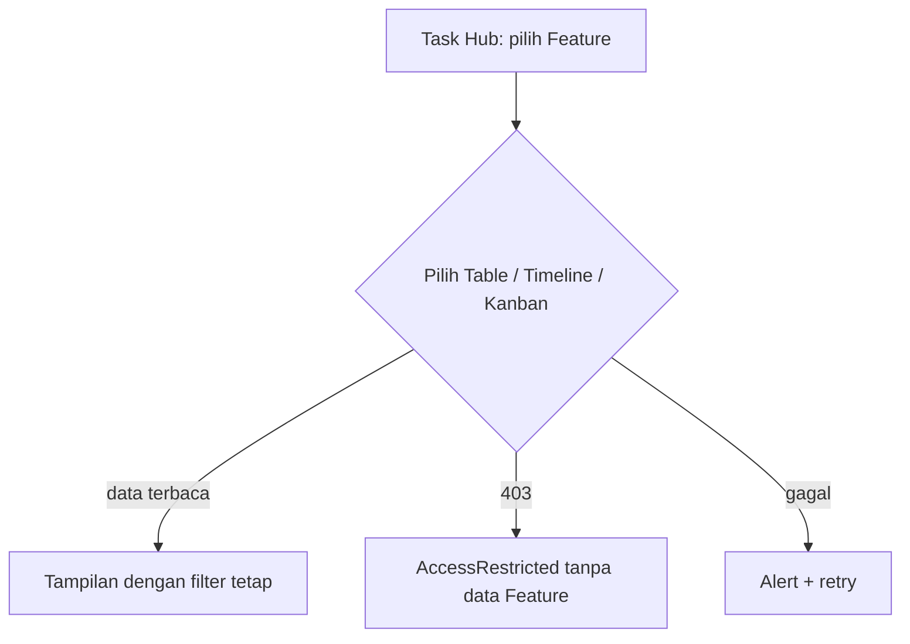

# UI-WORKSPACE-REFRESH — Tahap 2: PRD (Product Requirements)

**Status:** Disetujui
**Gerbang:** G2 — disetujui oleh PO
**Solusi terpilih:** [solution.md](solution.md)
**Applicable Policy IDs:** UI-001, UI-002, UI-003, UI-004, AUTH-001, AUTH-002, CONTRACT-001, DATA-001, TEST-001, DOC-005, SDLC-001

Aturan token, state UI, dan RBAC tetap ditautkan ke SSoT, bukan digandakan di dokumen ini.

## 1. Tujuan dan pengguna

Owner, PO, Developer, dan QA memperoleh navigasi dan konteks kerja yang konsisten pada Ringkasan,
Task Hub, Tugas Saya, Laporan, serta detail Feature. Targetnya adalah menemukan pekerjaan dan status
kanonis tanpa overflow, reset filter, atau kalkulasi bisnis baru di browser.

## 2. Requirement dan Acceptance Criteria

| Req ID | Requirement             | AC ID  | Acceptance Criterion (Given / When / Then)                                                                                                                            | Role  | Bukti minimum                |
| ------ | ----------------------- | ------ | --------------------------------------------------------------------------------------------------------------------------------------------------------------------- | ----- | ---------------------------- |
| REQ-1  | Tema sistem konsisten   | AC-1.1 | Given pilihan Light atau Dark tersimpan, when halaman direfresh, then bootstrap dan provider menerapkan tema yang sama sebelum/ketika React siap.                     | Semua | E2 UI test + E4 hard refresh |
| REQ-1  | Tema sistem konsisten   | AC-1.2 | Given shell, kartu, kontrol, status, drawer, modal, dan chart, when tema ditukar, then token semantik, focus, label, dan kontras WCAG 2.2 AA tetap dapat dipakai.     | Semua | E2 + E4 tiga viewport        |
| REQ-2  | Task Hub dapat dipindai | AC-2.1 | Given pengguna memfilter Task Hub, when Table/Timeline/Kanban dipilih, then filter tidak reset kecuali pengguna meresetnya.                                           | Semua | E2 + E4                      |
| REQ-2  | Task Hub dapat dipindai | AC-2.2 | Given viewport phone, tablet, atau desktop, when Task Hub dan detail Feature dibuka, then tidak ada overflow horizontal atau header/drawer yang menutup konteks/aksi. | Semua | E4                           |
| REQ-3  | Kanban Feature          | AC-3.1 | Given pengguna berwenang membaca Feature, when memilih Kanban, then subtask parent Feature yang sama tampil paginated pada status kanonis tanpa mutation.             | Semua | E2 + E3 + E4                 |
| REQ-3  | Kanban Feature          | AC-3.2 | Given loading, empty, error, forbidden, atau status non-prototype, when Kanban dirender, then state dan label tepat tampil tanpa menyembunyikan policy backend.       | Semua | E2 + E4                      |
| REQ-4  | Navigasi pekerjaan      | AC-4.1 | Given item `nextAction` dari antrean kerja, when pengguna membukanya, then route tujuan cocok dengan `nextAction.code` dan konteks task yang sama.                    | Semua | E2 + E4 per role             |
| REQ-5  | Ringkasan dan laporan   | AC-5.1 | Given Ringkasan atau Laporan, when data tersedia/empty/error/forbidden, then tampilan memakai interface backend yang ada dan tidak mengklaim total dari data parsial. | Semua | E2 + E3 + E4                 |

## 3. User flow



| Langkah | Layar / route | Aksi user                        | Respons sistem                                                 | AC terkait     |
| ------- | ------------- | -------------------------------- | -------------------------------------------------------------- | -------------- |
| 1       | `/work`       | Ubah Light/Dark.                 | Root class dan token berubah; pilihan disimpan.                | AC-1.1, AC-1.2 |
| 2       | `/work`       | Cari/filter lalu pilih view.     | Filter sama dipakai pada view berikutnya.                      | AC-2.1         |
| 3       | `/work`       | Pilih Feature lalu Kanban.       | Subtask Feature yang sama dimuat per halaman, tanpa drag/drop. | AC-3.1, AC-3.2 |
| 4       | `/my-tasks`   | Memilih next action.             | Route dipetakan dari kode aksi dan konteks task.               | AC-4.1         |
| 5       | `/reports`    | Membuka laporan/filter yang ada. | Data tetap dari interface backend, dengan state lengkap.       | AC-5.1         |

## 4. Wireframe per state

### Layar: Work hub terpadu — route `/work`

| State             | Wireframe / link                                | Catatan                                              |
| ----------------- | ----------------------------------------------- | ---------------------------------------------------- |
| Default           | Konsep `qlickhub-ui-concept.html` (ilustratif). | Panel daftar + detail; Kanban tidak mengubah status. |
| Loading           | `Skeleton` / `LoadingSpinner` existing.         | Tidak menampilkan data contoh.                       |
| Empty             | `EmptyState` existing.                          | Jelaskan filter aktif dan aksi reset bila ada.       |
| Error             | `TaskHubErrorBanner` / `Alert` + retry.         | Pesan tidak mengungkap detail internal.              |
| Disabled          | Tombol action existing, alasan terlihat.        | Kanban baca-saja.                                    |
| Permission-denied | `AccessRestricted` existing.                    | Tidak menggantikan enforcement backend.              |

```text
┌──────────── shell + theme control ─────────────────────┐
│ Ringkasan | Task Hub | Tugas Saya | Laporan             │
├──────── filter/search/view switcher ────────────────────┤
│ Feature list/table/timeline/kanban  │ detail Feature     │
│ Kanban: status columns, cards read-only, pagination      │
└─────────────────────────────────────────────────────────┘
```

| Breakpoint | Perbedaan layout                                                                           |
| ---------- | ------------------------------------------------------------------------------------------ |
| Phone      | Satu kolom; drawer/modal dapat dijangkau; Kanban di-scroll terkontrol tanpa page overflow. |
| Tablet     | Filter dan table/timeline tidak keluar viewport; detail tidak tertutup header.             |
| Desktop    | Daftar dan detail memakai ruang horizontal tanpa input search terjepit.                    |

### Komponen Atomic

| Kebutuhan      | Komponen yang dipakai ulang                                                              | Komponen baru? alasan                                         |
| -------------- | ---------------------------------------------------------------------------------------- | ------------------------------------------------------------- |
| Shell/controls | `AppLayoutTemplate`, `TaskHubControlsBar`, `SearchInput`, `Tabs`, `Button`, `IconButton` | Tidak untuk shell.                                            |
| Task views     | `TaskCollection`, `TaskTimelineView`, `TaskStatusBadge`, `TaskDetailDrawer`              | Kanban organism hanya bila reuse audit membuktikan belum ada. |
| States         | `Skeleton`, `LoadingSpinner`, `EmptyState`, `Alert`, `AccessRestricted`                  | Tidak.                                                        |
| Detail/modals  | `Drawer`, `Modal`, `TaskDetailDrawer`                                                    | Tidak.                                                        |

## 5. Data, contract, authorization

- Data & API: [contracts.md](contracts.md)
- Authorization matrix: [authorization.md](authorization.md)
- Langkah per role: [roles/](roles/)

## 6. Di luar scope

- Drag/drop atau mutation Kanban.
- Role switcher produksi, API/DB/contract/authorization baru.
- System theme, cross-device sync, dan analitik global baru.
- Perbaikan default Acceptance Criterion pada Create Task; itu follow-up terpisah.

## 7. Unknown yang tersisa

| Pertanyaan                                       | Memengaruhi AC         | Status                                                                                                                             |
| ------------------------------------------------ | ---------------------- | ---------------------------------------------------------------------------------------------------------------------------------- |
| Sesi runtime Dev/QA/PO tersedia untuk E4?        | AC-3.1, AC-4.1, AC-5.1 | Resolved for P4 and Task Hub visual observation; the missing specific P1/P2 flows are tracked in `testing.md`.                     |
| Disposable PostgreSQL dan test records tersedia? | AC-3.1, AC-5.1         | Resolved for P4 capacity E3; P3 remains blocked by its UI data-scope mismatch before a Kanban-specific E3 run would be meaningful. |
