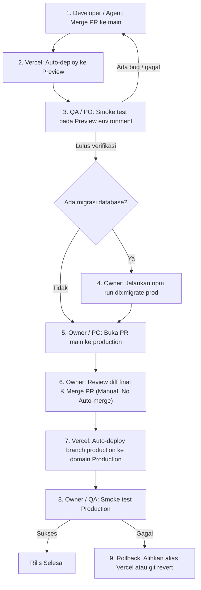

# VERCEL-PRODUCTION-BRANCH — Tahap 2: PRD (Product Requirements)

**Status:** Menunggu persetujuan
**Gerbang:** G2 — disetujui oleh PO
**Solusi terpilih:** [solution.md](solution.md)
**Applicable Policy IDs:** DOC-005, SDLC-001, AI-013, AI-020, DOC-002

## 1. Tujuan dan pengguna

Memisahkan branch integrasi (`main`) dari branch rilis (`production`) sehingga setiap merge ke `main` hanya menghasilkan Vercel Preview deployment. Rilis ke Production dilakukan melalui Pull Request terpisah dari `main` ke `production` yang di-merge secara manual oleh Owner setelah migrasi skema database PostgreSQL dan pengujian Preview selesai.

Pengguna yang terdampak:
- **Owner**: Memegang kendali mutlak dan gerbang rilis Production tanpa risiko auto-deploy prematur.
- **PO & QA**: Dapat melakukan pengujian dan verifikasi acceptance criteria pada Preview deployment sebelum menyetujui rilis ke Production.
- **Developer & AI Agent**: Dapat melakukan integrasi PR rutin (Tier 1/Tier 2) ke `main` secara aman tanpa memicu deploy Production.

## 2. Requirement dan Acceptance Criteria

| Req ID | Requirement | AC ID | Acceptance Criterion (Given / When / Then) | Role | Bukti minimum (E-level) |
| --- | --- | --- | --- | --- | --- |
| REQ-PROD-01 | Decoupling branch `main` dari Production deployment Vercel | AC-1.1 | Given merge commit masuk ke branch `main`, When Vercel mendeteksi pembaruan git, Then Vercel men-deploy aplikasi ke environment Preview (bukan Production). | DevOps / Agent | E4 — deployment ID dan environment Preview di Vercel |
| REQ-PROD-02 | Alur promosi rilis melalui Pull Request `main` → `production` | AC-2.1 | Given perubahan pada `main` telah teruji di Preview, When rilis Production disiapkan, Then dibuka Pull Request dari `main` ke `production`. | PO / Owner | E1 — GitHub PR link dan target branch `production` |
| REQ-PROD-02 | Larangan auto-merge pada PR rilis `production` | AC-2.2 | Given PR rilis dari `main` ke `production`, When PR dibuat, Then auto-merge dilarang aktif, dan hanya Owner yang dapat melakukan merge secara manual. | Owner | E1 — GitHub branch protection / ruleset dan PR merge event |
| REQ-PROD-03 | Urutan rilis baku (Migration-first, Deploy-second) | AC-3.1 | Given rilis menyertakan perubahan skema database, When rilis dipromosikan, Then migrasi database (`npm run db:migrate:prod`) dijalankan dan diverifikasi sukses sebelum PR ke `production` di-merge. | Owner | E3 — log eksekusi migrasi database PostgreSQL |
| REQ-PROD-03 | Deployment Production otomatis pasca-merge oleh Owner | AC-3.2 | Given PR ke `production` di-merge oleh Owner, When Vercel mendeteksi commit di branch `production`, Then Vercel men-deploy aplikasi ke Production (`qlickhub.vercel.app`). | Owner | E4 — log deployment ID dan domain Production |
| REQ-PROD-04 | Penutupan konflik ADR-028 dan kepatuhan AI-013 | AC-4.1 | Given PR Tier 1 di-merge ke `main` via auto-merge ADR-028, When merge selesai, Then domain Production tidak ter-deploy sehingga batasan AI-013 terpenuhi. | Agent / Verifier | E1/E4 — status environment deployment Vercel |
| REQ-PROD-05 | Prosedur rollback terdokumentasi dan teruji | AC-5.1 | Given terjadi kegagalan pada rilis Production, When rollback diperlukan, Then Owner dapat segera mengalihkan domain Production ke deployment stabil sebelumnya di Vercel atau melakukan git revert di branch `production`. | Owner | E1 — prosedur rollback di SSoT |
| REQ-PROD-06 | Panduan konfigurasi eksternal untuk Owner | AC-6.1 | Given agent tidak mengubah setting eksternal Vercel dan GitHub, When implementasi disiapkan, Then panduan langkah operasional tertulis lengkap untuk Owner. | Owner / Agent | E1 — instruksi langkah di ADR-031 dan SSoT |

## 3. User flow rilis Production

## 4. Antarmuka dan UI States

Perubahan ini adalah alur infrastruktur deployment dan tata kelola rilis repository. Tidak ada layar atau komponen baru di `apps/web`.

- **Antarmuka eksternal terdampak**:
  - GitHub Pull Request (`main` → `production`).
  - Vercel Project Deployment Dashboard (`Preview` vs `Production`).
- **Komponen Atomic**: Tidak ada penambahan atau pengubahan komponen UI Atomic.

## 5. Data, contract, authorization

- **Data & Shared Contracts**: [contracts.md](contracts.md)
- **Authorization matrix**: [authorization.md](authorization.md)
- **Peran dan alur kerja peran**: [roles/](roles/)

## 6. Di luar scope

- Pengubahan kode runtime aplikasi (`apps/`, `packages/`, `api/`, `database/`).
- Eksekusi langsung ke Vercel API / Settings atau GitHub Settings oleh AI Agent.
- Otomasi eksekusi migrasi database di cloud runner (tetap dijalankan manual dengan kredensial aman oleh Owner).

## 7. Unknown yang tersisa

| Pertanyaan | Memengaruhi AC | Status |
| --- | --- | --- |
| Konfigurasi env var dan database scope Preview di Vercel (Preview tidak boleh memakai DB Production) | AC-1.1 | Open — diverifikasi oleh Owner di Vercel Dashboard |
| Kebutuhan trigger `ci.yml` untuk branch `production` | AC-2.1 | Open — dianalisis di Tahap 3 Breakdown |
| Bukti kelulusan `sdlc:check` dan `owner-gate` pada PR uji `main` → `production` | AC-2.1, AC-2.2 | Open — akan dibuktikan pada PR uji di Tahap 5 |
