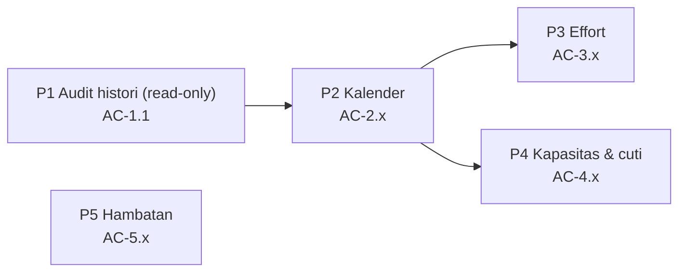

# WORK-FOUNDATION — Tahap 3: Breakdown (Phase → Task BE · FE · QA)

**Status:** Disetujui
**Gerbang:** G3 — disetujui oleh Owner; persetujuan ini sekaligus Approval Window untuk phase pertama
**Disetujui:** Owner melalui chat, 2026-11-17 — "Setuju G2 G3 semua (Recommended)" setelah merge PR #132
**PRD:** [product.md](product.md)
**Applicable Policy IDs:** AI-002, AI-009, AI-014, SDLC-001, DATA-002

## Aturan pemecahan

Mengikuti template: phase = vertical slice, WRA ≤ 8, setiap AC tepat di satu phase. Atas permintaan
Owner ("jalan 1 round semua"), persetujuan G3 ini berlaku sebagai Approval Window berurutan untuk P1–P5;
setiap phase tetap punya PR sendiri dan berhenti pada stop condition §4.

## 1. Peta phase

| Phase | Tujuan                                 | AC            | WRA  | Bergantung | Status         |
| ----- | -------------------------------------- | ------------- | ---- | ---------- | -------------- |
| P1    | Laporan kualitas histori status        | AC-1.1        | 3/16 | —          | Belum mulai    |
| P2    | Kalender Workspace + hitung hari kerja | AC-2.1–AC-2.4 | 7/16 | —          | Kandidat lokal |
| P3    | Effort Subtask                         | AC-3.1–AC-3.4 | 7/16 | P2         | Belum mulai    |
| P4    | Kapasitas pribadi + cuti               | AC-4.1–AC-4.4 | 7/16 | P2         | Belum mulai    |
| P5    | Hambatan + notifikasi PIC              | AC-5.1–AC-5.4 | 8/16 | —          | Belum mulai    |

## 2. Task per phase

### Phase 1 — Audit histori status

| Task ID | Layer | Pekerjaan                                                    | File/path perkiraan                          | AC     | Bukti selesai                              |
| ------- | ----- | ------------------------------------------------------------ | -------------------------------------------- | ------ | ------------------------------------------ |
| P1-BE-1 | BE    | Skrip read-only `npm run audit:status-history` (SELECT saja) | `apps/api/src/scripts/auditStatusHistory.ts` | AC-1.1 | Integration test pada seed PostgreSQL (E3) |
| P1-FE-1 | FE    | N/A — tidak ada UI                                           | —                                            | —      | —                                          |
| P1-QA-1 | QA    | Cocokkan hitungan dengan seed                                | —                                            | AC-1.1 | Test Result (E3)                           |

WRA: requirement 0 · lapisan 1 · data 1 · authorization 0 · contract 0 · ketersinggungan 0 · validasi 1 · eksternal 0 = **3/16**

### Phase 2 — Kalender Workspace

| Task ID | Layer | Pekerjaan                                                                                  | File/path perkiraan                                                          | AC             | Bukti selesai                         |
| ------- | ----- | ------------------------------------------------------------------------------------------ | ---------------------------------------------------------------------------- | -------------- | ------------------------------------- |
| P2-BE-1 | BE    | Migrasi `workspaces.timezone`, `workspaces.working_days`, tabel `workspace_holidays`       | `apps/api/src/db/migrations/*`                                               | AC-2.1, AC-2.3 | Clean migrate + down (E3)             |
| P2-BE-2 | BE    | Contract `workCalendar.ts`; service hitung hari kerja; GET/PUT kalender, POST/DELETE libur | `packages/contracts/src/workCalendar.ts`, `apps/api/src/modules/workspaces/` | AC-2.1–AC-2.4  | Integration 200/403 + unit hari kerja |
| P2-FE-1 | FE    | Tab Kalender & Kapasitas (bagian kalender)                                                 | `apps/web/src/pages/WorkspaceSettingsPage.tsx`, organism baru                | AC-2.1, AC-2.2 | Component test + phone/desktop        |
| P2-QA-1 | QA    | Test Case kalender + UAT                                                                   | —                                                                            | AC-2.x         | Test Result (E4)                      |

WRA: requirement 1 · lapisan 2 · data 1 · authorization 1 · contract 1 · ketersinggungan 0 · validasi 1 · eksternal 0 = **7/16**

### Phase 3 — Effort Subtask

| Task ID | Layer | Pekerjaan                                                                                                                 | File/path perkiraan                                             | AC             | Bukti selesai           |
| ------- | ----- | ------------------------------------------------------------------------------------------------------------------------- | --------------------------------------------------------------- | -------------- | ----------------------- |
| P3-BE-1 | BE    | Migrasi `tasks.effort` (enum nullable); peta poin di contracts; validasi wajib untuk Subtask baru berjadwal; Planner-only | `packages/contracts/src/task.ts`, `apps/api/src/modules/tasks/` | AC-3.1–AC-3.3  | Integration 200/400/403 |
| P3-BE-2 | BE    | Effort pada draft AI Apply                                                                                                | `apps/api/src/modules/ai/`                                      | AC-3.4         | Integration             |
| P3-FE-1 | FE    | Pilihan effort di form create/edit Subtask; badge effort                                                                  | `CreateSubtaskModal.tsx`, `SubtaskAccordionItem.tsx`            | AC-3.1, AC-3.2 | Component test          |
| P3-QA-1 | QA    | UAT form Subtask                                                                                                          | —                                                               | AC-3.x         | Test Result (E4)        |

WRA: requirement 1 · lapisan 2 · data 1 · authorization 1 · contract 1 · ketersinggungan 1 · validasi 0 · eksternal 0 = **7/16**

### Phase 4 — Kapasitas dan cuti

| Task ID | Layer | Pekerjaan                                                                                                                     | File/path perkiraan                                 | AC             | Bukti selesai              |
| ------- | ----- | ----------------------------------------------------------------------------------------------------------------------------- | --------------------------------------------------- | -------------- | -------------------------- |
| P4-BE-1 | BE    | Migrasi `workspaces.default_weekly_capacity_points`, tabel `user_capacities` (override) dan `user_time_off` (rentang tanggal) | migrasi + model                                     | AC-4.1, AC-4.4 | Clean migrate + down       |
| P4-BE-2 | BE    | API kapasitas & cuti; aturan siapa boleh mengubah; kapasitas efektif                                                          | `apps/api/src/modules/capacity/`                    | AC-4.2, AC-4.3 | Integration 200/403 + unit |
| P4-FE-1 | FE    | Bagian kapasitas di tab Kalender & Kapasitas; kapasitas & cuti di profil                                                      | `WorkspaceSettingsPage.tsx`, `UserProfileModal.tsx` | AC-4.1, AC-4.2 | Component test             |
| P4-QA-1 | QA    | UAT                                                                                                                           | —                                                   | AC-4.x         | Test Result (E4)           |

WRA: requirement 1 · lapisan 2 · data 1 · authorization 1 · contract 1 · ketersinggungan 0 · validasi 1 · eksternal 0 = **7/16**

### Phase 5 — Hambatan

| Task ID | Layer | Pekerjaan                                                                                               | File/path perkiraan                             | AC            | Bukti selesai                  |
| ------- | ----- | ------------------------------------------------------------------------------------------------------- | ----------------------------------------------- | ------------- | ------------------------------ |
| P5-BE-1 | BE    | Migrasi `task_blockers`; contract `blocker.ts`; GET/POST/resolve; activity; notifikasi PIC lewat outbox | `apps/api/src/modules/tasks/`, `notifications/` | AC-5.1–AC-5.3 | Integration 200/403 + outbox   |
| P5-FE-1 | FE    | Panel Hambatan di detail Subtask                                                                        | `components/ui/organisms/taskDetail/`           | AC-5.4        | Component test + phone/desktop |
| P5-QA-1 | QA    | UAT lintas role                                                                                         | —                                               | AC-5.x        | Test Result (E4)               |

WRA: requirement 1 · lapisan 2 · data 1 · authorization 1 · contract 1 · ketersinggungan 1 · validasi 1 · eksternal 0 = **8/16**

## 3. Risiko lintas phase

| Risiko                                                                                   | Phase | Mitigasi / rollback                                                      |
| ---------------------------------------------------------------------------------------- | ----- | ------------------------------------------------------------------------ |
| Histori status tidak lengkap                                                             | P1    | Baseline mengeluarkan data tak lengkap ("tidak diketahui"), bukan direka |
| Bentrok file dengan pekerjaan Codex/UI-WORKSPACE-REFRESH di form Subtask atau Pengaturan | P2–P5 | Cek worktree aktif sebelum mulai; PR kecil                               |
| Migrasi gagal di Production                                                              | P2–P5 | Migrasi aditif nullable; gate ADR-039; `down` diuji                      |

## 4. Stop condition yang sudah terlihat

| Phase | Stop condition                                     | Kapan akan diminta                                   |
| ----- | -------------------------------------------------- | ---------------------------------------------------- |
| P2–P5 | Merge PR berisi migrasi (Tier 2, `owner-approved`) | Setiap PR phase                                      |
| P1    | Menjalankan audit ke data Production               | Setelah P1 merge; hanya dengan izin Owner, read-only |
| P5    | Notifikasi baru ke pengguna Production             | Saat merge P5                                        |
