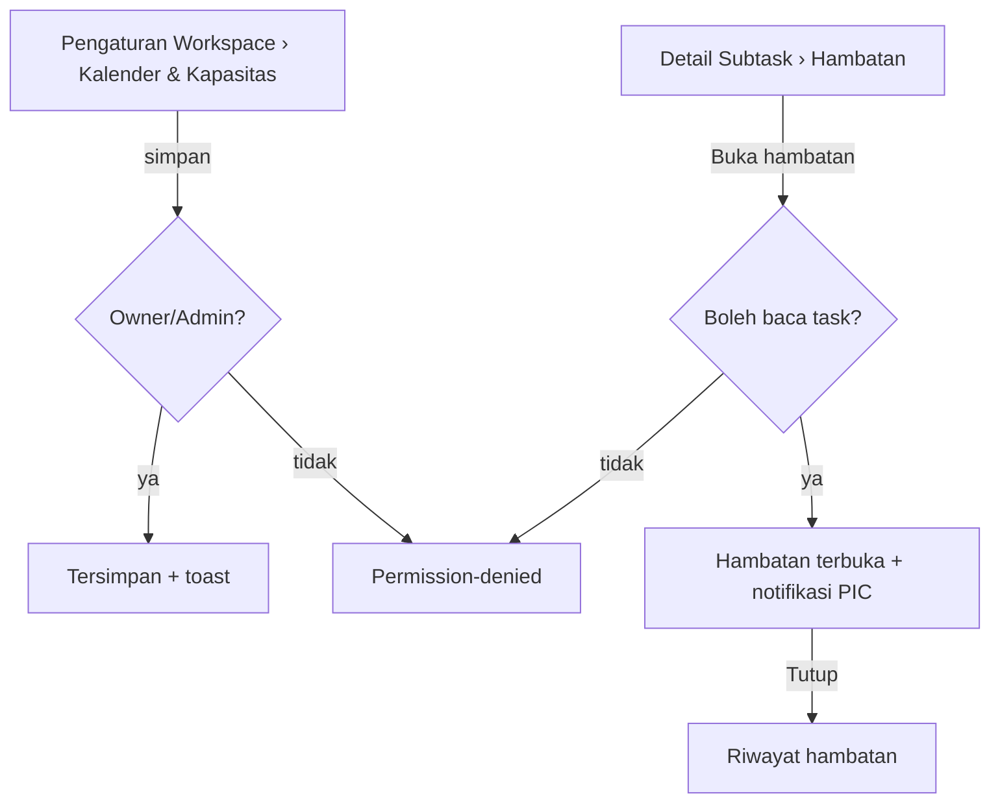

# WORK-FOUNDATION — Tahap 2: PRD (Product Requirements)

**Status:** Menunggu persetujuan
**Gerbang:** G2 — disetujui oleh PO
**Solusi terpilih:** [solution.md](solution.md)
**Applicable Policy IDs:** DOC-005, UI-001, UI-002, SDLC-001, FLOW-002, DATA-005

## 1. Tujuan dan pengguna

Owner/Admin mengatur kalender dan kapasitas; PO memberi effort saat menjadwalkan Subtask; Dev/QA/PO
mencatat hambatan dengan PIC. Metrik: [problem.md](problem.md) §5.

## 2. Requirement dan Acceptance Criteria

| Req ID | Requirement                                                           | AC ID  | Acceptance Criterion (Given / When / Then)                                                                                                                                                               | Role        | Bukti minimum                                                 |
| ------ | --------------------------------------------------------------------- | ------ | -------------------------------------------------------------------------------------------------------------------------------------------------------------------------------------------------------- | ----------- | ------------------------------------------------------------- |
| REQ-1  | Laporan kualitas histori status dan `completedAt` tanpa mengubah data | AC-1.1 | Given database dengan Subtask `done`, When skrip audit dijalankan, Then laporan berisi jumlah Subtask tanpa event `in_progress` dan tanpa `completedAt`, per Workspace, dan tidak ada baris yang berubah | Owner       | E3 — skrip dijalankan ke PostgreSQL seed, hitungan dicocokkan |
| REQ-2  | Kalender Workspace                                                    | AC-2.1 | Given Owner/Admin, When menyimpan zona waktu, hari kerja, dan hari libur, Then nilai tersimpan dan terbaca kembali                                                                                       | Owner/Admin | E3 — integration write/read-back                              |
|        |                                                                       | AC-2.2 | Given PO/Dev/QA, When mengubah kalender, Then 403 dan data tidak berubah                                                                                                                                 | PO/Dev/QA   | E3 — integration 403                                          |
|        |                                                                       | AC-2.3 | Given Workspace tanpa pengaturan, Then default Asia/Jakarta dan Senin–Jumat dipakai                                                                                                                      | semua       | E3                                                            |
|        |                                                                       | AC-2.4 | Given rentang tanggal dan kalender, When menghitung hari kerja, Then hari libur dan akhir pekan tidak dihitung (termasuk pergantian bulan)                                                               | sistem      | E2 — unit test                                                |
| REQ-3  | Effort Subtask                                                        | AC-3.1 | Given Planner, When membuat/menjadwalkan Subtask baru dengan effort, Then effort tersimpan dan poinnya mengikuti peta di contracts                                                                       | PO          | E3                                                            |
|        |                                                                       | AC-3.2 | Given Planner membuat Subtask baru berjadwal tanpa effort, Then 400 dengan pesan jelas; Subtask lama tanpa effort tetap bisa diubah field lainnya                                                        | PO          | E3                                                            |
|        |                                                                       | AC-3.3 | Given Dev/QA, When mengubah effort, Then 403 (`FLOW-002`)                                                                                                                                                | Dev/QA      | E3                                                            |
|        |                                                                       | AC-3.4 | Draft AI (Apply) membawa effort bila ada; bila tidak, Subtask ditandai "beban belum diukur"                                                                                                              | PO          | E3                                                            |
| REQ-4  | Kapasitas dan cuti                                                    | AC-4.1 | Given Owner/Admin, When mengatur kapasitas default Workspace, Then tersimpan                                                                                                                             | Owner/Admin | E3                                                            |
|        |                                                                       | AC-4.2 | Given user, When mengatur kapasitas pribadi dan cuti sendiri, Then tersimpan; Owner/Admin dari Workspace bersama juga boleh; pihak lain 403                                                              | semua       | E3                                                            |
|        |                                                                       | AC-4.3 | Kapasitas efektif = override user atau default terkecil dari Workspace aktif user                                                                                                                        | sistem      | E2/E3                                                         |
|        |                                                                       | AC-4.4 | Cuti hanya menyimpan rentang tanggal, tanpa alasan                                                                                                                                                       | sistem      | E1/E3                                                         |
| REQ-5  | Hambatan (blocker)                                                    | AC-5.1 | Given anggota yang boleh membaca task (`AUTH-013`), When membuka hambatan dengan kategori, deskripsi, dan PIC anggota Workspace, Then tersimpan, tercatat di activity, dan PIC menerima notifikasi       | Dev/QA/PO   | E3                                                            |
|        |                                                                       | AC-5.2 | Given pembuka, PIC, atau Planner, When menutup hambatan, Then `resolved_at/by` terisi dan tercatat; pihak lain 403                                                                                       | semua       | E3                                                            |
|        |                                                                       | AC-5.3 | Status task tidak berubah saat hambatan dibuka/ditutup                                                                                                                                                   | sistem      | E3                                                            |
|        |                                                                       | AC-5.4 | Panel Hambatan di detail Subtask menampilkan hambatan terbuka dan riwayat, dengan state loading/empty/error/permission                                                                                   | semua       | E2 + E4 (phone/desktop)                                       |

## 3. User flow



| Langkah | Layar / route                                   | Aksi user                                             | Respons sistem                    | AC             |
| ------- | ----------------------------------------------- | ----------------------------------------------------- | --------------------------------- | -------------- |
| 1       | `/workspaces/settings` tab Kalender & Kapasitas | Ubah zona waktu, hari kerja, libur, kapasitas default | Simpan; validasi zona waktu IANA  | AC-2.1, AC-4.1 |
| 2       | Form Subtask                                    | Pilih effort XS–XL                                    | Wajib bila Subtask baru berjadwal | AC-3.1, AC-3.2 |
| 3       | Profil › Kapasitas & cuti                       | Isi kapasitas pribadi dan rentang cuti                | Simpan                            | AC-4.2         |
| 4       | Detail Subtask › Hambatan                       | Buka/tutup hambatan                                   | Activity + notifikasi             | AC-5.1, AC-5.2 |

## 4. Wireframe per state

### Layar: Kalender & Kapasitas — `/workspaces/settings`

| State             | Wireframe / link                                                          | Catatan |
| ----------------- | ------------------------------------------------------------------------- | ------- |
| Default           | `docs/plans/work-visibility/design/05-pengaturan-kalender-kapasitas.webp` |         |
| Loading           | skeleton form                                                             |         |
| Empty             | default Asia/Jakarta, Sen–Jum, tanpa libur                                |         |
| Error             | Alert + Coba lagi                                                         |         |
| Disabled          | form hanya-baca untuk PO/Dev/QA, dengan alasan                            |         |
| Permission-denied | sama dengan Disabled                                                      |         |

### Panel: Hambatan — detail Subtask

```text
┌ Hambatan (1 terbuka) ─────────────── [+ Buka hambatan] ┐
│ ● Menunggu akses sandbox bank                           │
│   Pihak eksternal · 4 hari · PIC: Dimas      [Tutup]    │
│ Riwayat (2) ▸                                           │
└─────────────────────────────────────────────────────────┘
```

| State             | Catatan                                      |
| ----------------- | -------------------------------------------- |
| Empty             | "Tidak ada hambatan." + tombol Buka hambatan |
| Loading / Error   | skeleton / Alert + Coba lagi                 |
| Permission-denied | tombol disembunyikan; backend 403            |

| Breakpoint | Perbedaan layout                            |
| ---------- | ------------------------------------------- |
| Phone      | Form satu kolom; daftar libur sebagai kartu |
| Tablet     | Dua kolom pada bagian kapasitas             |
