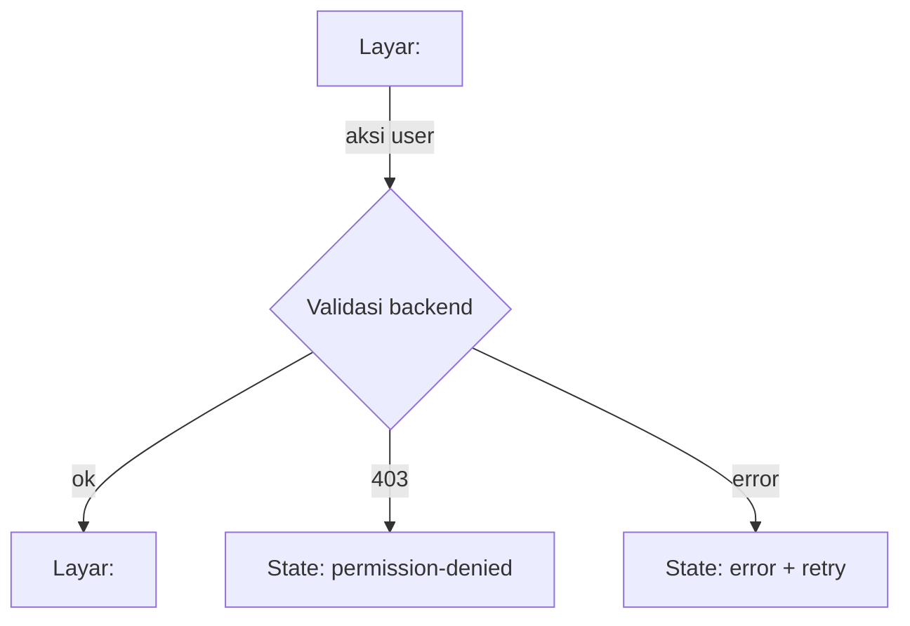

# [FEATURE-ID] — Tahap 2: PRD (Product Requirements)

**Status:** Draft | Menunggu persetujuan | Disetujui
**Gerbang:** G2 — disetujui oleh PO
**Solusi terpilih:** [solution.md](solution.md)
**Applicable Policy IDs:** DOC-005, UI-001, UI-002, SDLC-001, TBD

> Menggantikan `product.md` lama di `_template`. Aturan global (token warna, state UI wajib, RBAC)
> ditautkan ke SSoT, bukan disalin.

## 1. Tujuan dan pengguna

<Ringkas dari problem.md: siapa, untuk apa, metrik sukses.>

## 2. Requirement dan Acceptance Criteria

| Req ID | Requirement | AC ID  | Acceptance Criterion (Given / When / Then) | Role | Bukti minimum (E-level)               |
| ------ | ----------- | ------ | ------------------------------------------ | ---- | ------------------------------------- |
| REQ-1  |             | AC-1.1 | Given … When … Then …                      | QA   | E3 — integration test write/read-back |
|        |             | AC-1.2 | Given role tanpa akses … Then 403          | Dev  | E2/E3 — integration test 403          |

Setiap AC wajib punya bukti minimum. AC tanpa jalur bukti = G2 tidak boleh disetujui.

## 3. User flow

Satu diagram per perjalanan utama, termasuk jalur gagal.



| Langkah | Layar / route | Aksi user | Respons sistem | AC terkait |
| ------- | ------------- | --------- | -------------- | ---------- |
| 1       | `/route`      |           |                | AC-1.1     |

## 4. Wireframe per state

Gambar boleh berupa ASCII, link Design artifact, atau screenshot mockup. **Wajib** untuk setiap layar
baru/berubah. State yang berlaku mengikuti `docs/3_UI_ATOMIC_DESIGN_SYSTEM.md` §6–§7.

### Layar: <nama> — route `<...>`

| State                 | Wireframe / link | Catatan                  |
| --------------------- | ---------------- | ------------------------ |
| Default (berisi data) |                  |                          |
| Loading               |                  | skeleton / spinner       |
| Empty                 |                  | teks + aksi berikutnya   |
| Error                 |                  | pesan + retry            |
| Disabled              |                  | alasan disabled terlihat |
| Permission-denied     |                  |                          |

```text
Contoh ASCII (default, desktop):
┌──────────────────────────────────────────────┐
│ Header                         [Aksi utama]  │
├────────────┬─────────────────────────────────┤
│ Filter     │ Daftar item                     │
│            │  • Item A          status chip  │
│            │  • Item B          status chip  │
└────────────┴─────────────────────────────────┘
```

| Breakpoint | Perbedaan layout |
| ---------- | ---------------- |
| Phone      |                  |
| Tablet     |                  |
| Desktop    |                  |

### Komponen Atomic

| Kebutuhan | Komponen yang dipakai ulang (`apps/web/src/components/ui`) | Komponen baru? alasan |
| --------- | ---------------------------------------------------------- | --------------------- |
|           |                                                            |                       |

## 5. Data, contract, authorization

- Data & API: [contracts.md](contracts.md)
- Authorization matrix: [authorization.md](authorization.md)
- Langkah per role: [roles/](roles/)

## 6. Di luar scope

- <...>

## 7. Unknown yang tersisa

| Pertanyaan | Memengaruhi AC | Status            |
| ---------- | -------------- | ----------------- |
|            |                | Open / Diputuskan |
