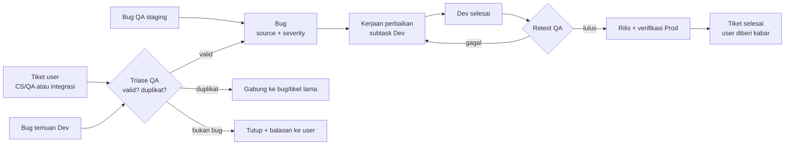

# BUG-INTAKE-SLA — Rencana Program: Bug Temuan Dev, Bug Production, dan Tiket User ber-SLA

**Status:** Draft — Tahap 0 (Problem) dan Tahap 1 (Opsi Solusi), menunggu G0/G1 Owner
**Disusun:** Claude, 2026-10-30 (Asia/Jakarta); dipindahkan dari Project qlickHub ke repo 2026-11-16
**Baseline inspeksi:** `main` 2026-10-30 (read-only, tanpa perubahan repository). Fakta §1 perlu
dicek ulang terhadap `main` saat Tahap 2 dimulai.
**Jalur SDLC:** Penuh (data/migrasi baru, authorization baru, integrasi eksternal) — `SDLC-001`, `SDLC-002`
**Policies terkait:** `AUTH-001`, `AUTH-002`, `AUTH-011`, `AUTH-013`, `QA-002`, `RELEASE-001`,
`RELEASE-002`, `DATA-001`, `DATA-002`, `CONTRACT-001`, `UI-001`, `TEST-001`, `DOC-002`, `DOC-007`,
`SDLC-001`

Dokumen ini adalah payung program. Setelah G0/G1, setiap Feature di §5 dibuat sebagai folder sendiri
(`npm run sdlc:new -- feature <ID>`). Dokumen ini bukan policy dan tidak memberi izin mutasi.

**Desain UI:** canvas Design "qlickHub — Laporan, Leader Hub & Akses", baris **"Bug & Tiket user"**
(9 artboard). Ekspor WebP + sumber masuk repo saat PRD disetujui (`DOC-007`).

**Keputusan Owner yang sudah ada (chat 2026-10-30):**

- Tiket user masuk lewat **dua jalur**: dicatat CS/QA di qlickHub, **dan** integrasi dari sistem lain (API/webhook).
- **Developer boleh mencatat bug temuannya sendiri**; QA melakukan triase sebelum masuk antrean perbaikan.
- **Aturan SLA sudah ada** di pihak Owner — angka targetnya belum diterima (lihat Unknown U1).

---

## 1. Fakta terkonfirmasi (sumber primer, per 2026-10-30)

| Area            | Fakta                                                                                                                                                                                                               | Sumber                                                           | Implikasi                                                                                     |
| --------------- | ------------------------------------------------------------------------------------------------------------------------------------------------------------------------------------------------------------------- | ---------------------------------------------------------------- | --------------------------------------------------------------------------------------------- |
| Model Bug       | `featureTaskId` dan `requirementId` **wajib** (NOT NULL); `testResultId` opsional; `environment` `staging`/`production`; `severity` critical/high/medium/low; `status` open/in_progress/resolved/verified/reopened. | `apps/api/src/db/models/bug.ts`, `packages/contracts/src/bug.ts` | Bug selalu harus terkait Feature + Requirement. Tiket user sering belum tahu Requirement-nya. |
| Pembuat bug     | `POST /workspaces/:id/bugs` hanya `owner`, `admin`, `qa`; assignee wajib Developer (`assertDeveloperAssignee`).                                                                                                     | `bugRoutes.ts`, `bugService.ts`                                  | Developer belum bisa mencatat temuannya sendiri.                                              |
| Alur bug        | Resolution event oleh Developer assignee; retest dan reopen oleh QA; activity dan evidence link sudah ada.                                                                                                          | `bugRoutes.ts`, `bugService.ts`                                  | Alur perbaikan → retest bisa dipakai ulang.                                                   |
| Halaman kerja   | `BugWorkPage` untuk Developer dan QA.                                                                                                                                                                               | `apps/web/src/pages/BugWorkPage.tsx`                             | Detail bug sudah ada; daftar/laporan lintas sumber belum.                                     |
| Role workspace  | `owner`, `admin`, `po`, `dev`, `qa` — tidak ada role support/CS.                                                                                                                                                    | `packages/contracts/src/workspace.ts`                            | CS butuh role baru atau memakai QA.                                                           |
| Tiket & SLA     | Tidak ada model, kontrak, atau UI tiket maupun SLA.                                                                                                                                                                 | pencarian repo `ticket`/`tiket`/`sla`                            | Entitas baru.                                                                                 |
| Rencana terkait | SIMPLE-UI-DELIVERY-FLOW **P8a** (Belum mulai): `bugs.source` + `bugs.release_id`, laporan user dicatat QA/support sebagai bug production (AC-8.1); **P8b** pemantauan rilis.                                        | `docs/features/SIMPLE-UI-DELIVERY-FLOW/breakdown.md`             | Tumpang tindih — lihat D1.                                                                    |
| Kalender kerja  | Belum ada; direncanakan di WORK-VISIBILITY F1-P2.                                                                                                                                                                   | `docs/plans/WORK_VISIBILITY_PROGRAM_PLAN.md`                     | SLA jam kerja bergantung padanya.                                                             |

---

## 2. Tahap 0 — Problem (draft)

| #   | Masalah                                                                                                   | Terdampak          |
| --- | --------------------------------------------------------------------------------------------------------- | ------------------ |
| P1  | Bug yang ditemukan Developer saat mengerjakan tidak bisa dicatat sendiri; sering hilang di chat.          | Dev, QA            |
| P2  | Bug production dan tiket user tidak punya tempat di qlickHub; status ke user dan tenggat tidak terpantau. | CS, QA, PO, Leader |
| P3  | Tidak ada SLA: tim tidak tahu tiket mana yang hampir lewat batas, dan Leader tidak melihat kepatuhan SLA. | Leader, CS         |
| P4  | Tiket harus diubah manual menjadi kerjaan tim; hubungan tiket → bug → perbaikan → rilis tidak terlacak.   | Semua              |
| P5  | Tidak ada laporan yang membedakan sumber bug (Dev, QA staging, production, user).                         | Leader, QA         |

**Metrik sukses (pilot 4 minggu):** 100% tiket user tercatat dengan jam masuk dan severity; ≥90% tiket
memenuhi target respons; setiap tiket yang diperbaiki punya tautan ke bug/kerjaan dan rilis; Leader bisa
melihat tiket yang berisiko lewat SLA dalam satu layar.

**Di luar scope:** portal publik untuk user (kandidat lanjutan); chat dua arah dengan user dari dalam
qlickHub; penalti/kontrak SLA; peringkat individu (`Workflow §2.5`).

**Unknown:**

| ID  | Unknown                                                                                     | Cara menyelesaikan                    |
| --- | ------------------------------------------------------------------------------------------- | ------------------------------------- |
| U1  | Angka SLA (target respons & selesai per severity, jam kerja atau 24/7, kapan jam berhenti). | Owner mengirim aturan SLA yang ada.   |
| U2  | Sistem asal integrasi (helpdesk apa, format data, bisa kirim webhook atau harus ditarik).   | Owner/tim produk.                     |
| U3  | Data pribadi pelapor yang boleh disimpan (nama, kontak, ID pelanggan).                      | Owner + kebijakan privasi perusahaan. |

---

## 3. Alur target

Jam SLA: **respons** berjalan dari tiket masuk sampai triase pertama; **penyelesaian** berjalan sampai
perbaikan terverifikasi di production (atau tiket ditutup dengan alasan). Jam **berhenti sementara** saat
status "Menunggu info user".

---

## 4. Tahap 1 — Opsi solusi dan Decision Snapshot

| Topik                     | Opsi A (rekomendasi)                                                                                                                                                 | Opsi B                                            | Alasan rekomendasi                                                                |
| ------------------------- | -------------------------------------------------------------------------------------------------------------------------------------------------------------------- | ------------------------------------------------- | --------------------------------------------------------------------------------- |
| 4.1 SIMPLE-UI P8a         | P8a (bug production + `source` + `release_id`) pindah ke program ini sebagai BI-P1; SIMPLE-UI tetap memegang P8b dan membaca data dari sini.                         | Tunggu P8a selesai, lalu tambah tiket di atasnya. | Satu model bug lintas sumber; `source` tidak dirancang dua kali.                  |
| 4.2 Tiket vs bug          | Tiket = entitas baru (suara user, SLA, kontak); bug tetap entitas teknis; banyak tiket bisa menaut ke satu bug.                                                      | Tiket = bug dengan `source = user`.               | Bug tetap bersih; tiket tidak memaksa Feature/Requirement; duplikat terlacak.     |
| 4.3 Pencatat tiket        | Role workspace baru `support` (tiket saja); QA dan Owner/Admin juga bisa.                                                                                            | Hanya QA.                                         | Akses minimal untuk CS; data kontak terbatas.                                     |
| 4.4 Bug temuan Developer  | **Sudah dipilih Owner:** Developer membuat bug berstatus `needs_triage`; QA menetapkan severity final, assignee, dan menolak/menggabungkan duplikat.                 | —                                                 | Temuan tidak hilang; QA menjaga kualitas data.                                    |
| 4.5 Tiket menjadi kerjaan | "Jadikan bug" (pilih Feature; Requirement opsional untuk production/user) lalu subtask perbaikan; tanpa Feature cocok memakai Feature root "Perbaikan production".   | Tiket langsung jadi subtask tanpa bug.            | Masuk alur Dev → QA → rilis yang ada; retest, evidence dan statistik bug terjaga. |
| 4.6 Integrasi             | Inbound API per workspace `POST /v1/integrations/tickets` dengan token integrasi (hash, bisa dicabut) dan `external_ref` untuk idempotensi; webhook keluar opsional. | Konektor khusus per vendor helpdesk.              | Tidak tergantung vendor; tidak menunggu U2.                                       |

---

## 5. Struktur Feature dan phase

| Phase | Feature            | Isi                                                                                                                                                    | Bergantung                              |
| ----- | ------------------ | ------------------------------------------------------------------------------------------------------------------------------------------------------ | --------------------------------------- |
| BI-P1 | BUG-SOURCES        | `bugs.source` (`dev_finding`, `qa_test`, `production`, `user_ticket`), `release_id`, environment `development`; status `needs_triage`; Dev boleh catat | —                                       |
| BI-P2 | BUG-SOURCES        | Antrean triase QA: valid/duplikat/bukan bug, severity final, assignee                                                                                  | BI-P1                                   |
| BI-P3 | BUG-SOURCES        | Daftar bug lintas sumber (Bug Hub) + filter                                                                                                            | BI-P1                                   |
| TK-P1 | USER-TICKETS       | Entitas tiket + role `support` + form CS + daftar + detail + status                                                                                    | BI-P1                                   |
| TK-P2 | USER-TICKETS       | Jadikan bug / gabung duplikat / tutup dengan alasan; tautan tiket ↔ bug ↔ rilis                                                                        | TK-P1, BI-P2                            |
| TK-P3 | USER-TICKETS       | Riwayat tiket append-only + catatan balasan ke user                                                                                                    | TK-P1                                   |
| SL-P1 | TICKET-SLA         | Kebijakan SLA per workspace per severity (respons, selesai, jam kerja/24×7, eskalasi)                                                                  | TK-P1, WORK-VISIBILITY F1-P2 (kalender) |
| SL-P2 | TICKET-SLA         | Jam SLA (mulai, jeda, lanjut, berhenti), status Aman/Berisiko/Lewat SLA                                                                                | SL-P1                                   |
| SL-P3 | TICKET-SLA         | Notifikasi berisiko (75%) dan lewat SLA + eskalasi                                                                                                     | SL-P2                                   |
| IN-P1 | TICKET-INTEGRATION | Token integrasi + inbound API idempoten + rate limit                                                                                                   | TK-P1                                   |
| IN-P2 | TICKET-INTEGRATION | Webhook keluar status tiket (opsional)                                                                                                                 | IN-P1, U2                               |
| RP-P1 | BUG-REPORTS        | Laporan bug & SLA: per sumber, MTTR per severity, kepatuhan SLA, tiket berisiko; masuk Leader Hub                                                      | BI-P3, SL-P2                            |

**Urutan disarankan:** BI-P1 → BI-P2 → TK-P1 → TK-P2 → SL-P1 → SL-P2 → BI-P3 → RP-P1 → SL-P3 → TK-P3 → IN-P1 → IN-P2.

---

## 6. Keputusan yang diperlukan

| ID  | Keputusan                                              | Rekomendasi                                                                                                                                                 |
| --- | ------------------------------------------------------ | ----------------------------------------------------------------------------------------------------------------------------------------------------------- |
| D1  | Nasib SIMPLE-UI P8a                                    | Opsi 4.1A — pindah ke BI-P1                                                                                                                                 |
| D2  | Tiket sebagai entitas sendiri                          | Opsi 4.2A                                                                                                                                                   |
| D3  | Role `support`                                         | Opsi 4.3A                                                                                                                                                   |
| D4  | `requirementId` nullable                               | Opsional untuk `production`/`user_ticket`; untuk `dev_finding` boleh kosong saat dicatat tetapi wajib diisi QA sebelum keluar triase; wajib untuk `qa_test` |
| D5  | Feature penampung "Perbaikan production" per workspace | Ya, dibuat otomatis saat tiket pertama dijadikan bug tanpa Feature cocok                                                                                    |
| D6  | Definisi "selesai" untuk SLA                           | Perbaikan terverifikasi di production, atau tiket ditutup dengan alasan                                                                                     |
| D7  | Data pelapor yang disimpan                             | Nama + kanal + ID pelanggan; kontak hanya terlihat oleh support/QA/Owner/Admin (U3)                                                                         |
| D8  | Angka SLA                                              | Mengikuti aturan Owner (U1)                                                                                                                                 |

Perubahan policy yang perlu ADR sebelum implementasi (`DOC-002`): role `support` dan batas akses data
pelapor; Developer membuat bug + status `needs_triage`; model tiket + SLA; token integrasi. Akses baca
tiket dan bug wajib mengikuti `AUTH-013` (ADR-043).

---

## 7. Dampak authorization, data, dan migrasi

- **Authorization:** role `support` (tiket saja); Developer `POST bugs` hanya dengan status `needs_triage`;
  triase hanya QA/Owner/Admin; data kontak pelapor tidak dikirim ke Dev/PO; token integrasi hanya
  membuat tiket di workspace pemiliknya.
- **Migrasi (aditif):** kolom `source`, `release_id`, status `needs_triage`, environment `development` di
  `bugs`; `requirement_id` nullable bersyarat (CHECK constraint per `source`); tabel `support_tickets`,
  `ticket_events`, `sla_policies`, `integration_tokens`; enum role `support`.
- **Production:** tidak ada mutasi Production sebelum G6 per Feature.

## 8. Acceptance criteria tingkat program → evidence

| AC                                                                                                               | Evidence                                |
| ---------------------------------------------------------------------------------------------------------------- | --------------------------------------- |
| AC-B1: Developer mencatat bug temuan; bug masuk antrean triase dan tidak masuk antrean perbaikan sebelum triase. | Integration PostgreSQL + authz test     |
| AC-B2: Tiket dari CS dan dari integrasi tersimpan sekali (idempoten) dengan jam masuk dan severity.              | Integration test token + `external_ref` |
| AC-B3: Tiket dapat dijadikan bug dan subtask perbaikan; tautan tiket ↔ bug ↔ rilis terlihat dua arah.            | Integration + E4 UAT                    |
| AC-B4: Jam SLA berjalan, berhenti saat "Menunggu info user", dan status Berisiko/Lewat SLA benar.                | Unit test kalkulasi + integration       |
| AC-B5: Kontak pelapor tidak terlihat oleh Developer/PO.                                                          | Authz test                              |
| AC-B6: Laporan bug per sumber dan kepatuhan SLA cocok dengan daftar sumbernya.                                   | Rekonsiliasi angka                      |

## 9. Langkah berikutnya

1. Owner mengirim angka SLA yang berlaku (U1) dan nama sistem asal integrasi (U2).
2. Owner memutuskan D1–D8 (boleh "pakai semua rekomendasi").
3. Setelah G0/G1: buat folder Feature, ADR, lalu PRD BUG-SOURCES dan USER-TICKETS lebih dulu.
