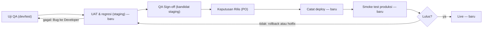

# Rencana Lanjutan — Jadwal Subtask, Referensi & Media, Perubahan Brief, Alur Rilis (F1–F4)

**Status:** Proposal — F1 siap dikerjakan; F2–F4 menunggu keputusan Owner K1–K7
**Tanggal:** 2026-11-07
**Owner:** reyand (Owner)
**Pelaksana:** Codex
**Sumber:** uji manual E2E-SDLC-FLOW dan temuan Owner 2026-11-06; versi kerja di Claude Docs
"Rencana Lanjutan qlickHub — Jadwal, Media, Brief, dan Rilis".

Rencana ini bukan policy dan bukan izin implementasi. Setiap butir dikerjakan lewat Feature folder
(`npm run sdlc:new -- feature <ID>`) dengan gerbang G0–G3 disetujui Owner sebelum build, sesuai
[Agent Guidelines §2B](../4_AGENT_DEV_GUIDELINES.md#2b-tahap-sdlc-feature-staged-feature-sdlc).
Periksa ulang asumsi terhadap kode sebelum mulai.

## Ringkasan

| ID  | Feature ID usulan                 | Masalah                                                                                           | Ukuran | Migrasi           |
| --- | --------------------------------- | ------------------------------------------------------------------------------------------------- | ------ | ----------------- |
| F1  | `SUBTASK-SCHEDULE-WITHIN-FEATURE` | Tanggal Feature bisa dipersempit sampai subtask aktif berada di luar rentang                      | Kecil  | Tidak             |
| F2  | `FEATURE-REFERENCES-MEDIA`        | Tidak ada tempat untuk banyak tautan, gambar, dan video produk                                    | Sedang | Ya (`task_links`) |
| F3  | `PRODUCT-BRIEF-CHANGE-CONTROL`    | Brief yang sudah disetujui bisa diubah tanpa persetujuan ulang dan tanpa pemberitahuan            | Sedang | Mungkin           |
| F4  | `RELEASE-UAT-DEPLOY-SMOKE`        | Alur berhenti di Keputusan Rilis: tidak ada UAT staging, catatan deploy, atau smoke test produksi | Besar  | Ya + ADR          |

Urutan: F1 → F3 → F2 → F4.

## F1 — Jadwal subtask harus di dalam rentang Feature

Hari ini API hanya mengecek tanggal mulai tidak lewat dari tenggat (`getTaskScheduleValidationIssue`
di `packages/contracts/src/task.ts`). Tidak ada pengecekan Feature ↔ subtask di
`apps/api/src/modules/tasks/internal/taskLifecycle.ts`, baik saat membuat maupun mengedit.

Aturan:

1. Edit tanggal Feature: bila ada subtask aktif (bukan `done`/`canceled`) dengan mulai < mulai
   Feature atau tenggat > tenggat Feature → `409` yang menyebut subtask dan tanggalnya.
2. Buat atau edit subtask: tanggal wajib di dalam rentang Feature; di luar → `400` dengan rentangnya.
3. Feature tanpa tanggal tidak membatasi subtask. Subtask selesai/dibatalkan tidak dihitung.
4. Data lama yang sudah keluar rentang tidak diubah; hanya ditandai di halaman Feature sampai disunting.

| Task    | Layer | Pekerjaan                                                                                                                                                                    |
| ------- | ----- | ---------------------------------------------------------------------------------------------------------------------------------------------------------------------------- |
| F1-BE-1 | BE    | `assertSubtasksWithinFeatureSchedule` di jalur update Feature dan create/update subtask, di dalam transaksi yang sama (`updateTaskInTransaction`, `createTaskInTransaction`) |
| F1-FE-1 | FE    | Form tanggal Feature dan subtask menampilkan batas rentang; pesan 409 menyebut subtask yang bentrok                                                                          |
| F1-FE-2 | FE    | Penanda "di luar jadwal Feature" di daftar subtask untuk data lama                                                                                                           |
| F1-QA-1 | QA    | Integration test PostgreSQL (persempit, perluas, subtask selesai diabaikan) + satu langkah E2E                                                                               |

- AC-F1.1 Given subtask aktif bertenggat 20 Nov, when tenggat Feature diubah ke 15 Nov, then `409` menyebut subtask itu dan tanggal Feature tidak berubah.
- AC-F1.2 Given Feature 1–30 Nov, when subtask dibuat 25 Nov–5 Des, then `400` dengan rentang 1–30 Nov.
- AC-F1.3 Given subtask `done` bertenggat 20 Nov, when tenggat Feature diubah ke 15 Nov, then perubahan diterima.

Keputusan Owner F1, 2026-11-07 (`ok` atas G0–G3): K1 tolak tanpa auto-shift; L1 edit tanggal
legacy wajib menghasilkan rentang valid penuh, edit non-tanggal tetap boleh; L2 reopen keluar
rentang ditolak. Data lama tidak diubah massal. [ADR-042](../adr/ADR-042-SUBTASK-SCHEDULE-WITHIN-FEATURE.md).

## F2 — Referensi & Media di halaman Feature

Satu bagian "Referensi & Media" di tahap PRD halaman Feature, tepat di bawah Product Brief. Sudah
ada: API lampiran ke Google Drive dengan kategori `product_media` (batas kontrak 15 MB) dan
`GET /v1/meta/link-preview`. `TaskAttachmentsPanel.tsx` belum dipasang di halaman mana pun.

| Jenis  | Cara masuk                                                        | Ditampilkan                                  | Catatan                                                                               |
| ------ | ----------------------------------------------------------------- | -------------------------------------------- | ------------------------------------------------------------------------------------- |
| Tautan | Judul + URL + jenis (Figma, dokumen, spreadsheet, video, lainnya) | Kartu dengan pratinjau, bisa diurutkan       | Jumlah tidak dibatasi; hanya `https`                                                  |
| Gambar | Upload lewat API lampiran yang ada                                | Galeri dengan keterangan                     | Batas efektif ±4,5 MB per request karena batas body fungsi Vercel; kompres di browser |
| Video  | Tautan YouTube, Loom, atau Google Drive                           | Kartu tautan; YouTube bisa diputar di tempat | Upload video langsung (signed URL ke penyimpanan) di luar fase ini                    |

Subtask tidak menyimpan salinan; halaman kerja Developer dan QA menautkan "Referensi Feature".

| Task    | Layer | Pekerjaan                                                                                         |
| ------- | ----- | ------------------------------------------------------------------------------------------------- |
| F2-DB-1 | DB    | Tabel `task_links` (workspace, task, judul, URL, jenis, urutan, pembuat) dengan FK Workspace      |
| F2-BE-1 | BE    | CRUD tautan per Feature + urutan; validasi URL `https`; izin sesuai K2                            |
| F2-FE-1 | FE    | Bagian Referensi & Media di tahap PRD: daftar tautan, galeri gambar, tambah/hapus/urutkan         |
| F2-FE-2 | FE    | Tautan "Referensi Feature" di halaman kerja Developer dan QA                                      |
| F2-QA-1 | QA    | Integration test izin dan validasi + E2E: PO menambah 3 tautan dan 1 gambar, Developer melihatnya |

- AC-F2.1 Given PO di tahap PRD, when menambah beberapa tautan, then semuanya tampil berurutan dengan pratinjau dan bisa diurutkan ulang.
- AC-F2.2 Given gambar ≤ batas, when PO meng-upload, then gambar tampil di galeri; di atas batas, pesan menjelaskan batasnya sebelum upload.
- AC-F2.3 Given Developer di halaman kerja subtask, when membuka Referensi Feature, then tautan dan gambar tampil hanya baca.

## F3 — Perubahan Brief setelah disetujui

Hari ini `qaDocumentService.upsertProductBrief` selalu membuat versi baru, tetapi status mengikuti
input editor (tetap `approved`), `ensureAutoBaseline` membuat baseline kesiapan baru diam-diam, dan
tidak ada notifikasi. QA Sign-off terikat ke baseline siklus uji; belum ada aturan yang membatalkan
sign-off bila Brief berubah sesudahnya (disimpulkan dari `releaseDecisionService.ts`; buktikan
dengan tes merah dulu).

Mekanisme:

1. Saat menyimpan Brief yang Disetujui, PO memilih jenis perubahan: Redaksional atau Scope.
2. Redaksional: versi baru, status tetap Disetujui. Server menolak "redaksional" bila item In/Out scope berubah.
3. Scope: catatan perubahan wajib; status kembali ke `in_review`; kartu "Setujui Brief" muncul lagi; halaman Brief menampilkan beda versi.
4. Developer dan QA Feature menerima notifikasi dan kartu "Brief berubah — tinjau subtask/Test Case".
5. QA Sign-off yang sudah tercatat ditandai perlu diulang; Keputusan Rilis menolak sign-off itu.
6. Feature dengan Keputusan Rilis Disetujui: Brief dikunci; tambahan scope jadi Feature baru yang menautkan Feature lama (K4).

| Task    | Layer | Pekerjaan                                                                                    |
| ------- | ----- | -------------------------------------------------------------------------------------------- |
| F3-BE-1 | BE    | `changeKind` + catatan wajib di `upsertProductBrief`; deteksi perubahan scope di server      |
| F3-BE-2 | BE    | Event outbox "Brief berubah" ke Developer/QA Feature; item antrean tinjau                    |
| F3-BE-3 | BE    | Sign-off usang bila scope Brief berubah setelah sign-off; Keputusan Rilis menolaknya (`409`) |
| F3-FE-1 | FE    | Pilihan jenis perubahan + catatan di editor Brief; tampilan beda versi                       |
| F3-QA-1 | QA    | Integration test + E2E ubah scope setelah sign-off                                           |

- AC-F3.1 Given Brief Disetujui, when PO menambah item In scope, then status Menunggu persetujuan dan kartu Setujui Brief muncul.
- AC-F3.2 Given perubahan scope, then Developer dan QA Feature menerima notifikasi yang membuka halaman Brief.
- AC-F3.3 Given QA sign-off tercatat, when scope Brief berubah, then Keputusan Rilis dengan sign-off itu ditolak sampai QA mencatat sign-off baru.
- AC-F3.4 Given perubahan redaksional, then status tetap Disetujui dan versi baru tercatat.

## F4 — Alur rilis di aplikasi: UAT staging, catat deploy, smoke test produksi

Feature dianggap Live hanya setelah kandidat yang lulus UAT di staging di-deploy dan lolos smoke test
produksi. Hari ini alur berhenti di Keputusan Rilis; siklus uji punya `build`, `candidateFingerprint`,
dan `environment` (teks bebas); tidak ada model deployment.

Aturan:

- Siklus uji punya jenis: QA, UAT/regresi (staging), Smoke (produksi). Environment dipilih dari daftar per Workspace.
- Test Case bisa ditandai regresi dan smoke; siklus UAT bisa memuat Test Case regresi dari Feature lain yang terdampak.
- QA Sign-off mengunci kandidat yang lulus UAT; kandidat berubah setelah sign-off = sign-off tidak berlaku.
- Catat deploy menyimpan kandidat, environment produksi, waktu, pencatat, dan tautan pipeline; ditolak bila kandidat beda dari yang disetujui.
- Smoke lulus = Feature Live. Gagal = keputusan rollback atau hotfix tercatat; hotfix membuka kandidat baru.
- Tahap baru diaktifkan per Workspace (K7); bila mati, alur tetap seperti sekarang.

| Task    | Layer | Pekerjaan                                                                                                         |
| ------- | ----- | ----------------------------------------------------------------------------------------------------------------- |
| F4-DB-1 | DB    | Jenis siklus uji, daftar environment per Workspace, tanda regresi/smoke di Test Case, tabel `feature_deployments` |
| F4-BE-1 | BE    | Siklus UAT dengan Test Case regresi lintas Feature; sign-off terkunci ke kandidat                                 |
| F4-BE-2 | BE    | Endpoint catat deploy (+ webhook pipeline menyusul) dengan cek kandidat; status Siap deploy → Deployed → Live     |
| F4-BE-3 | BE    | Siklus smoke produksi; keputusan rollback/hotfix; item antrean per tahap                                          |
| F4-FE-1 | FE    | Kartu Tugas Saya: Jalankan UAT staging, Catat deploy, Smoke test produksi; panel rilis menampilkan tahapnya       |
| F4-FE-2 | FE    | Pengaturan Workspace: environment dan aktif/nonaktif tahap                                                        |
| F4-QA-1 | QA    | Integration test (kandidat beda ditolak, sign-off usang) + E2E satu rilis lengkap sampai Live                     |

- AC-F4.1 Given Keputusan Rilis Disetujui, when deploy dicatat dengan kandidat lain, then ditolak dan menyebut kandidat yang disetujui.
- AC-F4.2 Given deploy tercatat, then QA mendapat kartu Smoke test produksi berisi Test Case bertanda smoke.
- AC-F4.3 Given smoke test lulus, then Feature berstatus Live dengan versi dan waktu deploy.
- AC-F4.4 Given smoke test gagal dan hotfix dipilih, then kandidat baru wajib lulus UAT staging sebelum deploy lagi.
- AC-F4.5 Given tahap rilis dinonaktifkan di Workspace, then alur berhenti di Keputusan Rilis seperti sekarang.

F4 butuh ADR baru dan dipecah tiga fase: (a) jenis siklus dan environment, (b) catat deploy,
(c) smoke dan status Live.

## Keputusan Owner

| ID  | Untuk | Pertanyaan                                                                | Rekomendasi                                           | Keputusan                              |
| --- | ----- | ------------------------------------------------------------------------- | ----------------------------------------------------- | -------------------------------------- |
| K1  | F1    | Tanggal Feature dipersempit: tolak saja, atau tawarkan menggeser subtask? | Tolak dulu; tawaran geser menyusul                    | Tolak; Owner ok, 2026-11-07 (G0–G3 F1) |
| K2  | F2    | Siapa boleh menambah tautan dan gambar?                                   | Owner/Admin/PO                                        | Belum                                  |
| K3  | F3    | Persetujuan ulang Brief: PO yang sama, atau harus Owner/Admin?            | PO yang sama                                          | Belum                                  |
| K4  | F3    | Feature yang sudah dirilis: Brief dikunci, tambahan jadi Feature baru?    | Ya                                                    | Belum                                  |
| K5  | F4    | UAT staging dijalankan siapa?                                             | QA untuk regresi, PO untuk penerimaan bisnis          | Belum                                  |
| K6  | F4    | Catat deploy oleh siapa?                                                  | Developer atau Owner/Admin; webhook pipeline menyusul | Belum                                  |
| K7  | F4    | Tahap UAT, deploy, smoke wajib atau per Workspace?                        | Per Workspace, default aktif                          | Belum                                  |

Pelaksana tidak memulai F2–F4 sebelum keputusan yang relevan terisi di tabel ini oleh Owner.

## Risiko

| Risiko                                                                  | Mitigasi                                                                                        |
| ----------------------------------------------------------------------- | ----------------------------------------------------------------------------------------------- |
| F1 menolak edit pada Feature lama yang subtasknya sudah di luar rentang | Data lama ditandai; edit tanggal wajib valid penuh, edit non-tanggal tetap boleh (L1 disetujui) |
| Upload gambar besar gagal di batas body Vercel                          | Kompres di browser; pesan batas sebelum upload; video lewat tautan                              |
| F3 menambah langkah PO pada perubahan kecil                             | Pilihan Redaksional; persetujuan ulang hanya bila scope berubah                                 |
| F4 menambah tahap yang belum dipakai semua tim                          | Aktif/nonaktif per Workspace (K7)                                                               |
| Data kerja Production kosong setelah reset 2026-11-06                   | Uji ulang tiap fase memakai Feature uji baru bertanda `[UJI]`                                   |
