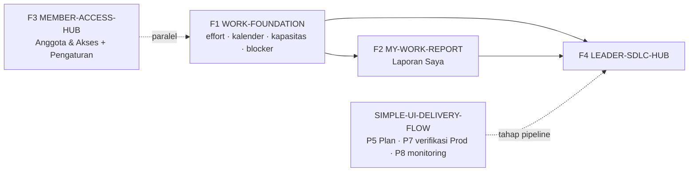

# WORK-VISIBILITY — Rencana Program: Laporan Saya, Leader Hub SDLC, dan Anggota & Akses

**Status:** Draft — Tahap 0 (Problem) dan Tahap 1 (Opsi Solusi), menunggu G0/G1 Owner
**Disusun:** Claude, 2026-10-29 (Asia/Jakarta)
**Baseline inspeksi:** `3c2254c` (read-only); disimpan di repo dari `main` @ `04ff4f4`
**Jalur SDLC:** Penuh (lintas role, data/migrasi, authorization) — `SDLC-001`, `SDLC-002`
**Policies terkait:** `AUTH-001`, `AUTH-002`, `AUTH-011`, `FLOW-007`, `DATA-001`, `CONTRACT-001`,
`UI-001`–`UI-005`, `TEST-001`, `DOC-002`–`DOC-007`, `SDLC-001`, `SDLC-002`

Dokumen ini adalah **payung program**. Setelah G0/G1 disetujui, setiap Feature di §4 dibuat sebagai
folder sendiri dengan `npm run sdlc:new -- feature <ID>`, lalu Tahap 2 (PRD) dan Tahap 3 (Breakdown)
ditulis per Feature. Dokumen ini belum menjadi policy dan tidak memberi izin mutasi.

**Desain UI:** [ekspor dan sumber di `work-visibility/design/`](work-visibility/design/README.md)
(5 layar: Laporan Saya, Leader Hub — Ringkasan, Anggota & Akses, Undang anggota, Pengaturan Workspace —
Kalender & Kapasitas). Canvas Design privat hanya berkas kerja; acuan di repo mengikuti `DOC-007`.

---

## 1. Ringkasan

Tiga permintaan (Laporan, Leader Hub, Pengaturan Workspace) bergantung pada fondasi data yang
**belum ada**: bobot kerja, kapasitas orang, kalender kerja, dan pencatatan hambatan. Program dipecah
menjadi empat Feature dengan urutan:

1. **WORK-FOUNDATION** — effort, kalender workspace, kapasitas, blocker, dan audit histori status.
2. **MEMBER-ACCESS-HUB** — Anggota & Akses lintas workspace serta penataan ulang Pengaturan Workspace
   (bisa berjalan paralel dengan F1 karena hampir tidak bergantung padanya).
3. **MY-WORK-REPORT** — Laporan Saya: semua kerjaan user lintas workspace, tepat waktu/telat,
   kewajaran waktu, dan irisan.
4. **LEADER-SDLC-HUB** — tampilan helikopter pipeline SDLC, kesehatan proyek dan penyebab hambatan,
   beban kerja anggota/tim, dan aksi realtime.

---

## 2. Fakta terkonfirmasi (sumber primer)

| Area                   | Fakta                                                                                                                                                                                                                                                 | Sumber                                                                                                        | Implikasi                                                                                              |
| ---------------------- | ----------------------------------------------------------------------------------------------------------------------------------------------------------------------------------------------------------------------------------------------------- | ------------------------------------------------------------------------------------------------------------- | ------------------------------------------------------------------------------------------------------ |
| Model Task             | Field: `status` (todo, in_progress, in_review, changes_requested, done, canceled), `priority` (low–urgent), `deliveryArea`, `startDate`, `dueDate`, `completedAt`, `reviewedBy`. **Tidak ada effort/estimasi** dan **tidak ada status/flag blocked**. | `apps/api/src/db/models/task.ts`                                                                              | Berat kerja dan hambatan belum bisa dihitung; perlu data baru.                                         |
| Histori status         | Update status dicatat ke `task_activities` dengan `metadataJson.changes.status = {old, new}` dan `createdAt`.                                                                                                                                         | `apps/api/src/modules/tasks/internal/taskLifecycle.ts` (`logActivity`, aksi `*.status_updated` / `*.updated`) | Cycle time dan "mulai dikerjakan" dapat diturunkan, **tetapi kelengkapan data lama belum dibuktikan**. |
| Workspace              | Field: `name`, `slug`, `description`, `ownerId`, `allowQaTaskCreation`, `archivedAt`. **Tidak ada zona waktu, hari kerja, atau hari libur.**                                                                                                          | `apps/api/src/db/models/workspace.ts`                                                                         | Batas "hari ini/telat" dan hari kerja tersedia belum bisa dihitung benar.                              |
| Organisasi             | Tidak ada model Organization.                                                                                                                                                                                                                         | `apps/api/src/db/models/`                                                                                     | Ruang lingkup "lintas workspace" diturunkan dari keanggotaan aktor.                                    |
| `/reports`             | Hanya `TeamCapacityTimeline` untuk **workspace aktif**. Scope `all` = anggota Dev/QA workspace aktif beserta subtask mereka di workspace lain (diredaksi). Kerjaan PO/Owner tidak masuk.                                                              | `apps/web/src/pages/ReportPage.tsx`, `apps/api/src/modules/capacity/capacityService.ts`                       | Belum ada laporan pribadi lintas workspace.                                                            |
| Irisan jadwal          | Overlap inklusif tanggal, advisory, redaksi lintas workspace.                                                                                                                                                                                         | ADR-024, `FLOW-007`, `AUTH-011`                                                                               | Dipertahankan; diperluas dengan beban harian.                                                          |
| Leader Hub             | Tab Timeline & Beban Kerja, Kualitas & Bug, Digest; akses Owner/Admin per workspace.                                                                                                                                                                  | `apps/web/src/pages/LeaderHubPage.tsx`, `packages/contracts/src/leader.ts`                                    | Belum ada pipeline SDLC atau alasan hambatan.                                                          |
| Rumus beban Leader     | `overloaded` bila ≥3 subtask aktif **atau** ≥1 bentrok; `underutilized` bila 0.                                                                                                                                                                       | `apps/api/src/modules/leader/leaderService.ts` ±L261                                                          | Tidak mencerminkan berat kerja; perlu diganti.                                                         |
| Metrik kualitas Leader | `getLeaderQualityMetrics` tidak memakai timeframe.                                                                                                                                                                                                    | `docs/plans/ROLE_AUDIT_REPORTS_PLAN.md` (temuan Codex)                                                        | Diperbaiki di F4.                                                                                      |
| Realtime               | SSE per workspace: `GET /workspaces/:id/realtime-stream`.                                                                                                                                                                                             | `apps/api/src/modules/realtime/realtimeRoutes.ts`                                                             | Leader lintas workspace perlu banyak stream atau stream agregat.                                       |
| Undangan               | `POST /workspaces/:id/members` (Owner/Admin) menerima banyak workspace sekaligus dengan role + spesialisasi per workspace; user baru dibuat tanpa password + token setel password + email undangan.                                                   | `workspaceMembership.ts` (L93–330), `InviteMemberModal.tsx`                                                   | Invite multi-workspace **sudah ada**; masalahnya ada di titik masuk dan pengelolaan.                   |
| Masa berlaku           | `expiresAt` hanya ada di **izin pembuatan task**, bukan di keanggotaan. (Koreksi atas jawaban sebelumnya.)                                                                                                                                            | `workspaceService.ts` L83–89                                                                                  | Akses anggota berbatas waktu perlu kolom baru.                                                         |
| Job                    | Hanya worker notification outbox.                                                                                                                                                                                                                     | `apps/api/src/jobs/`                                                                                          | Kedaluwarsa akses perlu job/cek saat request.                                                          |
| Batas kebijakan        | "Klasifikasi dipakai untuk perbaikan proses, bukan skor atau ranking karyawan."                                                                                                                                                                       | `docs/2_WORKFLOW_AND_ROLES.md` §2 butir 5                                                                     | Kewajaran waktu **tidak boleh** jadi skor per orang.                                                   |

**Pekerjaan yang beririsan (sedang berjalan):**

- `SIMPLE-UI-DELIVERY-FLOW` (Claude, In progress) — menyentuh Sidebar/Lainnya, dan fase P5a–P8b
  menyediakan tahap **Plan**, **verifikasi Production**, dan **monitoring** yang dibutuhkan pipeline Leader.
- `UI-WORKSPACE-REFRESH` (Codex, In progress) — menyentuh halaman Laporan.
- `ROLE-AUDIT-REPORTS` (Draft, belum dimulai) — rencana laporan per role di `/reports`; tumpang tindih (lihat D1).

---

## 3. Tahap 0 — Problem (draft)

### 3.1 Masalah

| #   | Masalah                                                                                                                                              | Terdampak          |
| --- | ---------------------------------------------------------------------------------------------------------------------------------------------------- | ------------------ |
| P1  | User yang bekerja di beberapa workspace tidak punya satu tempat untuk melihat semua kerjaannya beserta status tepat waktu/telat.                     | Dev, QA, PO        |
| P2  | Tidak ada cara membandingkan berat kerjaan A dengan B, jadi tidak bisa menilai apakah waktu yang diberikan wajar.                                    | PO, Leader, Dev/QA |
| P3  | Kerjaan lintas workspace sering beririsan (jadwal bentrok atau saling terkait), tetapi hanya terlihat sebagai overlap tanggal di timeline workspace. | Semua role         |
| P4  | Leader tidak bisa melihat posisi setiap Feature dalam SDLC, mana yang terhambat, dan **kenapa**.                                                     | Owner/Admin        |
| P5  | Beban kerja dihitung dari jumlah subtask, sehingga label "overloaded" menyesatkan.                                                                   | Owner/Admin, PO    |
| P6  | Pengelolaan anggota tersebar per workspace; tidak ada gambaran siapa punya akses ke mana, status undangan, atau akses sementara.                     | Owner/Admin        |

### 3.2 Bila tidak dikerjakan

Keterlambatan terdeteksi setelah lewat tenggat, penugasan dibuat tanpa tahu beban sebenarnya, dan
Leader tetap mengandalkan tanya manual untuk status proyek.

### 3.3 Metrik sukses (diukur di workspace pilot selama 4 minggu)

- ≥90% subtask aktif punya jadwal **dan** effort.
- User bisa menjawab "kerjaan saya mana yang telat/berisiko di semua workspace" dalam satu halaman (UAT).
- Leader bisa menyebut Feature yang terhambat beserta penyebab dan PIC-nya dalam <1 menit (UAT).
- Satu undangan bisa memberi akses ke beberapa workspace dan statusnya terlihat sampai user aktif.

### 3.4 Di luar scope

- Skor, ranking, atau penilaian performa per orang (`Workflow §2.5`).
- Reassign, penggeseran jadwal, atau perubahan prioritas otomatis (ADR-024: advisory).
- Model Organization/billing.
- Integrasi GitHub/Vercel di pengaturan (dicatat sebagai kandidat lanjutan).

### 3.5 Unknown

| Unknown                                                                   | Cara membuktikan                                                                   |
| ------------------------------------------------------------------------- | ---------------------------------------------------------------------------------- |
| Sejak kapan `task_activities` mencatat perubahan status secara konsisten. | Query read-only di PostgreSQL lokal/UAT: subtask `done` tanpa event `in_progress`. |
| Apakah ada subtask yang `done` tanpa `completedAt`.                       | Query read-only.                                                                   |
| Zona waktu yang dipakai pengguna (semua Asia/Jakarta?).                   | Keputusan Owner (D4).                                                              |

---

## 4. Struktur program

---

## 5. Tahap 1 — Opsi solusi dan Decision Snapshot

### 5.1 Penempatan laporan

| Opsi                | Isi                                                                                                                                                 | Pro                                                                               | Kontra                                                                             |
| ------------------- | --------------------------------------------------------------------------------------------------------------------------------------------------- | --------------------------------------------------------------------------------- | ---------------------------------------------------------------------------------- |
| **A (rekomendasi)** | Menu **Laporan Saya** global (tidak bergantung workspace aktif). Timeline Tim pindah ke dalam konteks workspace. Leader Hub tetap untuk lintas tim. | Sesuai kebutuhan "memantau kerjaan saya"; tiga level jelas (saya · tim · leader). | Navigasi berubah; harus dikoordinasikan dengan SIMPLE-UI dan UI-WORKSPACE-REFRESH. |
| B                   | Perluas `/reports` dengan scope "Saya / Workspace".                                                                                                 | Perubahan navigasi kecil.                                                         | Tetap terikat workspace aktif; membingungkan.                                      |
| C                   | Tidak dikerjakan.                                                                                                                                   | —                                                                                 | P1–P3 tetap ada.                                                                   |

### 5.2 Ukuran bobot kerja

| Opsi                | Isi                                                                                                                           | Pro                                           | Kontra                                                             |
| ------------------- | ----------------------------------------------------------------------------------------------------------------------------- | --------------------------------------------- | ------------------------------------------------------------------ |
| **A (rekomendasi)** | Effort ukuran kaos per subtask: XS=1, S=2, M=3, L=5, XL=8 poin. Wajib saat subtask dijadwalkan; boleh kosong untuk data lama. | Cepat diisi; cukup untuk beban dan kewajaran. | Subjektif di awal; dikalibrasi lewat baseline.                     |
| B                   | Estimasi jam.                                                                                                                 | Presisi.                                      | Berat diisi, sering tidak akurat, dan rawan dipakai menilai orang. |
| C                   | Pakai `priority` sebagai bobot.                                                                                               | Tanpa migrasi.                                | **Ditolak**: priority = urgensi, bukan berat.                      |

### 5.3 Kewajaran waktu

| Opsi                | Isi                                                                                                                                                                                                                                                          | Pro                                        | Kontra                                                                       |
| ------------------- | ------------------------------------------------------------------------------------------------------------------------------------------------------------------------------------------------------------------------------------------------------------ | ------------------------------------------ | ---------------------------------------------------------------------------- |
| **A (rekomendasi)** | Bandingkan hari kerja tersedia (start→due, tanpa libur) dengan **median hari kerja aktual per ukuran effort di workspace** (90 hari terakhir, minimal 5 sampel). Label per **task**: Terlalu ketat (<0,7×), Wajar, Longgar (>1,5×), atau "Data belum cukup". | Tidak menilai orang; sesuai Workflow §2.5. | Butuh histori status yang lengkap.                                           |
| B                   | Baseline kecepatan per orang.                                                                                                                                                                                                                                | Lebih personal.                            | Menjadi skor individu; **bertentangan dengan Workflow §2.5** tanpa ADR baru. |

### 5.4 Pencatatan hambatan

| Opsi                | Isi                                                                                                                 | Pro                                                                                                | Kontra                                                                          |
| ------------------- | ------------------------------------------------------------------------------------------------------------------- | -------------------------------------------------------------------------------------------------- | ------------------------------------------------------------------------------- |
| **A (rekomendasi)** | Tabel `task_blockers` terpisah: kategori, deskripsi, PIC, dibuka/ditutup oleh dan kapan. Status task tidak berubah. | Alur status yang ada tetap utuh; histori hambatan lengkap; satu task bisa punya beberapa hambatan. | Satu entitas baru.                                                              |
| B                   | Tambah status `blocked` di enum.                                                                                    | Sederhana di UI.                                                                                   | Mengubah alur status, gate QA/rilis, dan kanban; kehilangan alasan dan histori. |

### 5.5 Anggota & Akses

| Opsi                | Isi                                                                                                                                                                                    | Pro                                                                 | Kontra                                                          |
| ------------------- | -------------------------------------------------------------------------------------------------------------------------------------------------------------------------------------- | ------------------------------------------------------------------- | --------------------------------------------------------------- |
| **A (rekomendasi)** | Halaman **Anggota & Akses** di luar workspace. Cakupannya semua workspace tempat aktor menjadi Owner/Admin. Matriks orang × workspace, undangan, dan status. Tanpa model Organization. | Memakai endpoint dan aturan otorisasi yang sudah ada per workspace. | Tidak ada konsep "admin organisasi".                            |
| B                   | Buat entitas Organization.                                                                                                                                                             | Model jangka panjang.                                               | Migrasi besar dan boundary otorisasi baru; berlebihan saat ini. |
| C                   | Tetap per workspace.                                                                                                                                                                   | Tanpa kerja.                                                        | P6 tetap ada.                                                   |

### 5.6 Sumber tahap pipeline Leader

| Opsi                | Isi                                                                                                                                                                                                                                                  | Pro                        | Kontra                             |
| ------------------- | ---------------------------------------------------------------------------------------------------------------------------------------------------------------------------------------------------------------------------------------------------- | -------------------------- | ---------------------------------- |
| **A (rekomendasi)** | V1 menurunkan tahap dari data yang sudah ada (Requirement/AC, baseline kesiapan, status subtask Dev/QA, QA sign-off, release decision, bug environment). Tahap Plan, verifikasi Prod, dan monitoring ditambahkan setelah SIMPLE-UI P5/P7/P8 selesai. | Bisa mulai tanpa menunggu. | Pemetaan harus diaudit di Tahap 2. |
| B                   | Tunggu SIMPLE-UI selesai seluruhnya.                                                                                                                                                                                                                 | Sekali jadi.               | Tertunda lama.                     |

---

## 6. Rancangan per Feature (bahan Tahap 2)

### F1 — WORK-FOUNDATION

- **Kalender workspace:** zona waktu (default Asia/Jakarta), hari kerja (default Senin–Jumat), dan
  daftar hari libur. Semua hitungan "hari ini", "telat", dan "hari kerja tersedia" memakai kalender ini.
- **Effort subtask:** kolom nullable `effort` (`xs|s|m|l|xl`). Peta poin ada di contracts agar FE
  tidak menghitung sendiri. Ditampilkan di form create/edit subtask dan di draft AI (Apply).
- **Kapasitas anggota:** default poin per minggu per workspace, override per anggota, dan periode
  cuti. Kapasitas dihitung per orang **lintas workspace** (satu orang, satu kapasitas).
  Lihat keputusan D6.
- **Blocker:** `task_blockers` (opsi 5.4A). Kategori awal: menunggu klarifikasi, menunggu
  dependency, menunggu review, lingkungan/infra, akses, pihak eksternal, lainnya. Membuka dan
  menutup blocker tercatat di activity dan memicu notifikasi ke PIC.
- **Audit histori status:** definisi "mulai dikerjakan" = transisi pertama ke `in_progress`. Buat
  laporan kualitas data. **Tidak ada backfill rekaan**; data lama yang tidak lengkap ditandai "tidak diketahui".

### F2 — MY-WORK-REPORT (Laporan Saya)

Cakupan: semua task/subtask dengan assignee = aktor di semua workspace aktif tempat aktor menjadi
anggota. Untuk PO/Owner, termasuk Feature yang mereka buat (reporter).

**Status ketepatan waktu** (dihitung di backend, tanggal mengikuti kalender workspace task):

| Kategori            | Aturan                                                                                                                                                           |
| ------------------- | ---------------------------------------------------------------------------------------------------------------------------------------------------------------- |
| Selesai tepat waktu | `done` dan tanggal `completedAt` ≤ `dueDate`                                                                                                                     |
| Selesai telat       | `done` dan tanggal `completedAt` > `dueDate`                                                                                                                     |
| Telat               | belum selesai dan `dueDate` < hari ini                                                                                                                           |
| Berisiko            | belum selesai, belum telat, dan (sisa hari kerja ≤2 dengan status `todo`) **atau** (≥70% waktu terpakai dengan status masih `todo`) **atau** ada blocker terbuka |
| Sesuai jadwal       | terjadwal, belum selesai, dan tidak masuk kategori di atas                                                                                                       |
| Tanpa jadwal        | `startDate` atau `dueDate` kosong                                                                                                                                |

`canceled` dikeluarkan. Ambang Berisiko adalah keputusan D5.

**Beban harian lintas workspace:** beban per hari = Σ (poin effort ÷ hari kerja task) untuk semua
task aktif yang mencakup hari itu, dibagi kapasitas harian. Ditampilkan sebagai heatmap: <40% ringan,
40–100% seimbang, >100% melebihi kapasitas. Subtask tanpa effort ditampilkan terpisah sebagai
"beban belum diukur".

**Irisan:**

1. _Jadwal bentrok:_ hari dengan beban >100%, beserta task penyebabnya (detail lengkap karena milik user sendiri).
2. _Keterkaitan:_ tabel `task_links` (`relates_to`, `blocks`, `duplicates`) yang bisa lintas
   workspace. Detail task tujuan hanya tampil bila aktor anggota workspace tersebut; selain itu
   diredaksi sesuai `AUTH-011`.

**Kewajaran waktu:** opsi 5.3A, tampil di Laporan Saya dan sebagai saran (advisory) di form subtask.

**Tampilan:** ringkasan (6 kategori) → heatmap beban → daftar per workspace/Feature dengan filter
periode, workspace, status, dan kategori → klik membuka detail task. Ada ringkasan mingguan. Export
CSV opsional (D8).

### F3 — MEMBER-ACCESS-HUB

**Anggota & Akses (di luar workspace):**

- Matriks orang × workspace. Setiap sel berisi role dan spesialisasi, bisa diedit langsung
  (memanggil endpoint per workspace yang sudah ada).
- Undang: memakai ulang `InviteMemberModal`; pilih banyak workspace dengan role per workspace (sudah didukung backend).
- Status undangan: _Menunggu aktivasi_ (user belum menyetel password) dan _Aktif_. Bisa kirim ulang
  atau batalkan undangan.
- Template role (misalnya "QA standar" = QA di workspace X, Y).
- Undangan massal via CSV (email, workspace, role, spesialisasi) dengan pratinjau validasi.
- Akses berbatas waktu: kolom baru `expires_at` di keanggotaan, dicek saat request dan dibersihkan oleh job.
- Riwayat perubahan akses dari `workspace_membership_activities` (sudah ada).

**Pengaturan Workspace ditata ulang menjadi tab:**

| Tab                  | Isi                                                  | Status               |
| -------------------- | ---------------------------------------------------- | -------------------- |
| Umum                 | nama, deskripsi, slug                                | ada                  |
| Kalender & Kapasitas | zona waktu, hari kerja, libur, kapasitas default     | baru (F1)            |
| Anggota              | daftar anggota workspace + tautan ke Anggota & Akses | ada, dirapikan       |
| Alur & Kebijakan     | kebijakan pembuatan task, izin khusus                | ada                  |
| QA                   | rollout QA assurance                                 | ada                  |
| Notifikasi           | preferensi notifikasi workspace                      | kandidat lanjutan    |
| Integrasi            | GitHub, Vercel, token MCP                            | kandidat lanjutan    |
| Log Audit            | aktivitas workspace                                  | ada (feed), dipindah |
| Zona Bahaya          | arsip, hapus permanen                                | ada                  |

### F4 — LEADER-SDLC-HUB

- **Ringkasan pipeline:** satu baris per Feature dengan tahap Plan → PRD → Task → Dev → Review → QA
  → Keputusan Rilis → Verifikasi Prod → Monitoring. Setiap tahap menampilkan jumlah item dan umur
  (berapa hari di tahap itu). Pemetaan tahap ke data ditetapkan di Tahap 2 (opsi 5.6A).
- **Kesehatan + alasan** (dihitung di backend dan selalu disertai alasan yang bisa diklik):
  - _Terhambat_ bila ada blocker terbuka, atau ada item yang tertahan lebih lama dari ambang tahapnya.
  - _Berisiko_ bila ada subtask telat/berisiko, `changes_requested` ≥2 kali, bug critical/high
    terbuka menjelang rilis, assignee melebihi kapasitas, atau subtask aktif tanpa assignee/jadwal/effort.
  - _Aman_ bila tidak ada kondisi di atas.
- **Beban kerja anggota dan tim:** memakai mesin beban F2 (poin vs kapasitas) dan menggantikan
  aturan "≥3 subtask". Ditampilkan per spesialisasi (FE/BE/Mobile/QA) dalam heatmap mingguan.
- **Papan hambatan:** semua blocker terbuka dengan umur, kategori, dan PIC. Aksinya: buka task,
  reassign, ubah jadwal, atau ping PIC. Semua aksi memakai endpoint yang sudah ada dan bersifat
  advisory (ADR-024: tidak ada aksi otomatis).
- **Realtime:** refresh lewat SSE. Keputusan D7: banyak stream per workspace atau satu stream agregat Leader.
- **Metrik alur:** lead time, cycle time per tahap, throughput, dan % tepat waktu. Metrik kualitas
  diperbaiki agar memakai timeframe.
- **Akses:** tetap Owner/Admin per workspace (tanpa boundary baru).

---

## 7. Roadmap phase (draft — dirinci di breakdown masing-masing Feature)

Setiap phase adalah vertical slice dengan target WRA ≤ 8/16.

| Phase | Feature | Isi                                                       | BE                                    | FE                              | QA/Evidence                                        | Bergantung                  |
| ----- | ------- | --------------------------------------------------------- | ------------------------------------- | ------------------------------- | -------------------------------------------------- | --------------------------- |
| F1-P1 | F1      | Audit kualitas histori status + `completedAt` (read-only) | query/report                          | —                               | laporan data                                       | —                           |
| F1-P2 | F1      | Kalender workspace (TZ, hari kerja, libur)                | migrasi, contract, API                | tab Kalender & Kapasitas        | PostgreSQL integration, E2                         | —                           |
| F1-P3 | F1      | Effort subtask                                            | migrasi, contract, validasi, Apply AI | form subtask, badge             | integration + unit                                 | F1-P2                       |
| F1-P4 | F1      | Kapasitas anggota + cuti                                  | migrasi, API                          | UI kapasitas                    | integration                                        | F1-P2                       |
| F1-P5 | F1      | Blocker (buka/tutup, activity, notifikasi)                | migrasi, API                          | panel blocker di detail subtask | integration + E4 UAT                               | —                           |
| F3-P1 | F3      | API agregat Anggota & Akses (cakupan Owner/Admin)         | contract, API                         | —                               | authz test lintas workspace                        | —                           |
| F3-P2 | F3      | Halaman Anggota & Akses: matriks + undang                 | —                                     | halaman, reuse modal            | E2 + E4 responsif                                  | F3-P1                       |
| F3-P3 | F3      | Status undangan: kirim ulang/batalkan                     | API                                   | UI status                       | integration (email di-mock sebagai seam eksternal) | F3-P1                       |
| F3-P4 | F3      | Template role + undangan CSV                              | API                                   | wizard                          | integration                                        | F3-P2                       |
| F3-P5 | F3      | Akses berbatas waktu                                      | migrasi, middleware, job              | UI tanggal kedaluwarsa          | integration                                        | F3-P1                       |
| F3-P6 | F3      | Penataan tab Pengaturan Workspace                         | —                                     | tab                             | E2 + E4                                            | F1-P2                       |
| F2-P1 | F2      | API + halaman Laporan Saya: 6 kategori + daftar           | contract, agregasi                    | halaman, nav                    | integration + E4                                   | F1-P2                       |
| F2-P2 | F2      | Heatmap beban lintas workspace                            | agregasi beban                        | heatmap                         | integration (rekonsiliasi angka)                   | F1-P3, F1-P4                |
| F2-P3 | F2      | Kewajaran waktu (baseline workspace)                      | perhitungan baseline                  | label + saran di form           | integration                                        | F1-P1, F1-P3                |
| F2-P4 | F2      | Task links lintas workspace + redaksi                     | migrasi, API                          | panel tautan, irisan            | authz/redaksi test                                 | F2-P1                       |
| F2-P5 | F2      | Relokasi Timeline Tim ke workspace                        | —                                     | nav                             | E2 + E4                                            | F2-P1, koordinasi SIMPLE-UI |
| F4-P1 | F4      | Mesin kesehatan + tahap pipeline (data yang ada)          | contract, service                     | —                               | integration per aturan                             | F1-P5                       |
| F4-P2 | F4      | UI Ringkasan pipeline + drill-down                        | —                                     | tab Ringkasan                   | E2 + E4                                            | F4-P1                       |
| F4-P3 | F4      | Beban anggota/tim berbasis poin                           | ganti aturan beban                    | heatmap tim                     | integration                                        | F2-P2                       |
| F4-P4 | F4      | Papan hambatan + aksi                                     | reuse endpoint                        | papan                           | E4 UAT                                             | F4-P1                       |
| F4-P5 | F4      | Realtime lintas workspace                                 | SSE                                   | subscribe                       | integration                                        | F4-P2                       |
| F4-P6 | F4      | Metrik alur + perbaikan timeframe kualitas                | service                               | grafik                          | integration                                        | F1-P1                       |
| F4-P7 | F4      | Tahap Plan, verifikasi Prod, monitoring                   | pemetaan                              | pipeline penuh                  | integration                                        | SIMPLE-UI P5b, P7b, P8b     |

**Urutan kerja yang disarankan:** F1-P1 → F1-P2 → (F1-P3, F1-P5, F3-P1 paralel) → F1-P4 → F3-P2/P3 →
F2-P1 → F2-P2 → F2-P3 → F4-P1 → F4-P2 → F4-P3 → F4-P4 → sisanya. Phase yang menyentuh navigasi dan
Laporan (F2-P1, F2-P5, F3-P6) menunggu atau dikoordinasikan dengan SIMPLE-UI-DELIVERY-FLOW dan
UI-WORKSPACE-REFRESH supaya tidak bentrok di file yang sama.

---

## 8. Keputusan yang diperlukan

| ID  | Keputusan                                                 | Rekomendasi                                                                                                                                                    |
| --- | --------------------------------------------------------- | -------------------------------------------------------------------------------------------------------------------------------------------------------------- |
| D1  | Hubungan dengan `ROLE-AUDIT-REPORTS` (Draft)              | Bagian "Performa Individu – diri sendiri" digabung ke Laporan Saya; Timeline/Kanban workspace tetap di rencana itu. Tandai rencana lama `Superseded` sebagian. |
| D2  | Penempatan laporan                                        | Opsi 5.1A                                                                                                                                                      |
| D3  | Skala effort dan wajib-tidaknya                           | Opsi 5.2A; wajib untuk subtask baru yang dijadwalkan; data lama boleh kosong                                                                                   |
| D4  | Zona waktu default                                        | Asia/Jakarta per workspace, dapat diubah                                                                                                                       |
| D5  | Ambang Berisiko dan kewajaran (0,7× / 1,5×, ≤2 hari, 70%) | Pakai sebagai default, bisa diubah per workspace setelah pilot                                                                                                 |
| D6  | Kapasitas per orang lintas workspace atau per workspace   | Satu kapasitas per orang (beban lintas workspace dijumlahkan); alokasi % per workspace opsional di fase berikut                                                |
| D7  | Realtime Leader                                           | Mulai dengan banyak stream per workspace (tanpa endpoint baru); stream agregat bila jumlah workspace besar                                                     |
| D8  | Export CSV Laporan Saya                                   | Ya, fase F2-P1                                                                                                                                                 |
| D9  | Blocker sebagai tabel atau status                         | Opsi 5.4A (tabel)                                                                                                                                              |
| D10 | Organization entity                                       | Tidak sekarang (opsi 5.5A)                                                                                                                                     |

Perubahan policy yang memerlukan ADR **sebelum** implementasi (`DOC-002`):

- ADR kalender, effort, dan kapasitas (definisi data dan perhitungan beban).
- ADR blocker dan kesehatan proyek (definisi Terhambat/Berisiko).
- ADR akses anggota berbatas waktu dan halaman Anggota & Akses (boundary Owner/Admin lintas workspace).
- Amandemen ADR-024 untuk task links lintas workspace dan redaksinya.

---

## 9. Dampak authorization, data, dan migrasi

- **Authorization:**
  - Laporan Saya hanya membaca task milik aktor; detail task terkait di workspace lain mengikuti `AUTH-011`.
  - Anggota & Akses: setiap mutasi divalidasi per workspace dengan aturan Owner/Admin yang sudah ada;
    aktor tidak bisa memberi role di workspace yang tidak ia kelola, dan pemberian role Owner tetap dibatasi.
  - Leader tetap Owner/Admin.
- **Migrasi (semua aditif dan nullable, tanpa destruktif):**
  - kolom kalender di `workspaces`
  - `effort` di `tasks`
  - tabel kapasitas dan cuti
  - `task_blockers`
  - `task_links`
  - `expires_at` di `workspace_members`

  Setiap migrasi divalidasi dari database bersih dan punya rollback.

- **Production:** tidak ada mutasi Production di program ini sebelum G6 per Feature. Merge ke `main`
  memicu deploy Production, jadi mengikuti keputusan Owner yang berlaku (lokal dulu, PR boleh, tanpa merge).

---

## 10. Change Impact Map (perkiraan file)

| Layer     | Path kemungkinan                                                                                                                                                                                                                          |
| --------- | ----------------------------------------------------------------------------------------------------------------------------------------------------------------------------------------------------------------------------------------- |
| Contracts | `packages/contracts/src/{task,workspace,capacity,leader}.ts`, baru: `workCalendar.ts`, `blocker.ts`, `myWorkReport.ts`, `memberAccess.ts`, `taskLink.ts`                                                                                  |
| DB        | `apps/api/src/db/models/{task,workspace,workspaceMember}.ts`, model baru untuk blocker/link/kapasitas, `database/migrations/*`                                                                                                            |
| API       | `apps/api/src/modules/{tasks,capacity,leader,workspaces}/`, modul baru `myWork/`, `memberAccess/`, `apps/api/src/jobs/`                                                                                                                   |
| Web       | `pages/{ReportPage,LeaderHubPage,WorkspaceSettingsPage}.tsx`, `components/ui/organisms/{TeamCapacityTimeline,InviteMemberModal}.tsx`, `features/leader/*`, `components/layout/Sidebar.tsx`, halaman baru Laporan Saya dan Anggota & Akses |
| Docs      | 4 folder Feature, ADR baru, `POLICY_REGISTRY.md`, `TODO.md`, `ROLE_AUDIT_REPORTS_PLAN.md` (status)                                                                                                                                        |

---

## 11. WRA program (indikatif; tiap phase ≤ 8)

| Dimensi               |        Skor | Dasar                                              |
| --------------------- | ----------: | -------------------------------------------------- |
| Kejelasan requirement |           2 | D1–D10 belum diputuskan                            |
| Layer terdampak       |           3 | Contract, DB, API, Web, Docs                       |
| Data/migrasi          |           2 | Beberapa migrasi aditif                            |
| Authorization         |           2 | Akses lintas workspace dan redaksi                 |
| Shared contract       |           2 | Beberapa contract baru                             |
| Coupling              |           2 | Bergantung pada SIMPLE-UI dan UI-WORKSPACE-REFRESH |
| Validasi              |           2 | PostgreSQL integration, E2, E4 responsif, UAT      |
| Dependensi eksternal  |           1 | Email (sudah ada)                                  |
| **Total**             | **16 / 16** | **Penuh — wajib dipecah per Feature dan phase**    |

---

## 12. Acceptance criteria tingkat program → evidence

| AC                                                                                                                                 | Evidence                                                              |
| ---------------------------------------------------------------------------------------------------------------------------------- | --------------------------------------------------------------------- |
| AC-P1: Laporan Saya menampilkan semua kerjaan aktor dari semua workspace dalam 6 kategori, dengan angka sama dengan daftar sumber. | PostgreSQL integration seed 2+ workspace; rekonsiliasi jumlah; E4 UAT |
| AC-P2: Effort, kalender, dan kapasitas menghasilkan beban harian yang dapat ditelusuri ke task penyebab.                           | Integration test perhitungan + drill-down                             |
| AC-P3: Detail task lintas workspace tidak bocor ke non-anggota.                                                                    | Authz/redaksi test (`AUTH-011`)                                       |
| AC-P4: Leader melihat status Aman/Berisiko/Terhambat setiap Feature beserta alasan yang bisa diklik.                               | Integration test per aturan + E4 UAT                                  |
| AC-P5: Owner/Admin bisa mengundang satu orang ke beberapa workspace, melihat status undangan, dan mengatur akses lewat matriks.    | Integration + E4 UAT                                                  |
| AC-P6: Tidak ada skor/ranking individu dan tidak ada aksi otomatis.                                                                | Quality review §2A.H + review UI                                      |

---

## 13. Langkah berikutnya

1. Owner meninjau dokumen ini dan memutuskan D1–D10 (boleh "pakai semua rekomendasi").
2. Setelah `setuju G0` dan `setuju G1`, buat 4 folder Feature (`sdlc:new`), tulis ADR yang diperlukan,
   lalu Tahap 2 PRD dimulai dari **WORK-FOUNDATION** dan **MEMBER-ACCESS-HUB**.
3. F1-P1 (audit histori status, read-only) bisa dijalankan segera setelah G1 karena tidak mengubah repository.
